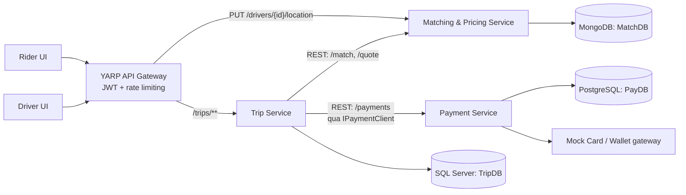
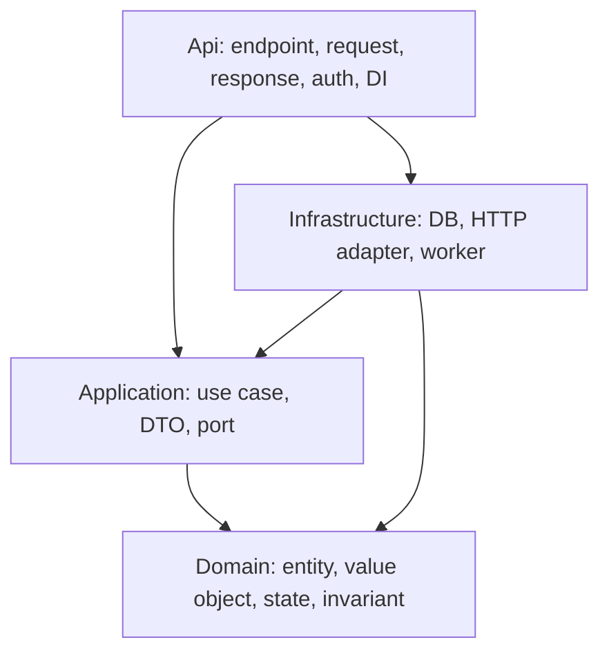
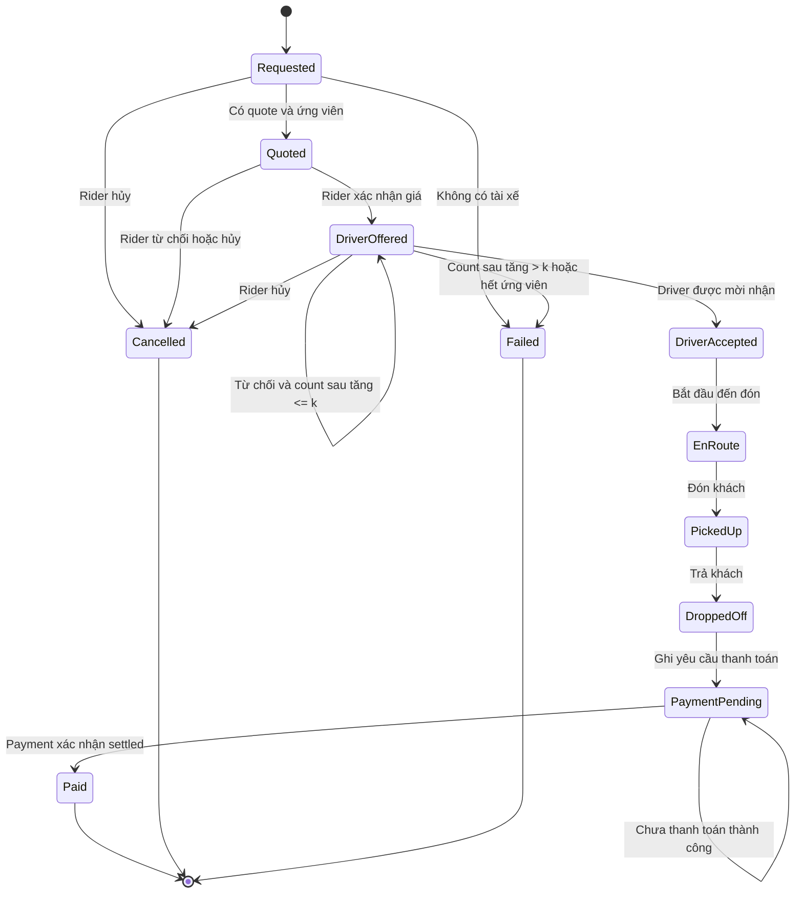
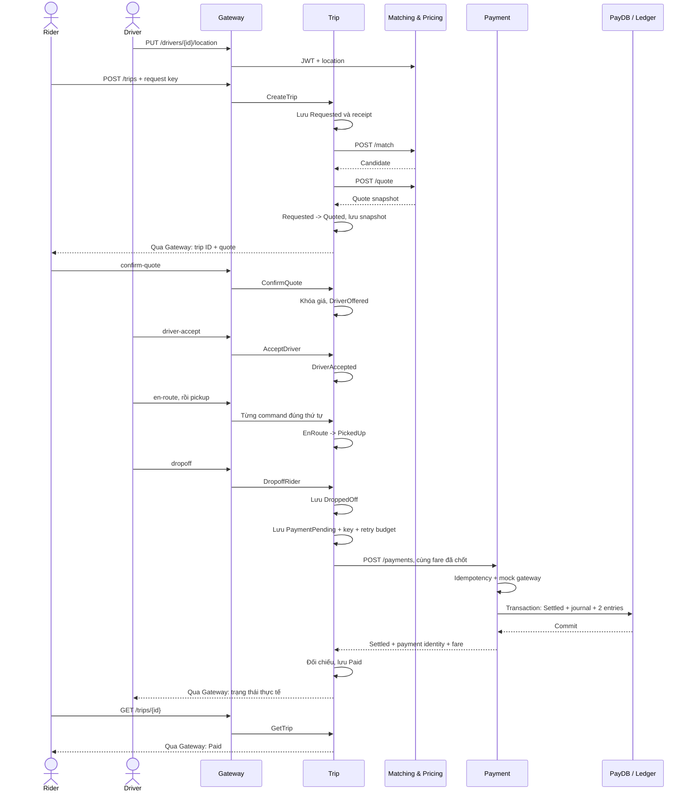
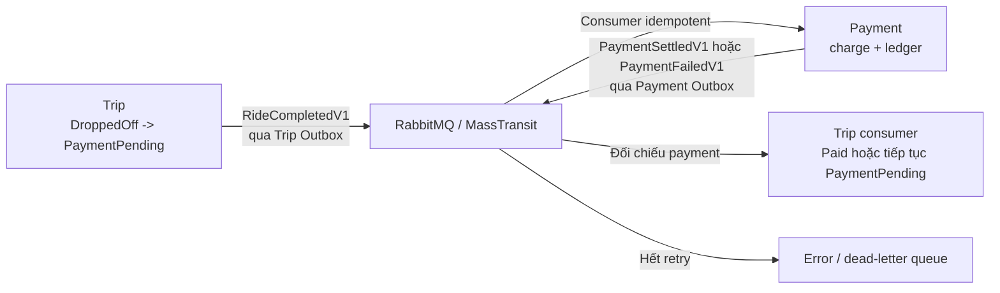

# Kiến trúc triển khai SwiftRide

> Cập nhật 26/10/2026: Matching và Payment đã có schema riêng trên PostgreSQL của Supabase;
> xem [thiết kế và trạng thái triển khai database](database-supabase.md). Phần MongoDB và mô hình
> bảng đầy đủ bên dưới là thiết kế cũ/mục tiêu, chưa phản ánh adapter runtime đã được chuyển đổi.

> Tài liệu nền để hiểu yêu cầu, chia chức năng và triển khai trên repository hiện tại.
> Ngày đối chiếu: 19/10/2026. Đây là thiết kế mục tiêu; các chức năng chưa được triển khai được ghi rõ bên dưới.

## Mục lục

1. [Nguồn yêu cầu và cách dùng](#1-nguồn-yêu-cầu-và-cách-dùng)
2. [Hiện trạng và khoảng trống](#2-hiện-trạng-và-khoảng-trống)
3. [Bản đồ yêu cầu và phạm vi](#3-bản-đồ-yêu-cầu-và-phạm-vi)
4. [Kiến trúc tổng thể](#4-kiến-trúc-tổng-thể)
5. [Phân tầng và tổ chức mã nguồn](#5-phân-tầng-và-tổ-chức-mã-nguồn)
6. [Dữ liệu và quyền sở hữu](#6-dữ-liệu-và-quyền-sở-hữu)
7. [Trip: vòng đời và quy tắc nghiệp vụ](#7-trip-vòng-đời-và-quy-tắc-nghiệp-vụ)
8. [Matching và Pricing](#8-matching-và-pricing)
9. [Payment, idempotency và ledger](#9-payment-idempotency-và-ledger)
10. [API và hợp đồng dữ liệu](#10-api-và-hợp-đồng-dữ-liệu)
11. [Luồng hoàn chỉnh của MVP](#11-luồng-hoàn-chỉnh-của-mvp)
12. [Timeout, retry và phục hồi](#12-timeout-retry-và-phục-hồi)
13. [Messaging, Outbox và compensation](#13-messaging-outbox-và-compensation)
14. [Bảo mật và quan sát hệ thống](#14-bảo-mật-và-quan-sát-hệ-thống)
15. [Kết nối giao diện hiện có](#15-kết-nối-giao-diện-hiện-có)
16. [SOLID, pattern và các quyết định](#16-solid-pattern-và-các-quyết-định)
17. [Thứ tự triển khai theo chức năng](#17-thứ-tự-triển-khai-theo-chức-năng)
18. [Kiểm thử và tiêu chí hoàn thành](#18-kiểm-thử-và-tiêu-chí-hoàn-thành)

## 1. Nguồn yêu cầu và cách dùng

### 1.1. Tài liệu gốc

- [RideLite-KienTrucPhanMem.pdf](../RideLite-KienTrucPhanMem.pdf): đề bài gốc, 11 trang PDF. Tên file là RideLite nhưng tên hệ thống bên trong là **SwiftRide**; tiếp tục dùng tên SwiftRide của repository.
- [requirements.md](requirements.md): bản chuyển đổi đề sang Markdown, tiện tra cứu.
- [AGENTS.md](../AGENTS.md): quy tắc triển khai của dự án, làm rõ state machine, API public/internal, bảo mật và thứ tự MVP.
- [README.md](../README.md), [scaffold-report.md](scaffold-report.md), [frontend-demo.md](frontend-demo.md) và source hiện tại: dùng để xác định những gì thực sự đã có.

Các tham chiếu trang dưới đây dùng **số trang vật lý của PDF**, tính bìa là trang 1; số trang in ở chân trang ít hơn một đơn vị.

### 1.2. Cách đọc và triển khai

Đọc mục 3-4 để hiểu hệ thống, mục 7-11 để hiểu luồng nghiệp vụ, rồi dùng mục 17-18 để chọn việc và kiểm tra kết quả. Với mỗi chức năng, xác định service sở hữu, quy tắc Domain, use case Application, dữ liệu cần lưu, hợp đồng API và test trước khi viết endpoint.

Trong tài liệu này:

| Nhãn | Ý nghĩa |
|---|---|
| **Theo đề** | Nội dung có trong PDF hoặc bản chuyển đổi yêu cầu |
| **Theo AGENTS** | Ràng buộc triển khai đã được dự án quy định cụ thể |
| **Quyết định triển khai** | Cách cụ thể hóa yêu cầu còn thiếu chi tiết; là hướng triển khai đề xuất, chưa phải code hiện hành |
| **Mở rộng** | Làm sau khi luồng MVP đã hoạt động |

Đề có ví dụ code rút gọn để giải thích pattern. Khi triển khai phải theo đầy đủ nghiệp vụ: không dùng ví dụ State ba trạng thái để bỏ bước xác nhận giá; không truyền entity `Trip` sang Matching; không xem `Save` rồi `Publish` riêng rẽ là Outbox.

## 2. Hiện trạng và khoảng trống

Đã kiểm tra các endpoint, `Program.cs`, DbContext, cấu hình Gateway/Compose và lớp demo frontend. Tình trạng dưới đây là quan sát từ source, không phải kết quả chạy hệ thống.

| Thành phần | Đã có trong repo | Cần triển khai |
|---|---|---|
| Solution và phân tầng | `.NET 10`, ba service có `Domain/Application/Infrastructure/Api` | Các lớp nghiệp vụ bên trong |
| Gateway | YARP, xác thực JWT, rate limiter, `/health`, `/dev/token` chỉ Development; automated tests seam Kestrel thật, routing, 429 và timeout 504 | Kiểm tra phân quyền theo vai trò trong service use case |
| Trip Service | Các route nghiệp vụ đã khai báo; Trip aggregate đầy đủ 11 trạng thái với State Pattern và 102 tests Domain | Use case Application, repository, EF Core mapping, migration |
| Matching API | Route location, `/match`, `/quote`; MongoDB DI | Hiện trả `501`; chưa có geo-query, index, seed, pricing |
| Payment API | `/payments`, `/payments/{id}/refund`; PostgreSQL DI | Hiện trả `501`; chưa có charge, ledger, idempotency, migration |
| Xử lý lỗi HTTP | `GlobalExceptionHandler` riêng cho bốn ứng dụng; Problem Details, che exception message | Ánh xạ domain exception theo kiểu cụ thể sang `404/409/...` |
| Phân quyền trong service | Chưa có middleware JWT/resource authorization trong Trip API đã kiểm tra | Kiểm tra chủ chuyến và tài xế được mời/được gán |
| Contracts | Project `SwiftRide.Contracts` | Chưa có integration event; dành cho giai đoạn messaging |
| Compose | Gateway + ba service + ba DB; RabbitMQ theo profile `messaging` | Chưa có cấu hình HTTP client Trip gọi Matching/Payment hoặc worker xử lý nghiệp vụ |
| Kiểm thử | Test HTTP cho exception handler; test placeholder cho ba service | Test nghiệp vụ và integration cho các ràng buộc DB quan trọng |
| WebApp | React/TypeScript, UI rider/driver, bản đồ, luồng demo trong `src/WebApp/src/demo.ts` | Chưa gọi backend; trạng thái, giá và thanh toán còn mô phỏng bằng localStorage |

**Những khác biệt cần xử lý khi triển khai:**

1. PDF minh họa Gateway nối đến cả Payment; dự án đã quy định `/payments/**` là nội bộ. Giữ route public/internal theo AGENTS, không mở Payment ra client.
2. Đề trình bày thanh toán bằng sự kiện; phần tóm tắt cho phép làm luồng đơn giản trước. MVP dùng REST qua `IPaymentClient`; sau đó chuyển sang choreography.
3. Giá frontend hiện có phí mở cửa và làm tròn nghìn đồng. Đây là dữ liệu demo, khác công thức đề. Khi tích hợp phải hiển thị giá backend, không đưa công thức demo thành nghiệp vụ chuẩn.
4. UI có nút mô phỏng thanh toán thành công. Backend thật chỉ cho phép kết quả Payment xác nhận `Paid`.
5. Báo cáo scaffold là lịch sử tạo khung. Source hiện đã có thêm frontend và xử lý lỗi; không dùng báo cáo cũ để suy ra trạng thái triển khai mới.

Tài liệu này bổ sung thiết kế và kế hoạch; không thay đổi các hành vi hiện có.

## 3. Bản đồ yêu cầu và phạm vi

### 3.1. Truy vết từ đề sang chức năng

| Mã | Yêu cầu / nguồn | Nơi triển khai | Điều kiện nghiệm thu | Giai đoạn |
|---|---|---|---|---|
| FR-01 | Rider đặt xe, PDF §2.2, trang 3 | Trip | Tạo `Requested`, lưu bền vững và trả được mã chuyến | MVP |
| FR-02 | Tìm tài xế gần nhất, PDF §5.2, trang 7 | Matching | Geo-query trả tài xế hợp lệ hoặc kết quả không có tài xế | MVP |
| FR-03 | Công thức giá, PDF §2.3, trang 4 | Matching Domain | Đúng thứ tự các phép tính, `decimal`, làm tròn cuối cùng | MVP |
| FR-04 | Rider xác nhận/từ chối giá, PDF §2.2, trang 3 | Trip | Xác nhận khóa giá; từ chối chuyển `Cancelled` | MVP |
| FR-05 | Driver nhận/từ chối, giới hạn `k`, PDF §4, trang 6 | Trip + Matching | Từ chối tìm người khác; lần thứ `k+1` chuyển `Failed` | MVP |
| FR-06 | Đến đón, đón, trả khách, PDF §2.2, trang 3 | Trip | Chỉ tài xế được gán, đúng thứ tự trạng thái | MVP |
| FR-07 | Thanh toán và ledger, PDF §5.3, trang 7 | Payment | Thu đúng giá Trip gửi; một bộ bút toán cân bằng | MVP |
| FR-08 | Không thu tiền hai lần, PDF §4/§5.3, trang 6-7 | Payment + Trip client | Gửi lại cùng key không tạo thêm charge/ledger | MVP |
| FR-09 | Hoàn tiền/bồi thường, PDF §5.3/§9.2, trang 7/11 | Payment; Trip tham gia khi mở rộng | Refund idempotent, ghi bút toán đảo; compensation có test | Sau luồng thanh toán cơ bản |
| FR-10 | Vị trí tài xế và dữ liệu demo, AGENTS §5.2 | Matching | Driver cập nhật vị trí của mình; có seed chạy lặp an toàn | MVP |
| NFR-01 | Tối đa ba service, DB riêng, PDF §2.4/§3.3, trang 4-5 | Toàn hệ thống | Không truy cập DB chéo; Gateway không là business service | Xuyên suốt |
| NFR-02 | Gateway + JWT + resource authorization, PDF §3/§9.3, trang 4-5/11 | Gateway + service | Client chỉ qua Gateway; sai chủ chuyến/driver bị từ chối | MVP |
| NFR-03 | SOLID và pattern, PDF §6-7, trang 7-10 | Domain/Application/Infrastructure | Có vị trí áp dụng và test hành vi tương ứng | Xuyên suốt |
| NFR-04 | Timeout, retry giới hạn, PDF §9.2, trang 11 | HTTP client / worker / consumer | Không retry lỗi nghiệp vụ hoặc chờ vô hạn | MVP, mở rộng cho broker |
| EXT-01 | Pub/Sub, Outbox, Saga, PDF §7/§9.2, trang 9/11 | Trong ba service hiện có | Không mất event sau commit; chịu được duplicate, có compensation | Mở rộng |
| EXT-02 | OpenTelemetry, PDF §9.3, trang 11 | Gateway + ba service | Trace liên kết request/message; metric đủ cho demo | Mở rộng |

### 3.2. Ranh giới MVP

MVP phải có một luồng thật qua Gateway: tạo chuyến -> báo giá -> rider xác nhận -> driver nhận -> đến đón -> đón -> trả -> Payment -> `Paid`, dữ liệu nằm trong đúng ba DB và gửi lại thanh toán không bị thu thêm.

Làm REST trước, dùng mock payment gateway có token. Không cần tích hợp bản đồ định tuyến thật hoặc cổng thanh toán thật. Không thêm Identity, Notification hay worker thành service thứ tư; không thêm Redis, Kafka, Kubernetes, CQRS hoặc event sourcing.

RabbitMQ, MassTransit, DLQ, Outbox, Saga và OpenTelemetry có thiết kế ở mục 13-14 nhưng không là điều kiện để bắt đầu triển khai MVP.

## 4. Kiến trúc tổng thể

### 4.1. Sơ đồ container của MVP



Mũi tên service -> DB thể hiện quyền truy cập độc quyền. Service chỉ lưu ID/snapshot cần thiết của service khác; không join hoặc đọc trực tiếp DB của nhau. Gateway không có DB nghiệp vụ.

### 4.2. Trách nhiệm và phần không sở hữu

| Thành phần | Sở hữu | Không chịu trách nhiệm |
|---|---|---|
| Rider/Driver UI | Hiển thị, nhập liệu, gửi command, đọc trạng thái | Quyết định giá, tự đánh dấu `Paid`, xác nhận quyền truy cập |
| Gateway | Routing, xác thực JWT, rate limit, chuyển trace context | State machine, tính tiền, ghi ledger, truy vấn DB |
| Trip | Trạng thái chuyến, chủ chuyến, tài xế được mời/gán, giá đã chốt | Công thức giá, geo-query, tự thực hiện charge |
| Matching & Pricing | Vị trí, tìm ứng viên, chính sách giá và quote | Đổi trạng thái chuyến, thu tiền, đọc TripDB |
| Payment | Payment, refund, kết quả gateway, ledger, idempotency | Tính lại giá hoặc trực tiếp cập nhật TripDB |

### 4.3. Quy tắc giao tiếp

- Client gọi backend qua Gateway. Các service dùng địa chỉ nội bộ Compose, không vòng lại Gateway.
- Trip cần phản hồi tức thời từ Matching nên dùng REST. MVP gọi Payment đồng bộ qua abstraction nhưng lưu `PaymentPending` trước khi gọi mạng.
- HTTP DTO thuộc API hoặc HTTP adapter của từng service. Không reference Domain/Application của service khác.
- `SwiftRide.Contracts` chỉ chứa integration event dạng plain record có version khi triển khai messaging; không đưa entity, HTTP DTO hay helper nghiệp vụ vào đây.
- Background work chạy bằng `BackgroundService` trong service sở hữu dữ liệu.

## 5. Phân tầng và tổ chức mã nguồn

### 5.1. Chiều phụ thuộc



`Api -> Infrastructure` phục vụ composition root/đăng ký DI. Endpoint nhận request -> gọi use case -> trả response. Domain không tham chiếu EF Core, MongoDB, ASP.NET, HTTP hoặc MassTransit. Infrastructure triển khai các port được khai báo ở Application/Domain.

### 5.2. Các lớp dự kiến cần tạo

Tên dưới đây là gợi ý để chia việc, chưa có trong source. Có thể điều chỉnh tên theo convention khi triển khai, nhưng giữ đúng trách nhiệm.

| Service / tầng | Lớp hoặc interface | Trách nhiệm |
|---|---|---|
| Trip Domain | `Trip`, `TripStatus`, `TripState`, các state cụ thể | Chuyển trạng thái hợp lệ, bảo vệ giá đã chốt và giới hạn từ chối |
| Trip Domain | `FareSnapshot`, `Location`, `TripDomainException` | Giá/tọa độ hợp lệ và lỗi nghiệp vụ |
| Trip Application | `CreateTrip`, `ConfirmQuote`, `CancelTrip`, `AcceptDriver`, `RejectDriver`, `StartEnRoute`, `PickupRider`, `DropoffRider`, `SettleTripPayment` | Mỗi use case kiểm tra actor, gọi Domain, lưu và phối hợp qua port |
| Trip Application | `ITripReader`, `ITripWriter`, `IMatchingClient`, `IPaymentClient` | Port đọc/ghi và gọi service khác |
| Trip Infrastructure | `TripRepository`, `MatchingHttpClient`, `PaymentHttpClient`, `PendingPaymentWorker` | EF Core, HTTP có timeout, phục hồi payment đang chờ |
| Matching Domain | `PricingContext`, `IPricingStrategy`, `StandardPricingStrategy`, các bước giá | Công thức và invariant, không biết `Trip` entity |
| Matching Application | `UpdateDriverLocation`, `MatchDriver`, `CreateQuote`, `FareCalculator` | Điều phối geo-query, cấu hình giá và lưu quote |
| Matching Application / Infrastructure | `IDriverLocationRepository` / `MongoDriverLocationRepository`, `IQuoteRepository` / `MongoQuoteRepository` | Truy cập MongoDB qua abstraction |
| Payment Domain | `Payment`, `Refund`, `LedgerEntry`, `PaymentMethodFactory` | Trạng thái giao dịch, bút toán và lựa chọn Card/Wallet |
| Payment Application | `ChargePayment`, `RefundPayment`, `IPaymentGateway`, `IPaymentRepository`, `ILedgerWriter` | Kiểm tra key/payload, gọi adapter, chốt kết quả trong transaction |
| Payment Infrastructure | `PaymentRepository`, `MockCardGateway`, `MockWalletGateway` | PostgreSQL và giả lập gateway, không có giá chuyến |
| Api từng service | Các file `*Endpoints.cs`, request/response riêng, exception mapping | Transport và xác thực; không chứa quy tắc nghiệp vụ |

Không cần MediatR, generic repository, base controller hay project `Common` để thực hiện các use case trên. Interface chỉ thêm khi có ranh giới cần thay thế/kiểm thử.

### 5.3. Giữ cây thư mục hiện tại

```text
src/
  ApiGateway/
  SwiftRide.Contracts/          # Integration events có version, làm sau
  TripService/
    Domain/                    # Trip, States/, ValueObjects/, Exceptions/
    Application/               # UseCases/, Ports/, DTOs/
    Infrastructure/            # Persistence/, HttpClients/, Workers/, Migrations/
    Api/                       # TripEndpoints.cs, Contracts/, Authorization/
  MatchingService/
    Domain/                    # Pricing/, ValueObjects/
    Application/               # UseCases/, Ports/, DTOs/
    Infrastructure/            # Mongo/, Seed/
    Api/
  PaymentService/
    Domain/                    # Payments/, Ledger/, PaymentMethods/
    Application/               # UseCases/, Ports/, DTOs/
    Infrastructure/            # Persistence/, Gateways/, Migrations/
    Api/
  WebApp/                      # UI hiện có; thêm HTTP adapter khi tích hợp
tests/
  SwiftRide.TripService.Tests/
  SwiftRide.MatchingService.Tests/
  SwiftRide.PaymentService.Tests/
  SwiftRide.Api.Tests/
```

Chỉ tạo thư mục khi thực sự có file. Migration nằm trong Infrastructure của đúng service. Mỗi service tự khởi tạo/migrate DB của mình; không có migration xuyên ba DB.

## 6. Dữ liệu và quyền sở hữu

Các cấu trúc sau là **mô hình đề xuất**, chưa phải schema hiện có. API trả DTO đã chọn trường, không serialize trực tiếp entity/DbContext document.

### 6.1. TripDB - SQL Server

| Cấu trúc | Trường chính | Ràng buộc |
|---|---|---|
| `Trips` | `Id`, `RiderId`, pickup/destination, `Status`, `CandidateDriverId`, `OfferedDriverId`, `AssignedDriverId`, `QuoteId`, `FareAmount`, `Currency`, `RejectionCount`, timestamps, `RowVersion` | ID unique; giá không âm; count không âm; optimistic concurrency |
| `ActiveDriverAssignments` | `DriverId`, `TripId`, `CreatedAt` | Unique `DriverId` và `TripId`; claim/release trong transaction Trip để tránh gán hai chuyến đồng thời |
| `TripDriverRejections` | `TripId`, `DriverId`, `RejectedAt` | Không chọn lại driver đã từ chối chuyến; không phải dữ liệu hồ sơ driver |
| `TripPaymentAttempts` | `TripId`, `IdempotencyKey`, `AttemptCount`, `NextAttemptAt`, kết quả/lỗi an toàn, `PaymentId` | Một logical payment/chuyến; lưu budget retry bền vững |
| `CommandReceipts` | `Scope`, `ActorId`, `TripId?`, `Operation`, `RequestId`, payload fingerprint, kết quả/tham chiếu | Unique `Scope` + `RequestId`; scope theo actor + operation, thêm trip cho command trên chuyến; ghi cùng transaction của command |
| `OutboxMessages`, `InboxMessages` | Event envelope, trạng thái xử lý | Chỉ thêm ở giai đoạn messaging |

`FareAmount` dùng `decimal(18,0)` cho VND. Quote snapshot gồm `QuoteId`, `FareAmount`, `Currency`; cần lưu được trước khi trả báo giá và bất biến sau xác nhận. `RowVersion` bảo vệ các thao tác accept/cancel hoặc pickup/dropoff đến đồng thời.

`CommandReceipts` phục vụ các command cần gửi lại sau timeout, đặc biệt tạo chuyến và driver-reject: cùng request không tạo thêm chuyến hay tăng bộ đếm thêm lần nữa. Đây là bảng kỹ thuật trong Trip, không phải event sourcing.

### 6.2. MatchDB - MongoDB

| Collection | Trường chính | Index / quy tắc |
|---|---|---|
| `driver_locations` | `DriverId`, GeoJSON `Location`, `IsOnline`, `UpdatedAt` | Unique `DriverId`; `2dsphere` trên `Location`; tọa độ lưu `[longitude, latitude]` |
| `quotes` | `QuoteId`, pricing input snapshot, breakdown, `Amount`, `Currency`, `CreatedAt` | Unique `QuoteId`; tiền dùng decimal/Decimal128, không binary floating point |

Driver cập nhật vị trí bằng upsert. Tọa độ phải đúng miền giá trị; bỏ driver offline hoặc vị trí quá cũ theo cấu hình. Seed dùng ID cố định và upsert, chạy lại không nhân bản dữ liệu.

Quyết định MVP: quote là snapshot của chuyến, không tự hết hạn trong lúc rider đang xác nhận. Nếu thêm TTL sau này, phải bổ sung rõ lỗi quote hết hạn và luồng yêu cầu báo giá lại; không âm thầm đổi giá.

### 6.3. PayDB - PostgreSQL

| Bảng | Trường chính | Ràng buộc |
|---|---|---|
| `Payments` | `Id`, `TripId`, `RiderId`, `Amount`, `Currency`, `Method`, `IdempotencyKey`, payload fingerprint, `Status`, `GatewayReference` | Unique `IdempotencyKey`; unique logical charge theo `TripId`; tiền `numeric(18,0)` |
| `LedgerTransactions` | `Id`, `PaymentId`, `RefundId?`, `Kind`, timestamp | Unique nguồn charge/refund; một journal cho mỗi tác động tài chính |
| `LedgerEntries` | `Id`, `LedgerTransactionId`, `AccountCode`, `Side`, `Amount`, `Currency` | Append-only; tổng debit = tổng credit theo transaction/currency |
| `Refunds` | `Id`, `PaymentId`, `Amount`, `Currency`, `IdempotencyKey`, fingerprint, `Status`, gateway reference | Unique refund key; unique `PaymentId` cho policy full refund; không hoàn vượt tiền đã thanh toán |
| `MockGatewayReceipts` | Operation, gateway key, payload fingerprint, kết quả giả lập | Lưu kết quả Card/Wallet theo key qua restart để mock hỗ trợ replay an toàn; chỉ dùng cho adapter demo |
| `OutboxMessages`, `InboxMessages` | Envelope, consumer, trạng thái xử lý | Giai đoạn messaging; inbox unique theo consumer + event ID |

Payment không có foreign key tới TripDB. `TripId`, `RiderId` là tham chiếu logic. Gateway reference là mã giả lập, không phải số thẻ. Chỉ giữ token opaque hoặc tham chiếu token cần cho xử lý, không lưu PAN/CVV; token không xuất hiện trong response công khai hay log.

Tất cả timestamp nghiệp vụ lưu UTC. Actor ID lấy từ claim `sub` dạng chuỗi, phù hợp dev-token hiện tại; không giả định actor ID luôn là GUID. Trip/quote/payment ID có thể dùng GUID. Không có transaction phân tán giữa các DB.

## 7. Trip: vòng đời và quy tắc nghiệp vụ

### 7.1. State machine chuẩn



### 7.2. Bảng transition dùng để viết Domain và test

| Mã test | Từ | Trigger / điều kiện | Đến | Tác động bắt buộc |
|---|---|---|---|---|
| TR-01 | `Requested` | Matching trả quote và candidate | `Quoted` | Lưu quote snapshot và candidate |
| TR-02 | `Requested` | Matching trả xác định không có driver | `Failed` | Lưu lý do không có tài xế |
| TR-03 | `Requested` | Rider hủy | `Cancelled` | Theo quy tắc hủy trước `DriverAccepted` |
| TR-04 | `Quoted` | Rider xác nhận đúng `QuoteId` | `DriverOffered` | Khóa fare; tạo lời mời cho candidate |
| TR-05 | `Quoted` | Rider từ chối giá/hủy | `Cancelled` | Không charge |
| TR-06 | `DriverOffered` | Driver đang được mời chấp nhận | `DriverAccepted` | Gán `AssignedDriverId` |
| TR-07 | `DriverOffered` | Driver từ chối, count sau tăng `<= k` | `DriverOffered` | Tăng đúng một lần, loại driver cũ, tìm người khác |
| TR-08 | `DriverOffered` | Driver từ chối, count sau tăng `> k` | `Failed` | Dừng tìm driver |
| TR-09 | `DriverOffered` | Rematch xác nhận hết ứng viên | `Failed` | Quyết định triển khai cho nhánh không còn tài xế |
| TR-10 | `DriverOffered` | Rider hủy | `Cancelled` | Thu hồi lời mời; không charge |
| TR-11 | `DriverAccepted` | Assigned driver bắt đầu đến đón | `EnRoute` | Ghi thời điểm tương ứng |
| TR-12 | `EnRoute` | Assigned driver đón khách | `PickedUp` | Ghi thời điểm đón |
| TR-13 | `PickedUp` | Assigned driver trả khách | `DroppedOff` | Tạo domain event `RideCompleted` đúng một lần |
| TR-14 | `DroppedOff` | Application ghi yêu cầu payment | `PaymentPending` | Lưu payment key/budget trước khi gọi mạng |
| TR-15 | `PaymentPending` | Payment xác nhận `Settled` hợp lệ | `Paid` | Lưu `PaymentId`; không chỉ dựa HTTP `200` |
| TR-16 | `PaymentPending` | Lỗi tạm thời hoặc kết quả chưa rõ | `PaymentPending` | Giữ key/payload, cập nhật lịch retry hữu hạn |
| TR-17 | `PaymentPending` | Hết retry hoặc lỗi từ chối không retry được | `PaymentPending` | Lưu lý do cần xử lý; không giả vờ hoàn tất |

TR-03/TR-10 cụ thể hóa quy tắc hủy trong AGENTS; TR-09 là quyết định cho nhánh rematch không còn tài xế. Chúng cần được đưa vào cùng bảng transition và test khi viết Domain, không thêm điều kiện rải rác ở endpoint.

Mọi transition không liệt kê đều ném domain exception. Ba trạng thái kết thúc là `Paid`, `Cancelled`, `Failed`; `PaymentPending` không kết thúc. Test ít nhất một transition sai ở **mỗi** trạng thái, kể cả trạng thái kết thúc.

### 7.3. Những quy tắc dễ triển khai sai

- `k = 3` mặc định nghĩa là từ chối lần 1, 2, 3 vẫn được rematch; lần 4 thất bại. So sánh sau khi tăng count. `k` lấy từ cấu hình, không đặt trong controller.
- Driver reject chỉ hợp lệ với lời mời hiện tại. Request lặp cùng `RequestId` trả lại kết quả đã xử lý, không tăng count hoặc gọi rematch thêm lần nữa.
- Rematch chỉ tìm driver khác, **không tính lại giá đã chốt**. Truyền danh sách driver đã bị loại sang `/match`.
- Dùng `OfferedDriverId` để phân biệt người được mời với `AssignedDriverId` sau khi nhận. Driver khác không được nhận lời mời hoặc cập nhật chuyến.
- Hủy chỉ trước `DriverAccepted`. Accept và cancel đồng thời được phân xử bằng transaction/`RowVersion`; chỉ một thao tác commit.
- Không gọi mạng khi đang giữ transaction/DB lock của Trip.
- Khi rematch lỗi kỹ thuật, lưu tiến độ xử lý command và tiếp tục có giới hạn; không coi timeout là không có tài xế. Có thể trả `202` với `DriverOffered` và cờ `RematchPending`; lúc này không cho nhận lời mời cũ.
- Với duplicate command/event đã hoàn tất, Application kiểm tra receipt/inbox và trả kết quả cũ trước khi gọi Domain. Không nới lỏng state machine để mọi transition lặp đều hợp lệ.

### 7.4. Phân công tài xế khi có request đồng thời

Geo-query tìm được **ứng viên**, không tự bảo đảm tài xế chưa được chuyến khác giữ chỗ. `RowVersion` trên một chuyến cũng không ngăn hai chuyến khác nhau chọn cùng driver.

Quyết định triển khai: Trip sở hữu bảng nhỏ `ActiveDriverAssignments` trong TripDB, giữ driver từ lúc mời đến khi dropoff/hủy/thất bại. Unique `DriverId` ngăn driver bị giữ bởi hai chuyến; unique `TripId` ngăn một chuyến giữ nhiều driver. Claim/release cùng transaction với thay đổi Trip; lúc từ chối giải phóng driver cũ trước khi rematch. Không dùng cache in-memory hoặc đọc MatchDB trực tiếp để thay ràng buộc này.

Candidate lúc `Quoted` chưa được giữ chỗ. Nếu đến lúc xác nhận giá candidate đã bận, tiếp tục tìm ứng viên khác với cùng giá đã chốt, có giới hạn và tiến độ lưu bền vững; không tính đây là driver rejection. Chỉ mở lời mời cho driver đã claim thành công. Lỗi uniqueness là xung đột phân công cần rematch, không phải lý do thu tiền hoặc tăng rejection count. Không giữ DB lock trong lúc gọi Matching.

## 8. Matching và Pricing

### 8.1. Các use case

1. `UpdateDriverLocation`: xác thực driver đang cập nhật chính mình, validate tọa độ, upsert vào MongoDB.
2. `MatchDriver`: tìm driver online, vị trí còn mới, trong bán kính cấu hình và không thuộc danh sách loại. Sắp theo khoảng cách; dùng `DriverId` để phá hòa cho demo/test ổn định.
3. `CreateQuote`: tạo `PricingContext`, chạy strategy/pipeline, lưu quote snapshot rồi trả DTO. Không cần đọc TripDB.

Quyết định contract: `/match` trả candidate hoặc kết quả `NoDriverAvailable`; `/quote` chỉ trả báo giá. Trip phối hợp hai phản hồi và chỉ chuyển `Quoted` khi có đủ. Không gộp việc thay đổi state của Trip vào Matching.

### 8.2. PricingContext và công thức

```text
baseFare      = costPerKm * distanceKm + costPerMinute * estimatedMinutes
afterSurge    = baseFare * surge
afterToll     = afterSurge + toll
afterPromo    = afterToll * promotionFactor
beforeRound   = afterPromo * (1 + tax)
fare          = Round(beforeRound, configuredRoundingMode, 0)
```

Thứ tự cố định: **giá cơ bản -> surge -> toll -> promotion -> tax -> làm tròn**. Toll không bị nhân surge nhưng có chịu promotion và tax theo đúng công thức đề.

| Input | Đơn vị / invariant | Nguồn |
|---|---|---|
| `DistanceKm` | km, `>= 0` | Ước lượng phía server/mock có quy tắc rõ |
| `EstimatedMinutes` | phút, `>= 0` | Ước lượng phía server/mock |
| `CostPerKm`, `CostPerMinute` | VND/km, VND/phút; `>= 0` | Pricing options theo mode |
| `Surge` | `>= 1` | Cấu hình/chính sách của Matching |
| `Toll` | VND, `>= 0` | Cấu hình hoặc tuyến demo được server nhận diện |
| `PromotionFactor` | `0 < value <= 1` | Cấu hình/chính sách promotion |
| `Tax` | Tỷ lệ, `>= 0`; ví dụ 8% là `0.08` | Cấu hình demo, không khẳng định mức thuế thực tế |
| `Currency`, rounding | `VND`, số nguyên, làm tròn đúng một lần | Cấu hình; mặc định đề xuất `AwayFromZero` |

`PricingContext` thuộc Matching, chứa dữ liệu đã được kiểm tra; không dùng `TripService.Domain.Trip`. Client không được tự truyền giá, surge, promo hoặc thuế để ép số tiền thanh toán. API public tạo chuyến chỉ nhận lựa chọn hành trình/mode và token demo; các hệ số do backend xác định.

Quyết định demo: dùng `IRouteEstimator` trong Matching, có adapter giả lập/ước lượng từ tọa độ và tham số cấu hình. Kết quả chỉ là khoảng cách/thời gian ước lượng, không khẳng định tuyến đường thực. Test giá có thể truyền `PricingContext` trực tiếp; không cần thêm Route Service.

### 8.3. Strategy và các bước kết hợp

`IPricingStrategy` biểu diễn cách tính phần giá cơ bản của một mode. `StandardPricingStrategy` dùng cấu hình; thêm mode mới bằng implementation và đăng ký DI mới. Các bước surge/toll/promotion/tax được kết hợp bằng decorator hoặc pipeline nhỏ, luôn giữ thứ tự trên. Không copy toàn bộ công thức sang từng mode hoặc viết switch mode lớn trong endpoint.

Mọi strategy phải giữ hợp đồng: không trả giá âm, không sửa input, không ghi DB/gọi HTTP. `FareCalculator` chịu trách nhiệm áp dụng các bước và làm tròn cuối. Test dùng chung bộ invariant cho mọi implementation để kiểm tra LSP.

Ví dụ kiểm thử với dữ liệu giả: `costPerKm=10_000`, `distance=5`, `costPerMinute=1_000`, `time=10`, `surge=1.2`, `toll=5_000`, `promotionFactor=0.9`, `tax=0.08` cho kết quả **74.844 VND**. Đây là fixture kiểm thử, không phải bảng giá mặc định của hệ thống.

## 9. Payment, idempotency và ledger

### 9.1. Hợp đồng nghiệp vụ

Trip gửi `TripId`, `RiderId`, `Amount`, `Currency`, payment method và opaque mock token. Payment kiểm tra payload nhưng **không tính lại giá** và không chấp nhận lời gọi charge trực tiếp từ rider.

Logical charge key: `trip-{tripId}-payment`. Key không thay đổi theo số lần thử, HTTP request, event ID hoặc thời điểm. Unique index là ràng buộc DB, không thay bằng câu lệnh kiểm tra tồn tại trước khi insert.

| Tình huống | Hành vi |
|---|---|
| Key mới, payload hợp lệ | Lưu payment, giành quyền xử lý logical charge |
| Cùng key + cùng payload, đã settled | Trả lại `PaymentId`, trạng thái và số tiền gốc; không gọi charge thêm |
| Cùng key + khác payload | `409 Conflict`; không sửa payment gốc |
| Cùng key đang xử lý/kết quả chưa rõ | `202 Pending` hoặc đọc kết quả hiện có; không tạo charge song song |
| Key khác nhưng cùng `TripId` đã có logical charge | Chặn bằng ràng buộc unique theo chuyến, trả conflict |
| Lỗi transient được phép thử lại | Tiếp tục payment đang có với cùng key và payload, không tạo payment mới |
| Lỗi nghiệp vụ/declined | Lưu kết quả có cấu trúc; không tự retry như lỗi mạng |

Payload fingerprint tính từ các trường có ý nghĩa tài chính đã chuẩn hóa: trip, rider, amount, currency, method, token reference. Không dùng raw JSON với thứ tự property tùy ý và không log fingerprint/token. Cùng key mà đổi token cũng là payload khác; đổi phương thức sau khi thất bại cần use case riêng, không lách idempotency.

### 9.2. Charge và commit an toàn

1. Trong transaction ngắn, insert/đọc payment theo unique key, đối chiếu payload và giành quyền xử lý bằng conditional update/lock phù hợp. Request cạnh tranh nhận trạng thái pending hoặc kết quả đã có.
2. Đóng transaction trước khi gọi `IPaymentGateway`. Truyền deterministic key vào mock Card/Wallet adapter.
3. Gateway adapter cũng phải hỗ trợ key. Mock dùng receipt bền vững theo key để test restart/timeout; chỉ dùng dictionary trong process không đủ cho bảo đảm qua restart.
4. Khi kết quả gateway xác nhận thành công, mở transaction PostgreSQL để cập nhật `Settled`, thêm ledger transaction và hai ledger entries. Tất cả cùng commit hoặc cùng rollback; giai đoạn messaging thêm outgoing event vào cùng transaction này.
5. Nếu timeout sau khi gateway có thể đã charge, giữ `Pending/Unknown`; dùng cùng key để tra cứu/replay an toàn. Khi thu hồi lease của worker cũ, không được coi việc hết lease là bằng chứng chưa thu tiền.
6. Nếu response bị mất sau commit, request lại trả kết quả đã lưu. Nếu Trip không lưu được `Paid`, gọi/đối chiếu lại Payment, không thu tiền lại hoặc tự hoàn tiền.

Unique index trong Payment chỉ chống tạo bản ghi trùng ở hệ thống của mình. Bảo đảm không double charge qua ranh giới gateway còn cần gateway idempotency và xử lý kết quả không rõ. Không tuyên bố transaction PostgreSQL bao trùm side effect của cổng thanh toán.

### 9.3. Ledger kép, append-only

Quyết định mô hình học tập: gateway giả lập đóng vai trò thu tiền; ledger ghi nhận tiền đã thu và khoản phải trả cho tài xế. Không tính thêm hoa hồng hay số dư ví thật vì đề chưa yêu cầu.

| Journal charge ví dụ 74.844 VND | Debit | Credit |
|---|---:|---:|
| `GatewayClearing` | 74.844 | 0 |
| `DriverPayable` | 0 | 74.844 |
| **Tổng** | **74.844** | **74.844** |

Một lần settled sinh **một journal với hai entry cân bằng**, không phải một entry đơn lẻ. Repository chỉ thêm entry, không sửa/xóa entry đã commit. Unique nguồn payment/refund ngăn journal trùng; kiểm tra cân bằng và ghi các entry trong cùng transaction. Integration test xác minh rollback không để payment settled thiếu journal.

Giá bằng 0 vẫn hợp lệ theo invariant đề: bỏ qua debit gateway bên ngoài và ghi journal hai entry bằng 0 theo policy demo, cân bằng; không gửi charge 0 tới adapter mặc định. Nếu chọn policy khác cần ghi rõ và có test, không tự đổi invariant thành giá bắt buộc dương.

### 9.4. Refund

Làm sau charge cơ bản. Chọn **full refund** cho phạm vi đầu tiên; chưa có partial refund/chiết khấu/chia tiền phức tạp.

- Chỉ refund payment đã settled, chưa được hoàn đủ; key đề xuất `payment-{paymentId}-refund`.
- Cùng key/payload trả lại refund cũ; payload khác trả `409`. Bảo vệ đồng thời bằng DB constraint/conditional update.
- Gateway refund cũng idempotent. Kết quả không rõ phải đối chiếu, không giả định hoàn thất bại và gửi giao dịch mới.
- Ghi bút toán đảo trong transaction refund: debit `DriverPayable`, credit `GatewayClearing`. Giữ nguyên journal charge để kiểm toán.
- Refund không tự cho phép chuyển Trip từ `Paid` sang `Cancelled`; bảng trạng thái Trip chưa có transition đó. Nếu cần nghiệp vụ hủy sau nhận/hoàn tiền hiển thị ở Trip, phải thiết kế bổ sung rõ trước.

Factory tạo/chọn PaymentMethod Card/Wallet, sau đó Application gọi qua `IPaymentGateway`; không đặt switch method và xử lý tiền trong endpoint.

## 10. API và hợp đồng dữ liệu

### 10.1. API public qua Gateway

Đây là **hợp đồng mục tiêu**, chưa thay các stub `501`. Mọi route nghiệp vụ public cần JWT và authorization trong service.

| Method / route | Actor | Input chính | Kết quả / use case |
|---|---|---|---|
| `POST /trips` | Rider | Pickup, destination, mode, mock payment method/token; `Idempotency-Key` | Tạo chuyến và lấy quote; thường `201` + `Location`; có thể `202` nếu đang phục hồi Matching |
| `GET /trips/{id}` | Rider chủ chuyến; driver có lời mời đang hiệu lực/được gán theo projection cho driver | Trip ID | `TripResponse` có state, fare snapshot, tiến độ payment an toàn |
| `POST /trips/{id}/confirm-quote` | Rider chủ chuyến | `QuoteId`, command request ID | `DriverOffered`; không nhận amount do client gửi |
| `POST /trips/{id}/cancel` | Rider chủ chuyến | Reason code, command request ID | `Cancelled` nếu chưa được driver nhận |
| `POST /trips/{id}/driver-accept` | Driver đang được mời | Command request ID | `DriverAccepted` |
| `POST /trips/{id}/driver-reject` | Driver đang được mời | Command request ID | Rematch hoặc `Failed` theo count |
| `POST /trips/{id}/en-route` | Assigned driver | Command request ID | `EnRoute` |
| `POST /trips/{id}/pickup` | Assigned driver | Command request ID | `PickedUp` |
| `POST /trips/{id}/dropoff` | Assigned driver | Command request ID | Trả trạng thái thực tế `PaymentPending` hoặc `Paid`, không hứa luôn paid ngay |
| `PUT /drivers/{id}/location` | Driver có `sub == id` | Latitude, longitude, online status | Upsert vị trí; `200/204` |

Quyết định API bổ sung: driver được `GET` chuyến đang được mời/gán để thực hiện giao diện; response riêng không chứa token hoặc thông tin payment của rider. Quyền đọc rider vẫn chỉ các chuyến của chính họ. Cơ chế lấy danh sách lời mời/lịch sử nằm ở mục 15, chưa phải endpoint hiện có.

Quy ước idempotency cho command: dùng header `Idempotency-Key`; `RequestId` trong mô hình receipt là giá trị header. `POST /trips` scope theo rider + operation; command còn lại scope theo actor + trip + operation. Cùng key khác payload trả `409`. Không dùng trace ID làm key nghiệp vụ vì mỗi lần gửi lại có thể tạo trace mới.

### 10.2. API nội bộ

| Method / route | Caller -> service | Request -> response tối thiểu |
|---|---|---|
| `POST /match` | Trip -> Matching | Pickup, excluded driver IDs -> candidate hoặc `NoDriverAvailable` |
| `POST /quote` | Trip -> Matching | Pickup, destination, pricing mode -> `QuoteId`, amount, currency, estimated distance/time, breakdown |
| `POST /payments` | Trip -> Payment | Trip/rider IDs, fare snapshot, method/token, deterministic key -> payment ID, trip ID, amount, currency, status |
| `POST /payments/{id}/refund` | Use case nội bộ được phép -> Payment | Full-refund request + deterministic refund key -> refund ID/status |

Các service tự định nghĩa DTO đầu ra và HTTP adapter phía gọi ánh xạ DTO đầu vào; không dùng entity chung. Đường `/match`, `/quote`, `/payments/**` không được thêm vào YARP public routes.

Payment response cần phân biệt `Pending`, `Settled`, `Declined` hoặc mã lỗi retryable. Trip đối chiếu `TripId`, `Amount`, `Currency` và chỉ nhận `Settled` cho logical payment đúng. Không tin một field `success` do client gửi.

### 10.3. HTTP status và lỗi

| HTTP status | Ý nghĩa mục tiêu |
|---|---|
| `400` | Dữ liệu sai định dạng/phạm vi, method không hợp lệ |
| `401` | Thiếu hoặc sai token ở route cần xác thực |
| `403` | Đã xác thực nhưng sai role/chủ tài nguyên/driver |
| `404` | Không tìm thấy tài nguyên; internal route gọi qua Gateway |
| `409` | Transition sai, quote không khớp, concurrency conflict hoặc key trùng khác payload |
| `429` | Vượt rate limit |
| `502/503/504` | Dependency gặp lỗi/mất khả dụng/timeout; chỉ trả khi phù hợp với kết quả use case |
| `202` | Command đã nhận và có tiến độ lưu bền vững; cần đọc tiếp trạng thái |

Không có driver là kết quả nghiệp vụ: chuyến chuyển `Failed`, không biến thành exception hạ tầng. Payment transient đã lưu `PaymentPending` nên có thể trả trạng thái pending thay vì làm client hiểu rằng dropoff chưa được lưu.

Tái sử dụng cấu trúc Problem Details có sẵn (`type`, `title`, `status`, `detail`, `traceId`); bổ sung error code ổn định khi cần. Ánh xạ theo exception type cụ thể. Giữ việc che exception message/stack trace và các test hiện tại.

## 11. Luồng hoàn chỉnh của MVP

### 11.1. Từ đặt xe đến `Paid`



Mũi tên trả về Rider/Driver đã rút gọn đường response qua Gateway. Các command `en-route` và `pickup` là hai request riêng, không gộp để bỏ kiểm tra transition.

### 11.2. Các nhánh lỗi phải làm cùng luồng chính

| Điểm lỗi | Trạng thái bền vững | Cách tiếp tục |
|---|---|---|
| Không có driver ở lần đầu | `Failed` | Trả lý do; rider tạo yêu cầu chuyến mới |
| Timeout Matching | `Requested` và create receipt đang chờ | Gửi lại create với cùng key để tiếp tục, không tạo chuyến mới; có thể bổ sung worker phục hồi sau |
| Rider từ chối giá | `Cancelled` | Không gửi payment |
| Driver từ chối còn lượt | `DriverOffered` và rejection đã lưu | Rematch loại driver cũ; command lặp không tăng count |
| Lần từ chối vượt `k` / hết ứng viên | `Failed` | Dừng xử lý lời mời |
| Crash sau dropoff, trước payment request | `DroppedOff` hoặc `PaymentPending` | Worker Trip tìm cả hai trạng thái và tiếp tục qua cùng use case |
| Payment timeout sau khi đã charge | `PaymentPending`; Payment có kết quả hoặc trạng thái chưa rõ | Đối chiếu/replay cùng payment key; không tạo key mới |
| Payment settled nhưng Trip commit lỗi | Payment đã settled, Trip còn pending | Đọc lại kết quả qua cùng idempotent request rồi lưu `Paid` |
| Payment declined/hết retry | `PaymentPending` với error code | Hiển thị cần xử lý; không retry vô hạn hoặc đổi thành `Paid/Failed` |

Đối với create/rematch có nhiều bước, receipt cần có trạng thái đang xử lý và tham chiếu trip/tiến độ, không chỉ một cờ đã hoàn thành. Mỗi lần tiếp tục đọc lại trip trước khi áp dụng kết quả mạng để không ghi đè chuyến đã bị hủy hoặc thay đổi đồng thời.

## 12. Timeout, retry và phục hồi

### 12.1. Chính sách cấu hình

Các giá trị sau là **đề xuất để khởi đầu demo**, không phải con số đề bài bắt buộc hoặc cấu hình đã được cài. Phải validate options lúc startup và điều chỉnh theo môi trường.

| Nhóm options | Giá trị khởi đầu / quy tắc |
|---|---|
| Trip | `MaxDriverRejections = 3` |
| Matching | `SearchRadiusMeters = 5000`, `MaxLocationAgeSeconds = 120` |
| Pricing | Giá/km, giá/phút, surge, toll, promotion, tax, rounding mode theo cấu hình; không hard-code trong API |
| Matching HTTP | Timeout từng attempt `3s`, tối đa `2` retries; total budget `12s` có tính backoff |
| Payment HTTP | Timeout từng lời gọi `5s`; không thêm retry transport tự động nếu worker đã sở hữu retry |
| Payment workflow | `MaxAttempts = 3` gồm lần đầu, exponential backoff + jitter; lưu count/next attempt bền vững |
| Background scan | Chu kỳ hữu hạn theo cấu hình, claim công việc nguyên tử; dừng graceful bằng cancellation token |
| Gateway | Hiện cấu hình YARP `ActivityTimeout = 30s`; cần đặt tổng request budget rõ khi tích hợp, không xem đây là timeout tổng tuyệt đối |

Đặt timeout/cancellation cho HTTP, DB connection/command, MongoDB và payment adapter. Chuyển cancellation token xuyên use case/adapter. Sau khi command đã commit phần việc cần phục hồi, client disconnect không được làm mất tiến độ thanh toán.

### 12.2. Lỗi nào được retry

- Có thể retry lỗi kết nối tạm thời, timeout và các upstream `5xx` được phân loại transient. `429` chỉ retry có giới hạn và tôn trọng `Retry-After` nếu còn budget.
- Không retry validation, auth, transition sai, idempotency conflict hoặc payment bị từ chối nghiệp vụ.
- Backoff tăng theo cấp số nhân, có jitter và thời gian chờ tối đa. Không dùng vòng lặp vô hạn hoặc `Thread.Sleep` trong request.
- Chỉ retry mutation khi request đã có semantics idempotent. Không bật retry mặc định cho mọi `POST` ở cả Gateway, HTTP client, worker và gateway adapter.
- `/quote` có thể tạo snapshot dư nếu retry; có thể dùng request key riêng cho quote để tránh dữ liệu thừa. Việc này không được làm thay đổi quote Trip đã khóa.

### 12.3. Worker trong Trip

`PendingPaymentWorker` là `BackgroundService` thuộc Trip Infrastructure, dùng cùng `SettleTripPayment` use case với endpoint dropoff:

1. Tìm `DroppedOff` chưa có payment request và `PaymentPending` đến lịch, còn budget.
2. Claim bằng DB concurrency/lease ngắn. Request trực tiếp và worker không tự khởi động hai attempt độc lập.
3. Tăng attempt count bền vững trước khi thử; dùng cùng key và fare snapshot.
4. Ghi `Paid` chỉ khi nhận settled đúng payment; lỗi transient cập nhật lịch lần sau.
5. Hết budget thì lưu cờ cần xử lý và dừng auto retry, kể cả service restart.

Không giữ DB transaction khi gọi mạng. Nếu attempt bị gián đoạn sau charge, lần sau vẫn replay an toàn nhờ idempotency ở Payment/gateway. Thao tác retry thủ công sau hết budget là phần vận hành riêng, phải được xác thực và audit; chưa mở endpoint public tùy tiện.

## 13. Messaging, Outbox và compensation

**Giai đoạn mở rộng sau MVP.** Giữ nguyên ba service, các bảng nghiệp vụ và state machine. RabbitMQ là hạ tầng; publisher/consumer nằm trong các service hiện có.

### 13.1. Choreography mục tiêu



Chỉ bật **một cơ chế kích hoạt charge** tại một thời điểm: REST hoặc consumer `RideCompletedV1`. Khi chuyển chế độ, tắt đường gọi REST charge tự động tương ứng; không vô tình vận hành song song hai luồng. Idempotency vẫn là hàng rào bắt buộc.

### 13.2. Integration event có version

| Event | Publisher -> subscriber | Payload nghiệp vụ tối thiểu |
|---|---|---|
| `TripAcceptedV1` | Trip -> subscriber cần biết | Trip ID, assigned driver ID, thời điểm nhận; chưa cần notification service |
| `RideCompletedV1` | Trip -> Payment | Trip/rider IDs, fare snapshot, method và token reference cần thiết, deterministic payment key |
| `PaymentSettledV1` | Payment -> Trip | Payment/trip IDs, amount, currency, payment key, thời điểm settled |
| `PaymentFailedV1` | Payment -> Trip | Payment/trip IDs, key, error code an toàn, retryable hay cần xử lý |
| `PaymentRefundedV1` | Payment -> thành phần có use case refund | Refund/payment/trip IDs, amount, currency; chỉ khi triển khai refund integration |

Envelope có `EventId`, version, `OccurredAtUtc`, `CorrelationId`, causation/trace context. Record hợp đồng nằm trong `SwiftRide.Contracts`, không mang EF entity hoặc domain behavior. Event chứa payment reference phải được giới hạn truy cập và không log payload/token; chỉ truyền opaque mock reference cần thiết.

### 13.3. Ghi Outbox và chống duplicate

- Trip ghi dropoff, chuyển payment pending, lưu domain changes và outgoing `RideCompletedV1` trong **một local transaction SQL Server**. Domain vẫn đi qua hai transition hợp lệ; DB có thể commit kết quả cuối cùng và event trong cùng transaction.
- Payment consumer kiểm tra inbox và deterministic payment key. Quy trình charge ngoài DB vẫn theo mục 9; không đánh dấu inbox completed trước khi trạng thái/ledger/outbox của kết quả được commit.
- Payment commit settled + balanced journal + outgoing `PaymentSettledV1` + inbox completion trong local transaction PostgreSQL khi chốt kết quả.
- Trip consumer kiểm tra event identity và payment identity/fare, cập nhật trạng thái + inbox cùng transaction. Event settled trùng không làm phát sinh transition mới; failed đến trễ không được kéo `Paid` về pending.
- Publisher có thể crash sau publish trước khi đánh dấu sent; consumer phải chịu được event lặp. Inbox dùng unique consumer + `EventId`, còn payment key ngăn double charge khi cùng logical payment có các event ID khác nhau.
- Publisher chạy `BackgroundService` trong Trip/Payment. Không thêm Outbox Service và không cần Outbox của Matching nếu chưa có sự kiện cần phát.
- MassTransit được pin phiên bản; khi lựa chọn/nâng major phải kiểm tra license và khả năng tương thích trước, không suy ra từ package cũ.

### 13.4. Retry và error queue

Consumer retry transient bằng exponential backoff + jitter, số lần hữu hạn; lỗi lâu dài đi error/dead-letter queue có nguyên nhân và correlation. Không acknowledge rồi bỏ qua lỗi. Replay sau sửa lỗi vẫn đi qua inbox và payment idempotency.

Retry delivery của broker và retry logical charge phải có budget rõ ràng, không nhân số lần gọi gateway theo mọi lớp. Phân biệt event `PaymentFailedV1` biểu diễn kết quả nghiệp vụ với exception transport khiến message được giao lại.

### 13.5. Saga và bồi thường

Luồng payment bằng sự kiện là choreography, không tạo central orchestrator service. Trạng thái các bước phân tán được lưu tại service sở hữu; Outbox giải quyết phát event tin cậy, Saga giải quyết các bước và bồi thường.

Với luật MVP không hủy sau driver nhận, chưa tự dựng thêm nhánh invalidation để trình diễn Saga. Nếu mở rộng cho trường hợp chuyến đã thu tiền nhưng bị vô hiệu hóa bởi **một quy tắc nghiệp vụ được định nghĩa rõ**, compensation là full refund idempotent, có trạng thái tiến độ/lỗi và test failure injection.

Payment settled nhưng Trip chưa ghi được `Paid` là lỗi đồng bộ trạng thái: trước hết đối chiếu/replay kết quả, **không tự refund**. Hoàn tiền không phải rollback transaction xuyên DB; ledger luôn ghi journal đảo. Nếu refund thất bại thì giữ tiến độ cần xử lý, không báo bồi thường hoàn tất.

## 14. Bảo mật và quan sát hệ thống

### 14.1. JWT và quyền tài nguyên

1. Gateway xác thực chữ ký, issuer, audience, expiry của JWT, rate-limit trước khi proxy.
2. Trip và route location của Matching xác thực JWT chuyển tiếp và áp dụng role policy. Service không chỉ tin header `X-User-Id` do client tự gửi.
3. `RiderId`/`DriverId` lấy từ `sub`; service đối chiếu chủ tài nguyên trước khi xử lý. Body chứa actor ID không được ghi đè danh tính đã xác thực.
4. Driver chỉ đọc projection chuyến được mời/gán và thay đổi mốc của chuyến đó; chỉ cập nhật location có ID trùng `sub`.
5. Public DTO không trả token, connection string hoặc trường nội bộ không cần thiết.

Quyết định xác thực nội bộ cho MVP: dùng policy riêng cho Trip -> Matching/Payment bằng API key từ environment/user-secrets, truyền header nội bộ và kiểm tra tại service nhận. Không reuse JWT rider làm quyền charge/refund, không cho API key mở route public, không log header này. Đây là cơ chế demo; OIDC service credentials có thể thay sau, không tạo Identity Service.

Compose phải bổ sung cấu hình JWT cho các API có public route và internal credential cho caller/receiver khi triển khai mục này; hiện chỉ Gateway đã có cấu hình JWT. Chỉ Gateway publish port ứng dụng, DB và service ở network nội bộ. Network isolation không thay kiểm tra quyền.

`/dev/token` giữ Development-only; không dùng làm login sản phẩm. Không commit secrets vào appsettings, `.env.example` hoặc tài liệu. Không thu thập số thẻ/CVV; mock token chỉ là chuỗi opaque được kiểm soát cho demo.

### 14.2. Logging và trace

MVP dùng structured log và `traceId` hiện có. Thêm `CorrelationId` xuyên Gateway -> HTTP client -> service; nếu client không gửi hoặc giá trị không hợp lệ thì tạo ID an toàn. Không log raw request body có token hoặc vị trí cá nhân khi không cần.

Mở rộng OpenTelemetry cho HTTP, DB và message; propagate trace context qua event. Các metric nên có: số chuyến theo kết quả, matching duration, API latency, payment failure rate, số payment pending/hết budget và queue depth. Không dùng TripId/RiderId làm metric label có cardinality cao.

### 14.3. Health và triển khai

Giữ `/health` là liveness đúng hiện trạng. Khi cần readiness, thêm kiểm tra dependency riêng; liveness không phụ thuộc tất cả service khác để tránh restart dây chuyền. Mỗi API readiness chỉ cần phản ánh dependency thiết yếu của chính nó.

Tiếp tục dùng Docker Compose và các volume đã có. Bổ sung migration, geo-index, seed theo service và nội bộ HTTP addresses; không đổi công nghệ DB hoặc nâng package chỉ để viết kiến trúc. Không coi `docker compose config` thành công là đã kiểm tra container, DB hay luồng thật.

## 15. Kết nối giao diện hiện có

`src/WebApp/src/demo.ts` hiện kiêm mock API, giữ state và phát cập nhật giữa các tab. Giữ giao diện và tách lớp truy cập dữ liệu để thay phần mock bằng HTTP qua Gateway; không đưa logic backend vào React.

| Hành vi demo hiện có | Khi kết nối backend |
|---|---|
| `quote(...)` tự tính giá, tạo trip local | `POST /trips`; lấy `QuoteId`, fare, candidate/state từ server |
| `confirmQuote`, `cancel` | Gọi command tương ứng với trip ID, command key; hiển thị response thật |
| `driverAccept`, `driverReject`, `enRoute`, `pickup`, `dropoff` | Gửi JWT driver, không tự cập nhật local state trước khi server xác nhận |
| `settlePayment()` và nút mô phỏng | Gỡ khỏi chế độ backend; đọc trạng thái Trip do Payment xác nhận |
| `setOnline` và local flag | Dùng location update có online status thuộc driver; không cho rider bật/tắt driver |
| History trong localStorage | Chỉ dùng cho mock; khi làm history thật phải có query API phân trang và resource authorization |
| Sự kiện `storage` giữa hai tab | Poll `GET /trips/{id}` có timeout, interval hữu hạn và dừng khi terminal; chưa cần WebSocket |

Không có endpoint list history hoặc list driver offers trong skeleton. Để demo đầu tiên có thể dùng trip ID biết trước giữa hai vai trò. Muốn hoàn thiện UI độc lập, thêm các query **trong Trip Service**, ví dụ:

- `GET /trips?scope=mine&cursor=...`: rider chỉ thấy chuyến của mình.
- `GET /trips/driver-offers`: driver chỉ thấy lời mời hiện tại của mình; cần thêm route cụ thể và test tránh nhầm với `/trips/{id}`.

Đây là backlog tích hợp giao diện, không phải route đề bài đã có hoặc một service mới. Không cho driver liệt kê mọi chuyến.

Frontend không lưu payment token trong localStorage/history ở chế độ backend. Với demo, chọn một token mock có kiểm soát; response Trip chỉ trả method label, tuyệt đối không echo token.

Map/tile và UI trình bày có thể giữ nguyên. Khoảng cách/giá mock hiện tại không dùng để đối soát payment thật. Trạng thái `Requested`, rematch đang chờ và `PaymentPending` cần được UI xử lý rõ; refresh trang đọc lại server thay vì tự đánh dấu hoàn tất.

## 16. SOLID, pattern và các quyết định

### 16.1. SOLID nhìn thấy trong code

| Nguyên tắc | Cách áp dụng | Bằng chứng cần có |
|---|---|---|
| SRP | Pricing không lưu DB; repository không quyết định transition; endpoint không charge | Test Domain chạy không cần host/DB |
| OCP | Thêm pricing mode bằng strategy mới và DI; giữ pipeline thứ tự ổn định | Thêm strategy mà không sửa công thức trong endpoint/strategy cũ |
| LSP | Mọi strategy tuân cùng input/output invariant | Bộ theory test chung cho tất cả strategy |
| ISP | `ITripReader` tách `ITripWriter`; port HTTP, ledger, gateway nhỏ theo nhu cầu | Use case chỉ phụ thuộc những thao tác nó dùng |
| DIP | Application dùng repository/client/gateway interface | Unit test thay bằng Moq/fake; DI nối implementation ở Api |

### 16.2. Pattern và thời điểm sử dụng

| Pattern | Bài toán giải quyết | Giai đoạn |
|---|---|---|
| State | Transition hợp lệ của Trip | MVP |
| Strategy + bước kết hợp/decorator | Thêm mode, giữ công thức giá rõ ràng | MVP |
| Repository | Cô lập persistence theo service | MVP |
| Factory | Chọn Card/Wallet phía Payment | MVP |
| API Gateway | Một điểm vào backend, JWT/rate limit | Khung đã có; hoàn thiện MVP |
| Pub/Sub | Tách xử lý payment bằng sự kiện | Mở rộng |
| Outbox + inbox | Không mất outgoing event, chịu duplicate delivery | Mở rộng |
| Saga/choreography | Theo dõi bước phân tán và bồi thường có nghiệp vụ | Mở rộng, chỉ khi có kịch bản cụ thể |

### 16.3. Các quyết định kiến trúc cần giữ

| Mã | Quyết định | Lý do / đánh đổi |
|---|---|---|
| ADR-01 | Ba business service và một Gateway; không tách thêm | Đúng đề, nhóm nhỏ dễ hoàn thành; Matching/Pricing vẫn tách class bên trong |
| ADR-02 | Giữ SQL Server/MongoDB/PostgreSQL của repo | Minh họa polyglot persistence; chấp nhận chi phí chạy ba loại DB cho môn học |
| ADR-03 | REST MVP, payment qua `IPaymentClient` | Dễ debug end-to-end; cần xử lý pending/recovery trước khi có broker |
| ADR-04 | Snapshot giá trong Trip và charge theo snapshot | Giá đã đồng ý không đổi khi policy Matching thay đổi |
| ADR-05 | Transaction nội bộ + key xuyên retry | Nhất quán trong service, chấp nhận khoảng chờ giữa các service |
| ADR-06 | Ledger append-only; refund bằng journal đảo | Có dấu vết kiểm toán, không sửa lịch sử để che sai lệch |
| ADR-07 | Không dùng Domain entity làm contract | Service phát triển độc lập, hạn chế coupling qua project reference |
| ADR-08 | Dùng token mock, không thêm Identity/cổng thanh toán thật | Tập trung kiến trúc và nghiệp vụ cốt lõi; không phải hệ thống thanh toán sản phẩm |
| ADR-09 | Giữ một Gateway, chưa thêm BFF | Hai UI hiện chưa cần API orchestration riêng |

Microservices ở đây phục vụ mục tiêu môn học: ranh giới dữ liệu, triển khai độc lập và giao tiếp phân tán. Đổi lại có timeout, retry, eventual consistency, nhiều DB và vận hành phức tạp hơn. Không thêm pattern chỉ để đủ tên nếu chưa có bài toán cần giải quyết.

## 17. Thứ tự triển khai theo chức năng

Mỗi hàng có thể trở thành một task hoặc PR nhỏ. Xây theo luồng dọc, có test từ đầu; không chờ cuối dự án mới kiểm tra nghiệp vụ. Gateway đã có khung nên giữ dùng trong các smoke test, dù hardening được thực hiện sau khi service nối được với nhau.

| Thứ tự / mã | Việc cụ thể | Vị trí chính | Hoàn thành khi |
|---|---|---|---|
| 01 / BASE-01 | Chốt request/response HTTP, actor identity, command key, error codes, options | Api/Application từng service; HTTP adapter khi có caller | Có contract rõ cho happy/error path; không reference chéo service; chưa cần broker |
| 02 / TRIP-01 | Trip aggregate, value object và State pattern theo mục 7 | Trip Domain + Trip tests | Tất cả TR-01..TR-17 và invalid transition mỗi state được test |
| 03 / TRIP-02 | Repository, schema/migration, row version, command receipt, driver assignment constraint | Trip Infrastructure/Application | Create/read/transition được lưu; command retry không lặp tác động; driver không bị giữ bởi hai chuyến |
| 04 / MATCH-01 | Location API, seed, `2dsphere`, nearest driver | Matching Domain/Application/Infrastructure/Api | Cập nhật đúng chủ driver; seed lặp an toàn; query loại offline/stale/rejected |
| 05 / PRICE-01 | Pricing strategies, pipeline, options, route estimator demo, quote persistence | Matching Domain/Application/Infrastructure | Đúng công thức/invariant; quote có ID; giá không do client quyết định |
| 06 / PAY-01 | PaymentMethod Factory, mock gateway có deterministic key | Payment Domain/Application/Infrastructure | Card/Wallet chọn đúng; adapter có timeout, kết quả transient/declined/unknown |
| 07 / PAY-02 | Charge use case, unique index, transaction, balanced ledger | Payment Application/Infrastructure + tests | Duplicate/concurrent request chỉ một logical charge; conflict không charge; rollback đúng |
| 08 / FLOW-01 | Trip gọi Matching/Payment, confirm/reject/rematch và pending worker | Trip Application/Infrastructure/Api | Luồng từ create đến paid hoạt động; crash/retry không mất tiến độ hoặc đổi giá |
| 09 / EDGE-01 | JWT ở service, internal auth, policies, timeout, Gateway route tests | Gateway + Api + Compose | Sai actor bị chặn; internal route trả 404 qua Gateway; secrets lấy từ cấu hình |
| 10 / DEMO-01 | Migration/seed, Compose variables, acceptance script hướng dẫn demo | Compose, docs, tests | Chạy DB thật và luồng qua Gateway; có bằng chứng một bộ ledger |
| 11 / REFUND-01 | Full refund idempotent, reversal journal | Payment + tests | Refund lặp không hoàn thêm; không sửa journal cũ |
| 12 / UI-01 | Thay mock bằng HTTP adapter; query offers/history nếu cần | WebApp + Trip query API | Rider/driver dùng backend, reload/poll đúng; bỏ settle button trong chế độ thật |
| 13 / EVENT-01 | Event V1, MassTransit, consumer, bounded retry, error queue | Contracts + Trip/Payment Infrastructure | Consumer chịu duplicate; không chạy song song hai cơ chế charge |
| 14 / OUTBOX-01 | Local transaction + Outbox/inbox + publisher worker | Trip/Payment Infrastructure | Restart không mất event hoặc tạo charge/ledger trùng |
| 15 / SAGA-01 | Kịch bản compensation được định nghĩa rõ, refund flow | Application/Infrastructure của service sở hữu | Failure injection và recovery có test, không báo refund thành công sai |
| 16 / OBS-01 | OpenTelemetry, trace propagation, metric, hardening tài liệu | Gateway + ba service + docs | Truy được một chuyến qua HTTP/message và nhìn được payment pending/lỗi |

FR-09 phần refund làm sau charge; Saga bồi thường là bước riêng. Nếu dừng ở MVP, ghi rõ các bước messaging/Saga/telemetry chưa làm, không đánh dấu hoàn tất chỉ vì có RabbitMQ container.

Gợi ý chức năng đầu tiên để bắt đầu code: **TRIP-01**. Đầu vào là bảng transition mục 7; đầu ra là Domain không phụ thuộc framework và bộ test tương ứng. Sau đó dùng repository/use case thật để thay từng stub `501`.

## 18. Kiểm thử và tiêu chí hoàn thành

### 18.1. Ma trận kiểm thử tối thiểu

| Nhóm | Trường hợp bắt buộc | Loại kiểm thử |
|---|---|---|
| Trip | Mọi dòng bảng transition; ít nhất một invalid transition/state | xUnit Domain |
| Trip | `k=0`, `k=3`, count tại `k` và `k+1`; duplicate reject không tăng count | Unit Application + DB khi kiểm tra receipt |
| Trip | Quote đã khóa không đổi khi rematch; actor sai; cancel sau nhận bị chặn | Domain/Application |
| Trip | Accept/cancel đồng thời; hai chuyến claim cùng driver; replay create cùng key; stale network result không ghi đè state mới | Integration SQL Server + Application |
| Matching | Tìm gần nhất, không có driver, offline, stale, excluded, tọa độ sai, seed lặp | Unit + MongoDB integration cho geo-index |
| Pricing | Ví dụ 74.844 VND; đúng thứ tự toll/promo/tax; boundary và midpoint rounding | xUnit Domain |
| Pricing | Giá không âm; surge dưới 1; promo bằng 0 hoặc trên 1; tax/rate/distance/time âm | Theory/invariant test cho mọi strategy |
| Payment | Cùng key/payload nhiều lần chỉ một charge/journal; key khác cùng trip bị chặn | Unit + PostgreSQL integration |
| Payment | Key cũ khác amount/currency/rider/method/token trả conflict | Unit/Application + unique constraint integration |
| Payment | Hai request đồng thời; gateway timeout sau charge; process restart; commit rollback | Integration/failure injection |
| Ledger | Debit = credit; payment không settled khi journal chưa commit; không có journal trùng; amount 0 theo policy | Domain + PostgreSQL integration |
| Refund | Chưa settled không refund; full refund lặp; concurrent refund; reversal giữ charge journal | Domain/Application + DB |
| HTTP/auth | 401/403 đúng; driver lạ không đọc/nhận chuyến; payment endpoint không mở qua Gateway | API/integration |
| Error handling | Giữ các test Problem Details không lộ secret/stack trace đang có | Bộ `SwiftRide.Api.Tests` hiện tại |
| Recovery | Worker không reset budget sau restart; HTTP retry không nhân attempt; pending không thành paid sai | Application + integration |
| Messaging | Duplicate event, khác event ID cùng payment key, event out of order, error queue, Outbox restart | Chỉ khi triển khai extension |
| UI | Hiển thị trạng thái server, refresh, poll dừng, pending/lỗi, không cho client settle | WebApp tests + demo qua Gateway |

Dùng xUnit + Moq như repo. Fake/mock phù hợp cho Domain và timeout branch; constraint unique, transaction, row version và Mongo geospatial cần DB thật để xác minh. Không dùng EF in-memory làm bằng chứng unique index/transaction của PostgreSQL hoặc SQL Server đúng.

### 18.2. Kịch bản nghiệm thu MVP

1. Chuẩn bị environment secrets, bật Docker daemon, chạy Compose và migration/seed của các service.
2. Trong Development, lấy JWT rider và driver bằng cơ chế dev-token hiện có; mọi command nghiệp vụ đi qua `http://localhost:5080`.
3. Driver cập nhật vị trí; rider tạo chuyến, nhận `Quoted` kèm quote snapshot và candidate.
4. Rider xác nhận; driver được mời nhận, lần lượt `en-route`, `pickup`, `dropoff`.
5. Đọc Trip tới `Paid`; đối chiếu Payment có đúng amount/currency và một journal với hai entry cân bằng.
6. Gửi lại payment với cùng key qua kiểm thử nội bộ hoặc lặp command dropoff với cùng key qua Gateway: không thêm charge hoặc journal. Không mở `/payments` public để phục vụ demo.
7. Chạy các nhánh rider hủy, driver từ chối ở biên `k`, hết driver, sai actor và payment timeout. Hết budget phải còn pending, không thanh toán giả.
8. Restart service ở điểm sau charge/trước cập nhật Trip; phục hồi bằng cùng key, không double charge. Kiểm tra dữ liệu còn trong volume.

Đối chiếu DB ở bước nghiệm thu là thao tác test/vận hành riêng với credentials test, không phải cho Trip/Gateway quyền đọc PayDB trong code ứng dụng.

### 18.3. Các lệnh xác thực khi triển khai

Từ repository root, chạy kiểm tra nhỏ nhất theo thay đổi, rồi build/test solution khi hoàn tất một mốc:

```powershell
dotnet test tests/SwiftRide.TripService.Tests/SwiftRide.TripService.Tests.csproj
dotnet test tests/SwiftRide.MatchingService.Tests/SwiftRide.MatchingService.Tests.csproj
dotnet test tests/SwiftRide.PaymentService.Tests/SwiftRide.PaymentService.Tests.csproj
dotnet test tests/SwiftRide.Api.Tests/SwiftRide.Api.Tests.csproj
dotnet build SwiftRide.sln
dotnet test SwiftRide.sln
docker compose config
docker compose up --build
```

Khi sửa WebApp, chạy các script hiện có từ `src/WebApp`: `npm run typecheck`, `npm test`, `npm run build`. Các lệnh ở đây là hướng dẫn cho lần triển khai, **không phải báo cáo đã chạy thành công khi tạo tài liệu này**.

`docs/check-skeleton.ps1` hiện kỳ vọng endpoint nghiệp vụ trả `501`. Khi thay stub bằng chức năng thật, cập nhật hoặc thay script bằng acceptance script có xác thực; không tiếp tục dùng kỳ vọng skeleton để đánh giá hệ thống đã triển khai.

### 18.4. Definition of Done cho một chức năng

- [ ] Service sở hữu dữ liệu và luật nghiệp vụ đã rõ, không truy cập DB chéo.
- [ ] Domain kiểm tra invariant/transition; endpoint chỉ làm transport và gọi use case.
- [ ] API/event dùng DTO/record riêng, có quyền truy cập phù hợp.
- [ ] Side effect có idempotency và xử lý cạnh tranh ở DB khi cần.
- [ ] Network call có timeout, retry transient hữu hạn và recovery cho kết quả chưa rõ.
- [ ] Có test hành vi quan trọng, chạy kiểm tra liên quan và báo chính xác kết quả.
- [ ] Schema/index/migration/seed và cấu hình Compose được cập nhật nếu thay đổi.
- [ ] Tài liệu hiện trạng, hợp đồng và cách demo khớp hành vi đã triển khai.

Với mỗi lần làm tiếp, ghi rõ mã công việc ở mục 17, phần đã hoàn thành, kiểm tra thực sự đã chạy và phần còn thiếu. Tài liệu kiến trúc là nền để triển khai; chỉ source và bằng chứng chạy mới xác nhận chức năng hoạt động.
