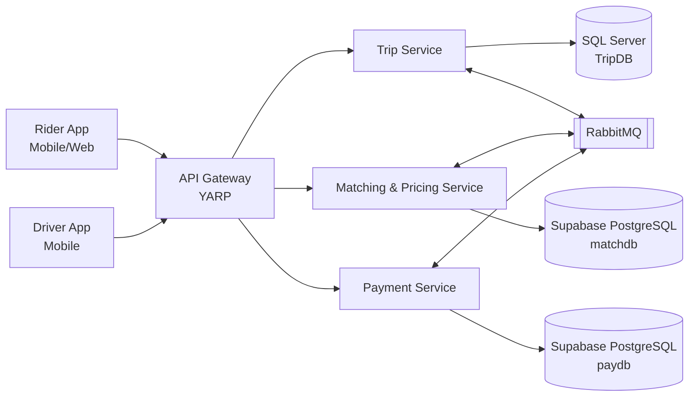
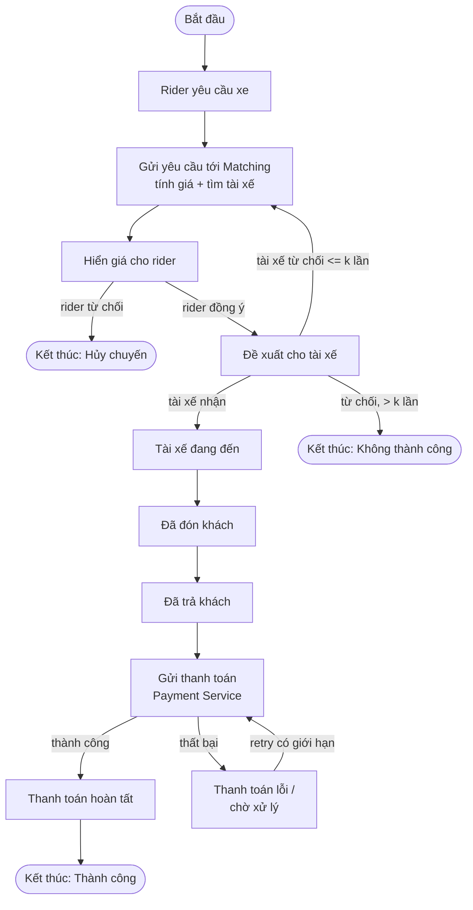

# SOFTWARE ARCHITECTURE - Bài tập lớn SwiftRide

**Trường:** Trường Đại học Sài Gòn  
**Khoa:** Công nghệ Thông tin  
**Môn học:** Kiến trúc Phần mềm  
**Học kỳ:** I - Năm học 2026-2027  
**Phiên bản:** 1.0  
**Năm:** 2026

> Tài liệu Markdown này được chuyển đổi từ file PDF đề bài để Codex/AI có thể đọc, tìm kiếm và tham chiếu dễ hơn. Nội dung được giữ theo cấu trúc của tài liệu gốc; các sơ đồ được biểu diễn lại bằng Mermaid khi phù hợp.

---

## Mục lục

1. [Tóm tắt](#1-tóm-tắt)
2. [Bài toán: SwiftRide](#2-bài-toán-swiftride)
   - [2.1 Bối cảnh](#21-bối-cảnh)
   - [2.2 Kịch bản đầy đủ: từ lúc đặt xe đến lúc thanh toán](#22-kịch-bản-đầy-đủ-từ-lúc-đặt-xe-đến-lúc-thanh-toán)
   - [2.3 Công thức tính giá](#23-công-thức-tính-giá)
   - [2.4 Quyết định thiết kế: 3 microservice cho SwiftRide](#24-quyết-định-thiết-kế-3-microservice-cho-swiftride)
3. [Kiến trúc tổng quan và Client Architecture](#3-kiến-trúc-tổng-quan-và-client-architecture)
   - [3.1 Sơ đồ kiến trúc logic](#31-sơ-đồ-kiến-trúc-logic)
   - [3.2 API Gateway](#32-api-gateway)
   - [3.3 Ba cơ sở dữ liệu khác nhau](#33-ba-cơ-sở-dữ-liệu-khác-nhau)
4. [Flowchart: vòng đời một chuyến đi](#4-flowchart-vòng-đời-một-chuyến-đi)
5. [Chi tiết ba microservice](#5-chi-tiết-ba-microservice)
6. [Áp dụng nguyên tắc SOLID](#6-áp-dụng-nguyên-tắc-solid-kèm-ví-dụ-net)
7. [Các design pattern sử dụng trong SwiftRide](#7-các-design-pattern-sử-dụng-trong-swiftride)
8. [Ngăn xếp công nghệ .NET](#8-ngăn-xếp-công-nghệ-net)
9. [Trade-off và yêu cầu chất lượng](#9-trade-off-và-yêu-cầu-chất-lượng)

---

# 1. Tóm tắt

Tài liệu này xây dựng một dự án mẫu tên là **SwiftRide**. Dự án áp dụng kiến trúc **Microservices** với tối đa **3 dịch vụ** và **3 cơ sở dữ liệu khác nhau**, trong đó dịch vụ **Thanh toán (Payment)** là bắt buộc.

Tài liệu trình bày:

1. Client Architecture.
2. Sơ đồ flowchart vòng đời chuyến đi.
3. Cách áp dụng nguyên tắc SOLID.
4. Các design pattern phổ biến.
5. Ngăn xếp công nghệ .NET.
6. Các trade-off quan trọng khi lựa chọn microservices.

Hệ thống SwiftRide thực tế có thể có nhiều dịch vụ như Driver Discovery, Route, Time Estimation, Surge Pricing, Tax, Toll, Matching... Tuy nhiên, trong bài tập lớn này hệ thống chỉ sử dụng **3 dịch vụ cốt lõi**.

Có thể chạy một luồng đơn giản trước; **message broker, Outbox và observability là phần mở rộng**.

---

# 2. Bài toán: SwiftRide

## 2.1 Bối cảnh

Hệ thống đặt xe là một **sàn giao dịch hai phía (two-sided marketplace)** kết nối:

- **Rider**: người đi.
- **Driver**: tài xế.

Giá trị cốt lõi của hệ thống là **độ tin cậy**, bao gồm khả năng cân bằng cung - cầu theo thời gian và không gian.

---

## 2.2 Kịch bản đầy đủ: từ lúc đặt xe đến lúc thanh toán

### 1. Đặt xe

Rider mở ứng dụng, chọn điểm đón và điểm đến, sau đó nhấn **"Đặt xe"**.

Yêu cầu đi qua:

```text
Client -> API Gateway -> Trip Service
```

### 2. Tạo chuyến

Trip Service tạo một chuyến đi mới ở trạng thái:

```text
Requested
```

và lưu vào **SQL Server**.

### 3. Tìm tài xế và báo giá

Trip Service gọi **Matching and Pricing Service**.

Dịch vụ này:

- tìm tài xế gần nhất;
- truy vấn dữ liệu vị trí trên Supabase PostgreSQL;
- tính giá chuyến đi.

### 4. Rider xác nhận giá

Giá được hiển thị cho rider.

- Nếu rider từ chối -> chuyến bị hủy.
- Nếu rider đồng ý -> tiếp tục quá trình tìm/đề xuất tài xế.

### 5. Đề xuất cho tài xế

Tài xế nhận lời mời.

- Nếu tài xế từ chối và chưa quá `k` lần thử -> tìm tài xế khác.
- Nếu vượt quá `k` lần -> chuyến không thành công.

### 6. Thực hiện chuyến

Khi tài xế nhận chuyến:

```text
đang đến
-> đã đón khách
-> đã trả khách
```

Ở mỗi mốc, tài xế cập nhật trạng thái và Trip Service thay đổi trạng thái chuyến đi tương ứng.

### 7. Thanh toán

Khi khách đã được trả tại điểm đến, Trip Service phát sự kiện để Payment Service:

- xử lý thanh toán;
- trừ tiền rider;
- ghi sổ cái giao dịch vào PostgreSQL.

### 8. Kết thúc

Khi thanh toán hoàn tất, chuyến đi được đóng lại ở trạng thái cuối.

---

## 2.3 Công thức tính giá

Giá tiền một chuyến đi được ước lượng theo công thức:

```text
p = ((cd * d + ct * t) * s + cm) * eta * (1 + T)
```

Trong đó:

| Ký hiệu | Ý nghĩa |
|---|---|
| `d` | Quãng đường |
| `t` | Thời gian ước lượng |
| `s` | Hệ số giá động (surge) |
| `cm` | Phí phụ (toll) |
| `eta` | Hệ số khuyến mãi |
| `T` | Thuế |

---

## 2.4 Quyết định thiết kế: 3 microservice cho SwiftRide

SwiftRide gồm ba microservice cốt lõi:

1. **Trip Service**
   - Quản lý vòng đời chuyến đi.
   - Quản lý state machine của chuyến đi.

2. **Matching and Pricing Service**
   - Tìm tài xế gần nhất.
   - Tính giá chuyến đi.

3. **Payment Service**
   - Bắt buộc trong bài tập.
   - Xử lý thanh toán.
   - Quản lý sổ cái giao dịch.

---

# 3. Kiến trúc tổng quan và Client Architecture

## 3.1 Sơ đồ kiến trúc logic

Client không gọi trực tiếp từng microservice mà đi qua **API Gateway**.

Các dịch vụ giao tiếp:

- **Đồng bộ:** REST/gRPC khi cần phản hồi ngay.
- **Bất đồng bộ:** RabbitMQ để phát và nhận event.

### Logical architecture



### Các tầng trong Client Architecture

#### Presentation (Client)

Rider App / Driver App:

- xử lý UI/UX;
- kiểm tra dữ liệu đầu vào;
- gọi API.

Các quy tắc nghiệp vụ quan trọng vẫn phải được xác minh ở server.

#### Edge / Gateway

API Gateway đảm nhận:

- routing;
- xác thực JWT;
- rate limiting;
- aggregation dữ liệu cho client.

#### Application (Microservices)

Mỗi service:

- sở hữu dữ liệu riêng;
- áp dụng **database-per-service**;
- không chia sẻ trực tiếp database.

#### Integration

RabbitMQ truyền các event như:

```text
TripAccepted
RideCompleted
PaymentSettled
```

---

## 3.2 API Gateway

Sử dụng **YARP (Yet Another Reverse Proxy)**.

YARP:

- do Microsoft phát triển;
- tích hợp tốt với ASP.NET Core;
- cấu hình tương đối đơn giản;
- phù hợp với dự án .NET.

### API Gateway và BFF

**API Gateway** là điểm vào chung và thực hiện routing.

**BFF (Backend for Frontend)** cung cấp API riêng cho từng loại client.

SwiftRide sử dụng **một API Gateway**. Trong tương lai có thể tách:

```text
Rider BFF
Driver BFF
```

nếu hai giao diện có nhu cầu khác biệt đáng kể.

---

## 3.3 Dữ liệu tách biệt theo dịch vụ

| Dịch vụ | CSDL | Lý do lựa chọn |
|---|---|---|
| Trip Service | SQL Server (quan hệ) | Trạng thái chuyến đi cần ACID, ràng buộc toàn vẹn và transition nhất quán |
| Matching and Pricing | Supabase PostgreSQL, schema `matchdb` | Lưu latitude/longitude và snapshot quote; MVP lọc driver hợp lệ rồi tính khoảng cách trong service |
| Payment Service | Supabase PostgreSQL, schema `paydb` | Ledger dạng double-entry cần transaction mạnh, kiểm toán và nhất quán dữ liệu tiền bạc |

### Cô lập dữ liệu theo service

Trip giữ SQL Server. Matching và Payment dùng Supabase PostgreSQL nhưng tách schema và quyền theo service, không truy vấn chéo.

Trade-off:

- tăng chi phí vận hành;
- tăng chi phí backup;
- tăng chi phí monitoring.

Trong phạm vi bài tập lớn, sinh viên **được phép dùng cùng một công nghệ CSDL**, nhưng phải tách:

```text
schema/database theo từng service
```

---

# 4. Flowchart: vòng đời một chuyến đi

Trip Service là nơi giữ trạng thái chuyến đi. Các service khác phản ứng thông qua event.



### Diễn giải

Quá trình:

```text
Rider yêu cầu xe
-> Matching tính giá + tìm tài xế
-> Rider xác nhận giá
-> Đề xuất tài xế
-> Tài xế nhận
-> Đón khách
-> Trả khách
-> Thanh toán
-> Hoàn tất
```

Nếu tài xế từ chối nhưng số lần thử chưa vượt `k`, hệ thống quay lại tìm tài xế khác.

Nếu tài xế từ chối quá `k` lần, chuyến kết thúc với trạng thái không thành công.

Nếu Payment Service gặp lỗi tạm thời:

- retry có giới hạn;
- sử dụng cùng một **idempotency key**;
- nếu vẫn lỗi, chuyến ở trạng thái chờ xử lý.

Mục tiêu là tránh:

- trừ tiền nhiều lần;
- báo thanh toán thành công sai.

---

# 5. Chi tiết ba microservice

## 5.1 Trip Service

### Trách nhiệm

- Khởi tạo chuyến đi.
- Giữ trạng thái chuyến đi.
- Chuyển trạng thái.
- Áp dụng State Pattern.
- Phát domain event.

### API tiêu biểu

```http
POST /trips
POST /trips/{id}/driver-accept
POST /trips/{id}/pickup
POST /trips/{id}/dropoff
```

---

## 5.2 Matching and Pricing Service

### Trách nhiệm

- Tìm tài xế gần nhất.
- MVP lọc driver online, vị trí còn mới và driver bị loại trừ rồi tính khoảng cách trong Matching. PostGIS chỉ bổ sung khi cần.
- Tính giá.
- Áp dụng Strategy Pattern.

Các chiến lược giá:

```text
Standard
Surge
Promotion
```

### API tiêu biểu

```http
POST /match
POST /quote
```

---

## 5.3 Payment Service

### Trách nhiệm

- Tạo giao dịch thanh toán.
- Ghi sổ cái.
- Xử lý refund.
- Xử lý compensation khi Saga thất bại.
- Hỗ trợ idempotency.

Cùng một request không được làm rider bị trừ tiền hai lần.

Trong hệ thống thực, Payment Service chỉ lưu token do cổng thanh toán cấp, **không lưu số thẻ/CVV**.

### API tiêu biểu

```http
POST /payments
POST /payments/{id}/refund
```

---

# 6. Áp dụng nguyên tắc SOLID (kèm ví dụ .NET)

## 6.1 S - Single Responsibility Principle

Mỗi lớp chỉ có một lý do để thay đổi.

Tách logic tính giá khỏi persistence.

```csharp
public sealed class FareCalculator
{
    public decimal Calculate(Trip trip, IPricingStrategy strategy)
        => strategy.GetPrice(trip);
}

public sealed class TripRepository
{
    private readonly TripDbContext _db;

    public TripRepository(TripDbContext db)
        => _db = db;

    public async Task SaveAsync(Trip trip)
    {
        _db.Trips.Update(trip);
        await _db.SaveChangesAsync();
    }
}
```

---

## 6.2 O - Open/Closed Principle

Mở để mở rộng, đóng để sửa đổi.

Có thể thêm chiến lược giá mới mà không cần sửa lớp giá cũ.

```csharp
public interface IPricingStrategy
{
    decimal GetPrice(Trip trip);
}

public sealed class StandardPricing : IPricingStrategy
{
    public decimal GetPrice(Trip trip)
        => trip.Distance * 1.0m
         + trip.EstimatedTime * 0.5m;
}

public sealed class SurgePricing : IPricingStrategy
{
    private readonly IPricingStrategy _basePricing;
    private readonly decimal _multiplier;

    public SurgePricing(
        IPricingStrategy basePricing,
        decimal multiplier)
    {
        _basePricing = basePricing;
        _multiplier = multiplier;
    }

    public decimal GetPrice(Trip trip)
        => _basePricing.GetPrice(trip) * _multiplier;
}
```

---

## 6.3 L - Liskov Substitution Principle

Lớp triển khai phải thay thế được abstraction mà không phá vỡ hành vi mong đợi.

Trong ví dụ, mọi pricing strategy phải bảo đảm:

```text
price >= 0
```

```csharp
public decimal Quote(
    Trip trip,
    IPricingStrategy strategy)
{
    decimal price = strategy.GetPrice(trip);

    if (price < 0)
        throw new InvalidOperationException("Gia khong hop le");

    return price;
}
```

Runtime validation chỉ là một hàng rào bảo vệ; hợp đồng này vẫn cần được ghi rõ và kiểm thử.

---

## 6.4 I - Interface Segregation Principle

Tách interface nhỏ thay vì tạo một interface quá lớn.

```csharp
public interface ITripReader
{
    Task<Trip?> GetByIdAsync(Guid id);
}

public interface ITripWriter
{
    Task SaveAsync(Trip trip);
}
```

Service chỉ đọc dữ liệu chỉ cần phụ thuộc `ITripReader`.

---

## 6.5 D - Dependency Inversion Principle

Module cấp cao phụ thuộc vào abstraction thay vì implementation cụ thể.

```csharp
public sealed class TripService
{
    private readonly ITripWriter _writer;
    private readonly IEventBus _bus;

    public TripService(
        ITripWriter writer,
        IEventBus bus)
    {
        _writer = writer;
        _bus = bus;
    }

    public async Task AcceptAsync(Trip trip)
    {
        trip.Accept();

        await _writer.SaveAsync(trip);

        await _bus.PublishAsync(
            new TripAccepted(trip.Id));
    }
}
```

Đăng ký Dependency Injection:

```csharp
builder.Services.AddScoped<ITripWriter, TripRepository>();
builder.Services.AddSingleton<IEventBus, RabbitMqEventBus>();
```

---

# 7. Các design pattern sử dụng trong SwiftRide

| Pattern | Loại | Ứng dụng trong SwiftRide |
|---|---|---|
| State | Behavioral | Vòng đời chuyến đi và các transition hợp lệ |
| Strategy | Behavioral | Pricing Standard / Surge / Promo |
| Repository | DDD | Trừu tượng hóa truy cập CSDL |
| Factory | Creational | Tạo PaymentMethod như Card/Wallet |
| Observer / Pub-Sub | Behavioral | Phát domain event qua RabbitMQ |
| API Gateway | Architectural | Một điểm vào cho client bằng YARP |
| Saga | Architectural | Quy trình nhiều service và compensation |
| Outbox | Architectural | Ghi dữ liệu và event tin cậy trong cùng transaction |

## Ví dụ State Pattern

Trạng thái nghiệp vụ đầy đủ:

```text
Requested
-> DriverAccepted
-> EnRoute
-> PickedUp
-> DroppedOff
-> PaymentPending
-> Paid
```

Các trạng thái kết thúc khác:

```text
Cancelled
Failed
```

Ví dụ đơn giản:

```csharp
public abstract class TripState
{
    public abstract TripState Accept();
    public abstract TripState Complete();
}

public sealed class RequestedState : TripState
{
    public override TripState Accept()
        => new AcceptedState();

    public override TripState Complete()
        => throw new InvalidOperationException(
            "Chua duoc chap nhan");
}

public sealed class AcceptedState : TripState
{
    public override TripState Accept()
        => throw new InvalidOperationException(
            "Da chap nhan roi");

    public override TripState Complete()
        => new CompletedState();
}

public sealed class CompletedState : TripState
{
    public override TripState Accept()
        => this;

    public override TripState Complete()
        => this;
}
```

---

# 8. Ngăn xếp công nghệ .NET

| Thành phần | Công nghệ đề xuất |
|---|---|
| Runtime / Framework | .NET 10 (LTS), ASP.NET Core Minimal API / Controllers |
| ORM / Data | EF Core 10 cho SQL Server/PostgreSQL, Npgsql.EntityFrameworkCore.PostgreSQL |
| API Gateway | YARP |
| Message Broker | RabbitMQ qua MassTransit |
| Xác thực | OAuth 2.0 / OpenID Connect, JWT Bearer |
| Container | Docker + docker-compose |
| Kiểm thử | xUnit + Moq |
| Quan sát hệ thống | OpenTelemetry cho log, metric, distributed trace |

---

## 8.1 Cấu trúc thư mục đề xuất

```text
SwiftRide/
├── src/
│   ├── ApiGateway/
│   │   └── # YARP, routing + JWT
│   │
│   ├── TripService/
│   │   ├── Domain/
│   │   │   └── # Trip, TripState (State pattern)
│   │   ├── Application/
│   │   │   └── # TripService, DTOs
│   │   ├── Infrastructure/
│   │   │   └── # EF Core + SQL Server
│   │   └── Api/
│   │       └── # Controllers / Minimal API
│   │
│   ├── MatchingService/
│   │   ├── Domain/
│   │   ├── Application/
│   │   ├── Infrastructure/
│   │   │   └── # Supabase PostgreSQL
│   │   └── Api/
│   │
│   └── PaymentService/
│       ├── Domain/
│       ├── Application/
│       ├── Infrastructure/
│       │   └── # PostgreSQL
│       └── Api/
│
├── tests/
│   └── TripService.Tests/
│       └── # xUnit + Moq
│
├── docker-compose.yml
└── SwiftRide.sln
```

---

# 9. Trade-off và yêu cầu chất lượng

## 9.1 Kiến trúc mã nguồn

Microservices không mặc định tốt hơn monolith.

Với:

- nhóm nhỏ;
- nghiệp vụ chưa ổn định;
- tải thấp;

thì **modular monolith** thường dễ:

- phát triển;
- kiểm thử;
- triển khai.

Trong bài tập lớn, kiến trúc microservices được sử dụng khi:

- cần triển khai độc lập;
- cần mở rộng độc lập;
- ranh giới nghiệp vụ đủ rõ;
- chấp nhận chi phí của hệ phân tán.

Trong SwiftRide, microservices là lựa chọn phục vụ học tập.

### Lộ trình hợp lý

1. Xác định module và bounded context.
2. Chạy luồng nghiệp vụ cơ bản.
3. Tách service và database.
4. Thêm messaging, Outbox và observability.

---

## 9.2 Nhất quán và độ tin cậy

### Consistency

```text
Strong consistency trong một service.
Eventual consistency giữa các service.
```

### Transactional Outbox

Transactional Outbox bảo đảm:

- thay đổi business data;
- ghi event vào Outbox;

được thực hiện trong **cùng một transaction**.

Sau đó worker publish event ra broker.

### Idempotent Consumer

Consumer phải idempotent vì message broker thường hoạt động theo cơ chế:

```text
at least once
```

Một message có thể được gửi đến consumer nhiều lần.

### Timeout và Retry

Mọi lời gọi network cần timeout.

Chỉ retry lỗi tạm thời.

Khuyến nghị:

```text
exponential backoff + jitter
```

Không retry vô hạn.

Message thất bại nhiều lần được chuyển sang:

```text
Dead Letter Queue
```

### Saga

Saga dùng để:

- điều phối/choreography workflow nhiều service;
- định nghĩa hành động bồi thường khi workflow thất bại.

Saga **không thay thế**:

- transaction nội bộ;
- Transactional Outbox.

---

## 9.3 Bảo mật và khả năng quan sát

### Security

Sử dụng:

```text
OAuth 2.0
OpenID Connect
JWT
```

Gateway thực hiện authentication nhưng service vẫn phải kiểm tra authorization đối với tài nguyên.

Không được log:

- token;
- số thẻ;
- dữ liệu cá nhân nhạy cảm.

Không hard-code secret trong source code.

### Correlation và Distributed Tracing

Mỗi request/message phải mang:

```text
CorrelationId
trace context
```

Sử dụng OpenTelemetry để liên kết:

- log;
- metric;
- distributed trace.

### Các metric nên theo dõi

- Tỉ lệ đặt xe thành công.
- Thời gian matching.
- API latency.
- Tỉ lệ thanh toán lỗi.
- Queue length.

---

# Ghi chú cho Codex

Khi sử dụng tài liệu này làm yêu cầu dự án:

1. Xem đây là **project specification**, không phải source code.
2. Đọc `AGENTS.md` để biết quy tắc triển khai và skill selection.
3. Không tự ý thêm service thứ tư nếu không có yêu cầu mới.
4. Giữ nguyên nguyên tắc **database-per-service**.
5. Payment Service là service bắt buộc.
6. Message broker, Transactional Outbox và observability có thể được triển khai theo phase.
7. Ưu tiên hoàn thành luồng nghiệp vụ cơ bản trước khi thêm infrastructure nâng cao.
8. Khi tài liệu này và code hiện tại khác nhau, kiểm tra `AGENTS.md` và trạng thái project trước khi refactor.
