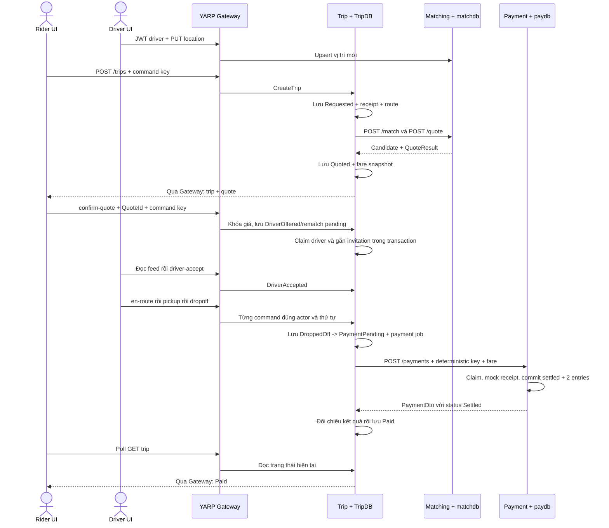

# Thiết kế nối luồng đặt xe đến thanh toán

> Ngày đối chiếu: 29/10/2026, commit `f43074d`. Trạng thái: đề xuất để xem trước, chưa triển khai.
> Người dùng đã chọn **lập plan chi tiết trước**. Lần làm này chỉ thêm tài liệu, không sửa production code, cài dependency hoặc thay đổi database.

## 1. Mục tiêu và phạm vi

Nối giao diện hiện có thành luồng backend có lưu dữ liệu thật:

`Rider UI -> Gateway -> Trip -> Matching/Pricing -> Driver UI -> Trip -> Payment -> Paid`.

“Luồng thật” trong tài liệu là HTTP thật, dữ liệu TripDB/Supabase thật và ledger có transaction. Cổng tài chính vẫn là mock Card/Wallet theo đề; không tích hợp ngân hàng, không thu tiền thật hoặc nhập PAN/CVV.

Giữ tối đa ba business service. Trip dùng SQL Server; Matching dùng `matchdb`, Payment dùng `paydb` trên Supabase với login/quyền riêng. Không thêm Identity, Notification, broker, Saga, Outbox, Redis hoặc BFF để nối MVP.

Nguồn ưu tiên: [AGENTS.md](../../../AGENTS.md) hiện hành, [requirements.md](../../requirements.md), source/test hiện tại. [architecture.md](../../architecture.md) có giá trị về lifecycle và ranh giới, nhưng các phần database cũ hoặc mô tả scaffold phải được cập nhật theo code mới.

## 2. Kết quả đọc dự án và baseline

| Phần | Thực tế ngày 29/10 | Việc cần làm |
|---|---|---|
| Gateway | YARP, JWT, rate limit, timeout, route Trip/location/search đã có | Giữ route nội bộ kín; thêm proxy frontend cho `/trips`, test các route query mới |
| Trip Domain | 11 state, state handlers `internal`, 102 test | Giữ luật; bổ sung rehydration an toàn và confirm sang trạng thái đang ghép khi chưa claim được driver |
| Trip Application/API | Application chưa có use case; endpoint trả `501` | Use case, DTO, authorization, query cho rider/driver, command receipt |
| Trip persistence | `TripDbContext` trống | Schema/migration, lưu/khôi phục aggregate, rowversion, claim driver, tiến độ công việc |
| Matching | `/match`, `/quote`, location, address search, Npgsql/map `matchdb` đã có | Tái sử dụng; thêm internal auth và HTTP contract tests phía Trip |
| Payment | Charge, GET theo ID/trip, refund, Factory, ledger và map `paydb` đã có | Kiểm chứng PostgreSQL thật; zero fare; atomic claim/recovery; receipt mock bền vững |
| WebApp | Tìm địa chỉ gọi Gateway; chọn điểm trên map; booking/payment còn `demo.ts` + localStorage | Session chung, API client, server state, polling, location heartbeat, bỏ nút tự settle |
| Compose/docs | Matching đã dùng Supabase; Payment vẫn phụ thuộc container PostgreSQL không cần thiết | Bổ sung địa chỉ client/JWT/internal auth cho Trip; sửa bootstrap/test/docs |

Ảnh người dùng cung cấp là bối cảnh, không phải bằng chứng source hiện tại. Đặc biệt, Payment **đã** có `HasDefaultSchema("paydb")`, converter enum lowercase và mapping snake_case trong code mới. Không lập lại một công việc “map schema paydb” đã hoàn thành; thay vào đó kiểm thử mapping với DDL/role/trigger thực.

Baseline đã chạy:

- `dotnet build SwiftRide.sln --no-restore` với cấu hình MSBuild phù hợp môi trường: thành công, 0 lỗi, 6 cảnh báo `Pkcs 9.0.11` đã biết.
- Test solution: **221 pass, 1 skip**: Trip 102, Payment 28, API 54, Matching 37 pass + 1 PostgreSQL integration skip.
- Ca skip cần `MATCHING_TEST_DB` trên PostgreSQL disposable localhost. Không có bằng chứng chạy schema thật từ số test unit/API này.
- Chưa chạy frontend test/build vì `src/WebApp/node_modules` chưa có; không cài package trong lần lập plan.
- Chưa gọi Supabase, Nominatim thật hoặc chạy container end-to-end. SQL trong repo là schema tham chiếu; phải kiểm tra drift trước khi áp thay đổi lên môi trường chung.

## 3. Quyết định thiết kế

Các quyết định dưới đây do người lập plan đề xuất để thu hẹp cách triển khai, chưa phải code đã có hoặc lựa chọn người dùng đã xác nhận riêng.

### 3.1. Luồng REST và thứ tự dữ liệu

Mọi state change và outgoing work intent của Trip được commit trước khi gọi service khác. Không giữ transaction/lock DB trong lúc gọi HTTP. Công việc có thể được request xử lý ngay một lần; worker trong Trip tiếp tục sau timeout/client disconnect/restart.

### 3.2. Contract public của Trip

Giữ các route command đã khai báo, thay stub bằng use case. Mọi route cần JWT; lấy actor từ `sub`, role từ `role`, không tin rider/driver ID trong body.

| Route | Contract mục tiêu |
|---|---|
| `POST /trips` | Rider; body pickup/destination `{name,address,latitude,longitude}`, `paymentMethod: "card"|"wallet"`, `mode: "standard"`; header `Idempotency-Key`; không nhận giá, tax/surge hay RiderId |
| `GET /trips/{id:guid}` | Chủ chuyến hoặc driver có invitation hiện hành/đã assigned; response projection theo role |
| `POST /trips/{id:guid}/confirm-quote` | Chủ chuyến; body `{quoteId}` + command key; driver do server chọn/claim |
| `POST /trips/{id:guid}/cancel` | Chủ chuyến, chỉ trước DriverAccepted; command key |
| `POST /trips/{id:guid}/driver-accept`, `/driver-reject`, `/en-route`, `/pickup`, `/dropoff` | Driver đúng invitation/assignment; command key; không nhận status đích tự do |
| `GET /trips/current` | Rider; trả active trip của mình hoặc `204`; hỗ trợ reload sau mất response tạo chuyến |
| `GET /trips/driver-feed` | Driver; `{offeredTrip, activeTrip}` chỉ thuộc chính driver; không list mọi chuyến |
| `GET /trips?cursor=...&limit=20` | Lịch sử theo actor/role, tối đa 100; driver chỉ lịch sử đã assigned |

Không thêm public endpoint settle/payment/refund. Existing `/locations/search` và `PUT /drivers/{id}/location` tiếp tục qua Gateway.

Trip response có `id`, `status`, route snapshot, quote snapshot, `candidateDriverId` khi thích hợp, offered/assigned driver, `rejectionCount`, `rematchPending`, timestamps và payment progress an toàn. Giá public là **chuỗi VND nguyên đồng**, ví dụ `fareAmount: "74844"`, `currency: "VND"`, để tránh mất độ chính xác JavaScript. Khoảng cách/thời gian là number hữu hạn; thời gian có thể có phần lẻ. Trip chưa Quoted có quote/fare null, không dùng giá 0 để biểu diễn “chưa có giá”.

Projection driver không có token hoặc danh tính tài chính rider không cần thiết. Không expose persistence entity, command receipt, lease owner hoặc connection details.

Status response: create mới `201` + Location; command hoàn tất `200`; đã nhận nhưng còn công việc bền vững `202`; payload sai `400`; sai JWT `401`; sai actor/role `403`; không tìm thấy `404`; transition/concurrency/idempotency conflict `409`. Receipt replay không thực hiện lại side effect. GET không tự kích hoạt charge.

### 3.3. Tái sử dụng contract Matching/Payment

| Lời gọi nội bộ | Cách dùng |
|---|---|
| Matching `POST /match` | `{latitude,longitude,excludedDriverIds}` -> `200` với `status: "Matched"/"NoDriverAvailable"`; candidate distance là driver -> pickup |
| Matching `POST /quote` | `{pickup:{latitude,longitude},destination:{latitude,longitude},mode}` -> `201 QuoteResult`; distance/time là hành trình |
| Payment `POST /payments` | Header `Idempotency-Key: trip-{tripId:D}-payment`; body trip/rider/assigned-driver, decimal amount, VND, `method:"Card"/"Wallet"`, opaque mock token |
| Payment `GET /payments?tripId=...` | Đối soát sau timeout/mất response/restart; không gọi POST bằng key mới |

HTTP DTO nằm tại API hoặc HTTP adapter từng service, không đưa vào `SwiftRide.Contracts`. Trip không reference project Domain/Application của Matching hoặc Payment.

Payment đang trả **201 với status Failed khi gateway từ chối**, `202 Pending`, `200` replay và `503` transient. Trip chỉ Paid khi `status == Settled`, trip/rider/driver/fare/currency khớp và refund chưa settled. PaymentDto hiện không chứa idempotency key; key được suy ra từ TripId theo CHECK deterministic của paydb, không lấy HTTP 2xx làm chứng cứ thành công.

Pending/Failed PaymentDto có thể không có DriverId do schema hiện không lưu driver_id; chỉ bắt buộc driver khớp khi settled và ledger đã có. Không thay ledger hiện hành `rider:<id>` debit / `driver:<id>` credit bằng hệ tài khoản mới.

### 3.4. Lưu Trip và khôi phục State Pattern

TripDB sở hữu:

- `Trips`: lifecycle snapshot, route/name/address, quote/distance/time, method + **mock token alias**, timestamps, SQL Server rowversion.
- Alias là tên kịch bản như `card.success.v1`/`wallet.success.v1`, không phải chuỗi token gửi Payment; adapter resolve bằng cấu hình server. Giữ mapping alias đã dùng bất biến khi còn job pending.
- `TripDriverRejections`: driver đã từ chối, unique trip + driver.
- `ActiveDriverAssignments`: unique DriverId và TripId; giữ từ invitation đến dropoff/cancel/fail, cùng transaction với state.
- `ActiveRiderTrips`: unique RiderId và TripId; claim cùng transaction tạo Requested, release chỉ khi Paid/Cancelled/Failed. Một rider có tối đa một chuyến non-terminal, kể cả PaymentPending, khớp hành vi giao diện hiện tại. Hai create key khác nhau cùng rider: một request thắng, request kia trả 409 kèm currentTripId của chính rider đó.
- `CommandReceipts`: unique actor + operation + trip scope + request key; canonical request hash, progress, response reference, retry schedule.
- `TripPaymentJobs`: một job/trip, stable key, attempt count, next attempt, short lease và requires-action.

Tách persistence record khỏi API và aggregate. Thêm `TripSnapshot` thuần Domain + `Trip.Restore(snapshot)` kiểm tra tính nhất quán, reconstruct concrete state **bên trong Domain**; không mở lại state handlers hoặc dùng reflection/InternalsVisibleTo. Restore không gọi lại chuỗi public commands và không phát lại RideCompleted.

Route/payment metadata thuộc bản ghi use-case của Trip; Domain lifecycle tiếp tục giữ business state và snapshot giá. EF Core mapping ở Infrastructure. Không dùng EF InMemory để chứng minh transaction, rowversion hoặc unique driver claim.

Thêm overload Domain `ConfirmQuote(string riderId, Guid quoteId)` để khóa giá và sang DriverOffered với invitation null. Application sau đó claim driver rồi gọi `OfferReplacementDriver`. Giữ overload ba tham số hiện tại để không phá test/caller cũ. Guard toàn bộ input trước mutation. Không giả một lần RejectDriver để tạo rematch pending vì sẽ tăng count sai.

Khi confirm, gọi `/match` lại để kiểm tra online/fresh trước invitation; candidate lúc quote chưa được reserve. Không tính lại giá. Driver feed chỉ trả invitation và active ride đang DriverAccepted/EnRoute/PickedUp; payment cũ sau dropoff đọc qua detail/history.

Claim candidate bị bận không tăng rejection count; thử ứng viên khác bằng `/match`, giữ nguyên giá, tối đa 5 candidate/command. Excluded list gồm driver đã từ chối, rider ID và candidate bị xung đột, không vượt giới hạn 100 của Matching. Hết ứng viên thật -> Failed; timeout -> giữ pending, không giả NoDriverAvailable.

### 3.5. Idempotency, worker và retry Trip

Command key của frontend sinh một lần cho một hành động, giữ lại khi timeout/reload và retry cùng payload; hành động mới có key mới. Fingerprint canonical JSON hoặc length-prefixed fields, không ghép chuỗi có delimiter không escape. Không lưu JWT trong receipt.

Receipt commit cùng domain mutation. Hai request cùng key chỉ một request claim tiến độ; key cũ khác payload -> 409. Khi cập nhật từ kết quả mạng, reload/kiểm tra rowversion và receipt ownership để không ghi đè chuyến đã hủy.

Hai BackgroundService trong Trip: `PendingTripWorker` phục hồi Requested/rematch; `PendingPaymentWorker` xử lý DroppedOff/PaymentPending. Dùng lease/CAS trong TripDB; request và worker gọi cùng use case, không tự viết lifecycle lần hai.

Giá trị khởi đầu đề xuất, phải validate options:

| Policy | Giá trị |
|---|---|
| Matching client | `/match` mỗi attempt 3s, tối đa 1 retry transient, exponential+jitter; tổng công việc tương tác 12s |
| Quote client | Timeout 4s; **không retry POST tự động**, vì mỗi lần tạo quote mới |
| Payment client | Timeout 12s; không transport retry cho POST; worker Trip sở hữu budget |
| Matching workflow | Tối đa 3 attempt tự động/logical work; base backoff 1s, cap 60s, jitter; persist count/next-attempt qua restart |
| Payment workflow | Payment giới hạn 3 gateway attempt thực sự; Trip đối soát tối đa 20 lượt và 10 phút, mỗi lượt tối đa 1 GET + 1 POST, không reset sau restart |
| Payment claim | Lease mặc định 60s, phải lớn hơn gateway timeout và budget finalize; 202 trả Retry-After theo lease |
| Browser | Timeout 20s, polling một request/role mỗi 3s, heartbeat driver 30s; không retry mutation ngầm |

Trước retry payment, GET-by-trip đối soát. Nếu đã settled thì chỉ cập nhật Trip, không charge. Payment trả thêm metadata nội bộ `processing: {attemptsStarted, leaseUntilUtc, canRetry, requiresAction}`; không có owner/token/hash. Chỉ Payment CAS claim thành công rồi bắt đầu gọi gateway mới tăng `attemptsStarted`, tối đa 3; zero fare không gọi gateway. `202`/GET không tiêu hao budget gateway. Trip chỉ POST lại khi Payment báo canRetry và lease đã hết, hoặc GET trả 404; Retry-After hợp lệ dời lịch, không sleep trong HTTP request. Khi GET lỗi/mơ hồ thì tiếp tục GET, không đoán rằng chưa charge.

Ngay cả khi hết 3 gateway attempt, Trip vẫn được GET đối soát trong phần còn lại của 20 lượt/10 phút để nhận kết quả settled đến trễ. Mỗi lượt được lưu trước khi gọi mạng, tối đa một GET và một POST; cộng lần POST đầu tiên, số HTTP call tự động cũng hữu hạn. Hết cửa sổ đối soát hoặc declined -> Trip vẫn PaymentPending, `requiresAction=true`; dừng auto network/charge, không Paid/Failed giả. Tác vụ vận hành có audit mới được mở một lượt đối soát tiếp theo, vẫn dùng key cũ và không tự tăng budget gateway.

PaymentPending giữ slot active rider nên không được tạo chuyến mới cho đến khi được đối soát thành Paid hoặc có quy tắc nghiệp vụ xử lý riêng được thiết kế sau. UI phải nói rõ đang chờ xử lý, không gợi ý hủy trái luật hoặc gửi key mới để thanh toán lại.

### 3.6. Payment: sửa những phần chặn nghiệm thu an toàn

1. Cho phép Money 0 VND, vẫn nguyên đồng và < 1e18. Zero charge bỏ qua gateway, chốt settled và hai bút toán 0 theo policy đã có của SQL.
2. Bỏ lease suy ra từ `UpdatedAt` mà không claim. Dùng CAS/transaction ngắn trong bảng kỹ thuật `paydb.payment_processing` để chọn một owner, lưu hash/version/driver, attempt counter và lease; chỉ owner được finalize. MaxGatewayAttempts=3 được cưỡng chế nguyên tử ở đây; không giữ lock khi gọi gateway.
3. Thêm `paydb.mock_gateway_operations` để mock receipt bền vững theo operation + key, canonical payload hash, outcome/reference và timestamp; không lưu raw token. Receipt được commit **độc lập trước** transaction settled+ledger để mô phỏng side effect gateway đã hoàn tất dù finalize rollback.
4. Chuyển mock adapter/factory từ singleton nếu cần scoped persistence; dùng connection/context riêng cho receipt, tránh vô tình commit pending ledger qua gateway context. Các bảng kỹ thuật chỉ thuộc Payment, không thêm service.
5. Chuẩn hóa fingerprint v2 của payload tài chính và token digest; cùng key mà đổi rider/driver/amount/currency/method/token -> 409 trước gateway. Replay phải gửi lại cùng token qua Trip adapter; API trước đây cho bỏ/đổi token khi replay cần được sửa contract/test rõ ràng, không đổi âm thầm.
6. Metadata xử lý mới ghi cùng transaction tạo Pending, lưu canonical hash/version và driver ID cần phục hồi. Dữ liệu legacy không có metadata vẫn được đọc; không sửa fingerprint của journal/settled cũ. Mutating retry legacy không xác minh được payload phải trả conflict/manual-review, tuyệt đối không charge để “sửa” dữ liệu. Kiểm kê Pending legacy trước rollout.
7. Khi request thua race hoặc finalize gặp winner đã settled, reload và trả kết quả winner sau đối chiếu, không trả 500 hoặc ghi ledger lần nữa. Status+hai entry+lease completion chốt trong một local transaction.

SQL bổ sung phải giữ nguyên ledger append-only, constraints, RLS và quyền tách schema. Không chạy lại SQL khởi tạo một lần hoặc `EnsureCreated` lên Supabase. Kiểm thử trên PostgreSQL disposable trước; khi áp môi trường chung phải có connection owner cho DDL và login runtime riêng, không dùng postgres/service key ở runtime.

Refund hiện không nằm trên happy path đặt xe. Một task hardening riêng sau core sẽ lưu intent Pending trước gateway, claim/replay/refund receipt bền vững và resume trên **cùng row**, kể cả failed/pending theo SQL. Sửa EF guard để cho đúng transition của refund và không UPDATE cột trigger-owned `updated_at`. Không thêm public refund hoặc tự refund chỉ vì Trip chưa lưu Paid.

### 3.7. Auth, cấu hình và deploy

- Trip xác thực JWT giống Matching: `MapInboundClaims=false`, `sub`/`role`, HMAC/issuer/audience/lifetime theo config; actor ID canonical, không trắng/không khoảng trắng đầu cuối, tối đa 100 để tương thích Payment.
- Các internal route dùng policy `X-Internal-Api-Key` từ environment/user-secrets, key riêng Trip -> Matching và Trip -> Payment. Driver/rider JWT không có quyền charge/refund. Gateway không nhận/chuyển internal key từ browser.
- Matching giữ JWT cho public route, thêm policy riêng cho `/match`/`/quote`. Payment bảo vệ cả POST/GET/refund nội bộ; `/health` là liveness.
- Compose thêm `MatchingClient__BaseAddress`, `PaymentClient__BaseAddress`, JWT Trip, internal keys và options. Bỏ `payment-service depends_on postgres` và PostgreSQL local khỏi stack mặc định khi dùng Supabase; không xóa volume cũ trên máy.
- Giữ Trip SQL Server. Migration Trip có toggle rõ, tài khoản DDL riêng với runtime nếu chạy môi trường chung. Payment/Matching không tự migrate Supabase ở startup.
- Dùng configuration ASP.NET Core; bỏ implicit `.env` traversal trong Payment bootstrap để env triển khai không bị ghi đè. `.env` chỉ dùng qua Compose/dev launcher và không commit.
- MigrateOnStartup của Payment hiện được Compose truyền nhưng code không dùng: bỏ option gây hiểu nhầm. Readiness riêng cho từng DB có thể thêm để acceptance chờ đúng, không dùng liveness làm bằng chứng DB hoạt động.

### 3.8. Frontend: giữ giao diện, thay nguồn dữ liệu

Tạo session/HTTP client dùng chung cho booking và tìm địa chỉ. Development lấy token từ Gateway cho `demo-rider`/`demo-driver`; driver phụ dùng `demo-driver-2` khi thử rematch. Token trong bộ nhớ tab, refresh DEV cấp lại; Production nhập JWT được cấp bên ngoài, không gọi dev-token tự động.

Chuyển khỏi `useDemo/demoApi` ở App, RiderView, DriverView, RideMap và locations. `demo.ts` chỉ còn chế độ mock được chọn tường minh để giữ demo/tests; chế độ backend **không fallback về mock** khi 401, timeout hay server lỗi. UI mặc định backend khi nghiệm thu.

- Quote button -> POST /trips; giữ stable command key cho action đang chờ.
- Confirm/cancel/progress -> API đúng actor; chỉ cập nhật từ response/GET server, không gán status tại browser.
- Driver feed và rider current/detail dùng polling có cleanup/abort, bỏ stale response khi đổi role/trip; không dựa storage event để đồng bộ backend.
- Driver online gửi PUT location, heartbeat 30s khi online, ngừng khi offline/unmount. Vị trí demo có nhãn rõ; chưa thêm GPS tracking. Seed startup hết freshness sau 300s nên không thay heartbeat bằng tắt kiểm tra freshness.
- History lấy API theo JWT; chỉ tải khi mở màn hình hoặc sau thay đổi liên quan, không poll lịch sử liên tục. Feed một request/3s mỗi role để không tiêu hết global quota 100/phút của Gateway.
- Bỏ nút `settlePayment()` ở backend mode. Pending/declined/hết budget hiển thị đúng; browser không có đường chuyển Paid.
- Tách types/format tiền khỏi `demo.ts`; VND string -> BigInt để format/cộng thống kê, không chuyển về number rồi làm tròn. ES2022 của WebApp hiện hỗ trợ BigInt.
- Giữ AddressSearch/map/attribution/nhấn Tìm; dùng token session chung. Đổi timeout địa chỉ frontend từ 12s lên 20s để lớn hơn budget 12s của geocoding backend.
- Vite proxy thêm `/trips`, `/drivers`; giữ `/locations`, `/dev/token`; không thêm `/payments`, `/match`, `/quote`. Khi deploy dùng reverse proxy cùng origin, không bật CORS wildcard cho nhanh.

## 4. Cổng nghiệm thu

| Gate | Chứng cứ bắt buộc |
|---|---|
| A - Contracts | Raw JSON/client tests khớp Matching/Payment; không Paid khi 201 Failed/202 Pending; token/key xử lý đúng |
| B - Persistence | Trip restore đúng state, không phát event lại; SQL Server rowversion/unique claim thật; PostgreSQL role/trigger/rollback thật |
| C - Backend flow | HTTP qua Gateway đến Paid trên DB thật; request lặp không thêm trip/charge/ledger; quyền actor và rematch đúng |
| D - Recovery | Restart sau dropoff, gateway success/trước commit, Payment settled/Trip pending; tất cả giữ một logical charge và một cặp entry |
| E - UI | Hai tab rider/driver trên backend, reload vẫn đúng, bỏ manual settle, lịch sử/server roles, map/search giữ hoạt động |

Chạy unit và HTTP contract tests không thay được gate DB/restart. Default suite được phép skip DB test khi chưa có fixture, nhưng gate C/D không được đánh dấu đạt với test đang skip. Runtime frontend cần được kiểm tra trên trình duyệt, không chỉ renderToStaticMarkup.

## 5. Ranh giới triển khai và bàn giao

Luồng core đến Paid là bắt buộc; refund hardening và đồng bộ tài liệu là task riêng sau core nhưng trước khi quảng bá refund có thể phục hồi. Không đưa RabbitMQ/Saga/OpenTelemetry vào cùng đợt để trì hoãn hoàn thành luồng REST.

Điều kiện bên ngoài cần sẵn khi thực thi: Docker daemon; runtime login cho `matchdb`/`paydb` và chủ schema để áp SQL bổ sung; signing/internal keys qua env; quyền kiểm thử môi trường Supabase riêng. Không cần cung cấp hoặc ghi các secret vào chat/plan.

Mọi thay đổi schema cloud phải là SQL additive đã qua fixture local, có kiểm tra drift và được người vận hành áp theo môi trường được chỉ định. Không dùng connection test trỏ Supabase để chạy test tạo/xóa schema. Các phần code/test chưa được làm trong lần lập tài liệu này.
