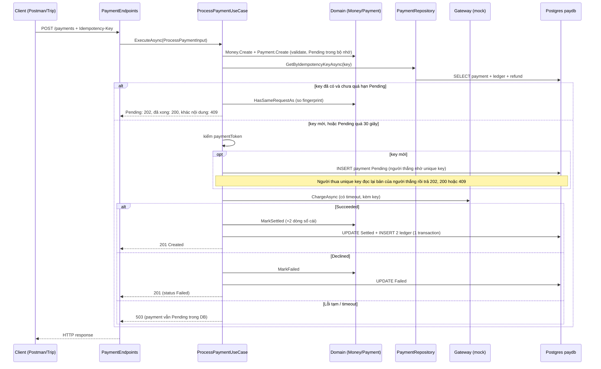
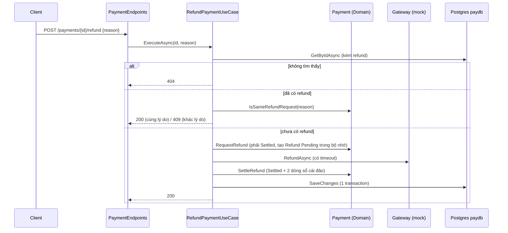
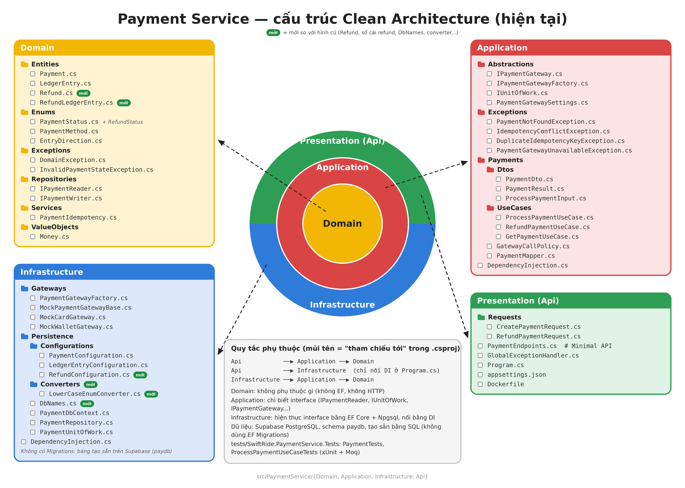

# Payment Service — SwiftRide

Dịch vụ thanh toán của SwiftRide: **thu tiền chuyến đi**, **xem payment**, **hoàn tiền**.

- Công nghệ: ASP.NET Core Minimal API, EF Core + Npgsql, Supabase PostgreSQL (schema `paydb`).
- Kiến trúc: Clean Architecture (Domain / Application / Infrastructure / Api).
- Cổng thanh toán hiện tại là **mock** (token giả, không có thẻ thật).
- Tài liệu này mô tả đúng code hiện tại của `src/PaymentService/`. Mọi đường dẫn bên dưới tính từ thư mục đó.

## Mục lục

1. [Danh sách endpoint](#1-danh-sách-endpoint)
2. [Cách test bằng Postman](#2-cách-test-bằng-postman)
3. [Chi tiết luồng và code từng dòng](#3-chi-tiết-luồng-và-code-từng-dòng)
4. [Sơ đồ kiến trúc](#4-sơ-đồ-kiến-trúc)
5. [Thay đổi so với luồng cũ](#5-thay-đổi-so-với-luồng-cũ)

---

## 1. Danh sách endpoint

| #   | Method | Route                        | Mục đích                   | Mã trả về                                        | Khai báo                     |
| --- | ------ | ---------------------------- | -------------------------- | ------------------------------------------------ | ---------------------------- |
| 1   | POST   | `/payments`                  | Thu tiền cho một chuyến đi | 201 (mới) / 200 (lặp lại) / **202 (đang xử lý)** | `Api/PaymentEndpoints.cs:14` |
| 2   | GET    | `/payments/{id:guid}`        | Xem một payment            | 200 / 404                                        | `Api/PaymentEndpoints.cs:15` |
| 3   | GET    | `/payments?tripId={guid}`    | Tra payment theo chuyến    | 200 / 400 / 404                                  | `Api/PaymentEndpoints.cs`    |
| 4   | POST   | `/payments/{id:guid}/refund` | Hoàn toàn bộ tiền          | 200                                              | `Api/PaymentEndpoints.cs:16` |
| 5   | GET    | `/health`                    | Health check               | 200 (body rỗng)                                  | `Api/Program.cs:18`          |

Lưu ý chung:

- Service này là **internal**: `ApiGateway` không có route `/payments` (xem `../ApiGateway/GatewayApplication.cs`), và service **không có xác thực**. Ai gọi được tới service là gọi được.
- Chạy local: `http://localhost:5285` (`Api/Properties/launchSettings.json`).
- Lỗi trả về theo chuẩn ProblemDetails: `{ "title": "...", "status": 400, "detail": "...", "traceId": "..." }` (xem mục 3.5).

### 1.1 `POST /payments`: thu tiền

Header:

| Header            | Bắt buộc | Giá trị                                   |
| ----------------- | -------- | ----------------------------------------- |
| `Idempotency-Key` | Có       | Đúng `trip-{tripId}-payment` (chữ thường) |
| `Content-Type`    | Có       | `application/json`                        |

Body (`Api/Requests/CreatePaymentRequest.cs`):

| Trường         | Kiểu                     | Quy tắc                                              |
| -------------- | ------------------------ | ---------------------------------------------------- |
| `tripId`       | GUID                     | Bắt buộc, khác `00000000-...`                        |
| `riderId`      | string                   | Bắt buộc, tối đa 100 ký tự (sau khi trim)            |
| `driverId`     | string                   | Bắt buộc, tối đa 100 ký tự, **khác** `riderId`       |
| `amount`       | số                       | VND, > 0, số nguyên, < 1e18                          |
| `currency`     | string                   | Tuỳ chọn, mặc định `"VND"`, chỉ nhận `"VND"`         |
| `method`       | `"Card"` hoặc `"Wallet"` | Bắt buộc                                             |
| `paymentToken` | string                   | Bắt buộc với yêu cầu mới (yêu cầu lặp lại có thể bỏ) |

Response thành công (ví dụ minh hoạ, giá trị thật sẽ khác):

```json
{
  "id": "0199e5a2-7c3b-7d10-9a55-3b1e7f0c1a22",
  "tripId": "8f14e45f-ceea-4e67-a0a4-1c0f7d0b6e11",
  "riderId": "rider-1",
  "driverId": "drv-1",
  "amount": 85000,
  "currency": "VND",
  "method": "Card",
  "status": "Settled",
  "failureCode": null,
  "createdAt": "2026-10-27T03:00:00+00:00",
  "settledAt": "2026-10-27T03:00:00+00:00",
  "ledgerEntries": [
    {
      "account": "rider:rider-1",
      "direction": "Debit",
      "amount": 85000,
      "currency": "VND",
      "createdAt": "..."
    },
    {
      "account": "driver:drv-1",
      "direction": "Credit",
      "amount": 85000,
      "currency": "VND",
      "createdAt": "..."
    }
  ],
  "refund": null
}
```

Kết quả theo tình huống:

| Tình huống                                                              | HTTP                                                                                      |
| ----------------------------------------------------------------------- | ----------------------------------------------------------------------------------------- |
| Thu tiền thành công lần đầu                                             | 201 + header `Location: /payments/{id}`, `status: "Settled"`                              |
| Cổng từ chối (token declined hoặc token lạ)                             | **201**, `status: "Failed"` + `failureCode`                                               |
| Cổng lỗi tạm hoặc timeout                                               | **503**. Payment **vẫn `Pending`** trong DB (để retry cùng key)                           |
| Gửi lại cùng key, cùng nội dung, payment đã `Settled`/`Failed`          | 200, trả kết quả cũ                                                                       |
| Gửi lại cùng key, cùng nội dung, payment còn `Pending` **dưới 30 giây** | **202**, `status: "Pending"`. Không gọi cổng lần nữa                                      |
| Gửi lại cùng key, cùng nội dung, payment `Pending` **quá 30 giây**      | Xử lý tiếp **cùng payment**: 201 (`Settled` hoặc `Failed`), hoặc 503 nếu cổng vẫn lỗi tạm |
| Gửi lại cùng key, khác nội dung                                         | 409                                                                                       |
| Dữ liệu sai, thiếu token, sai hoặc thiếu key, JSON hỏng                 | 400                                                                                       |

### 1.2 `GET /payments/{id}`: xem payment

Không có body. Trả `PaymentDto` như trên (kèm object `refund` nếu đã hoàn). Không tồn tại: 404. `id` không phải GUID: 404 mặc định của ASP.NET (không khớp route), body rỗng.

### 1.2a `GET /payments?tripId={guid}`: tra payment theo chuyến

Dùng khi Trip chỉ biết `tripId` mà chưa có `paymentId` (ví dụ gọi `POST /payments` bị timeout, hoặc nhận 503/202 rồi cần xem payment đang ở trạng thái nào để phục hồi chuyến `PaymentPending`). Mỗi chuyến có tối đa 1 payment (DB có `UNIQUE(trip_id)`).

Không có body. Trả `PaymentDto` giống `GET /payments/{id}` (kèm `ledgerEntries` và `refund` nếu có).

| Tình huống                            | HTTP                                                                                |
| ------------------------------------- | ----------------------------------------------------------------------------------- |
| Chuyến đã có payment (mọi trạng thái) | 200, `status` là `Pending`, `Settled` hoặc `Failed`                                 |
| Chuyến chưa có payment                | 404, `detail: "Payment '<tripId>' was not found."` (GUID trong message là `tripId`) |
| Thiếu `tripId` hoặc không phải GUID   | 400, `detail` chung `The request could not be processed. ...`                       |

### 1.3 `POST /payments/{id}/refund`: hoàn tiền

Body (`Api/Requests/RefundPaymentRequest.cs`): `{ "reason": "Customer cancelled" }`. `reason` bắt buộc, 1 đến 500 ký tự sau khi trim.

Trả 200 + `PaymentDto`. `status` của payment **vẫn là `Settled`**; thông tin hoàn nằm trong object `refund`:

```json
"refund": {
  "id": "...", "amount": 85000, "currency": "VND",
  "reason": "Customer cancelled", "status": "Settled",
  "createdAt": "...", "settledAt": "...",
  "ledgerEntries": [
    { "account": "driver:drv-1",  "direction": "Debit",  "amount": 85000, "currency": "VND", "createdAt": "..." },
    { "account": "rider:rider-1", "direction": "Credit", "amount": 85000, "currency": "VND", "createdAt": "..." }
  ]
}
```

### 1.4 `GET /health`

Trả 200, body rỗng.

---

## 2. Cách test bằng Postman

### 2.1 Chuẩn bị

1. Cấu hình chuỗi kết nối Supabase cho service (xem `HUONG-DAN-SUPABASE.md`). Có thể dùng user-secrets `ConnectionStrings:PaymentDB`, biến môi trường `ConnectionStrings__PaymentDB`, hoặc file `.env`. Code **không** đọc chuỗi này từ `appsettings.json`.
2. Chạy service: `cd Api` rồi `dotnet run`. Kiểm tra `GET http://localhost:5285/health` trả 200.
3. Trong Postman tạo Collection, thêm **Collection variable** `baseUrl = http://localhost:5285`.

### 2.2 Script dùng chung

Dán vào tab **Pre-request Script** của các request cần **chuyến mới** (đánh dấu 🆕 ở bảng dưới):

```js
const id = pm.variables.replaceIn("{{$guid}}"); // GUID chữ thường
pm.collectionVariables.set("tripId", id);
pm.collectionVariables.set("idemKey", "trip-" + id + "-payment");
```

Dán vào tab **Tests** của các case tạo payment thành công hoặc Failed, để các case sau dùng lại:

```js
pm.collectionVariables.set("paymentId", pm.response.json().id);
```

Body mẫu cho `POST {{baseUrl}}/payments` (Body, raw, JSON). Mỗi case ở dưới chỉ ghi phần **khác** so với mẫu:

```json
{
  "tripId": "{{tripId}}",
  "riderId": "rider-1",
  "driverId": "drv-1",
  "amount": 85000,
  "currency": "VND",
  "method": "Card",
  "paymentToken": "tok_card_ok"
}
```

Header mặc định cho mọi case `POST /payments`: `Idempotency-Key: {{idemKey}}`.

### 2.3 Lưu ý quan trọng

- Key phải **đúng từng ký tự** `trip-{tripId}-payment`, chữ thường (code so sánh Ordinal ở `Domain/Services/PaymentIdempotency.cs:20`).
- Chạy theo thứ tự trong bảng vì một số case dùng lại `{{paymentId}}` hoặc `{{tripId}}` của case trước.
- Token giả của gateway mock:

| Method | Thành công      | Bị từ chối                | Lỗi tạm (503)        |
| ------ | --------------- | ------------------------- | -------------------- |
| Card   | `tok_card_ok`   | `tok_card_declined`       | `tok_card_timeout`   |
| Wallet | `tok_wallet_ok` | `tok_wallet_insufficient` | `tok_wallet_timeout` |

Token khác với các token trên: bị từ chối với `failureCode = "unsupported_token"`.

### 2.4 Case cho `POST /payments`

| #     | Case                             | Chỉnh so với mẫu                                                    | Kết quả mong đợi                                                                                                                                                                                                                                             |
| ----- | -------------------------------- | ------------------------------------------------------------------- | ------------------------------------------------------------------------------------------------------------------------------------------------------------------------------------------------------------------------------------------------------------ |
| A1 🆕 | Thu tiền thẻ thành công          | Không đổi                                                           | **201**. Header `Location: /payments/{id}`. `status:"Settled"`, `method:"Card"`, `failureCode:null`, `settledAt` có giá trị, `refund:null`. `ledgerEntries` có 2 dòng: `rider:rider-1` **Debit** 85000 và `driver:drv-1` **Credit** 85000 (Debit đứng trước) |
| A2 🆕 | Thu tiền ví thành công           | `method:"Wallet"`, `paymentToken:"tok_wallet_ok"`                   | **201**, `status:"Settled"`, `method:"Wallet"`, 2 ledger entries                                                                                                                                                                                             |
| A3    | Gửi lại y hệt A1 (replay)        | Chạy lại A1, **bỏ** pre-request để giữ nguyên `tripId`              | **200**. `id` và `createdAt` giống A1. Không thu lần 2                                                                                                                                                                                                       |
| A3b   | Replay không gửi token           | Như A3, bỏ `paymentToken`                                           | **200** giống A3 (kiểm token nằm sau bước tra idempotency)                                                                                                                                                                                                   |
| A4    | Cùng key, khác nội dung          | Như A3, `amount: 90000`                                             | **409**, `detail: "The idempotency key was already used with a different request payload."`                                                                                                                                                                  |
| A5 🆕 | Thẻ bị từ chối                   | `paymentToken:"tok_card_declined"`                                  | **201** (không phải 4xx). `status:"Failed"`, `failureCode:"payment_method_declined"`, `settledAt:null`, `ledgerEntries:[]`, `driverId:"drv-1"`. Lưu `paymentId` này làm `failedPaymentId`                                                                    |
| A6 🆕 | Ví không đủ tiền                 | `method:"Wallet"`, `paymentToken:"tok_wallet_insufficient"`         | **201**, `status:"Failed"`, `failureCode:"payment_method_declined"`                                                                                                                                                                                          |
| A7 🆕 | Token lạ                         | `paymentToken:"tok_abc"`                                            | **201**, `status:"Failed"`, `failureCode:"unsupported_token"`                                                                                                                                                                                                |
| A8 🆕 | Gateway lỗi tạm                  | `paymentToken:"tok_card_timeout"`                                   | **503**, `detail:"Payment gateway is temporarily unavailable."`. Payment **vẫn `Pending`** trong DB (`GET` thấy `status:"Pending"`, `ledgerEntries:[]`)                                                                                                      |
| A8b   | Retry ngay sau A8 (dưới 30 giây) | Giữ nguyên `tripId` và key của A8, đổi `paymentToken:"tok_card_ok"` | **202**, `status:"Pending"`. Cổng **không** bị gọi lại                                                                                                                                                                                                       |
| A8c   | Retry sau A8 hơn 30 giây         | Như A8b, chờ quá 30 giây                                            | **201**, `status:"Settled"`, `id` giống `id` đã `Pending` ở A8 (xử lý tiếp cùng payment), 2 ledger entries                                                                                                                                                   |
| A9    | Thử lại sau khi đã Failed        | Dùng lại `tripId` và key của A5, đổi `paymentToken:"tok_card_ok"`   | **200**, vẫn `status:"Failed"`, `driverId:null`. Đây là hành vi hiện tại: Failed là trạng thái cuối                                                                                                                                                          |

Các case lỗi dữ liệu đầu vào (đều trả **400**):

| #      | Case                         | Chỉnh so với mẫu                                | `detail`                                                                 |
| ------ | ---------------------------- | ----------------------------------------------- | ------------------------------------------------------------------------ |
| A10 🆕 | Thiếu header Idempotency-Key | Tắt header                                      | `Idempotency key must be 'trip-<tripId>-payment'.`                       |
| A11 🆕 | Key của chuyến khác          | `Idempotency-Key: trip-<guid khác>-payment`     | Như A10                                                                  |
| A12 🆕 | Amount bằng 0 hoặc âm        | `amount: 0` (rồi thử `-5000`)                   | `Amount must be greater than zero.`                                      |
| A13 🆕 | Amount lẻ                    | `amount: 85000.5`                               | `VND amounts must be whole numbers.`                                     |
| A14 🆕 | Sai tiền tệ                  | `currency:"USD"`                                | `Only VND is supported.`                                                 |
| A15 🆕 | Rider trùng driver           | `riderId:"u1"`, `driverId:"u1"`                 | `Rider and driver must be different users.`                              |
| A16 🆕 | Thiếu rider                  | `riderId:""`                                    | `RiderId is required (max 100 characters).`                              |
| A17    | TripId rỗng                  | `tripId:"00000000-0000-0000-0000-000000000000"` | `TripId is required.`                                                    |
| A18 🆕 | Method số không hợp lệ       | `method: 99`                                    | `Unsupported payment method.`                                            |
| A19 🆕 | Thiếu token                  | Xoá `paymentToken`                              | `PaymentToken is required.`                                              |
| A20 🆕 | Method sai chữ               | `method:"Bitcoin"`                              | `The request could not be processed. Check the request format and size.` |
| A21    | Body hỏng hoặc rỗng          | Gửi `{` hoặc để trống body                      | Như A20                                                                  |

Timeout thật (quá 10 giây) không test được bằng mock vì mock trả ngay. Muốn thử phải tạm sửa mock cho nó chờ.

### 2.5 Case cho `GET /payments/{id}` và `GET /payments?tripId=`

| #   | Case                  | Request                                                                | Kết quả mong đợi                                                                  |
| --- | --------------------- | ---------------------------------------------------------------------- | --------------------------------------------------------------------------------- |
| B1  | Xem payment Settled   | `GET {{baseUrl}}/payments/{{paymentId}}` (id của A1)                   | **200**. Giống body A1 (`Settled`, 2 ledger entries, `refund:null`)               |
| B2  | Xem payment Failed    | `GET {{baseUrl}}/payments/<failedPaymentId của A5>`                    | **200**. `status:"Failed"`, `ledgerEntries:[]`, `driverId:null`                   |
| B3  | Không tồn tại         | `GET {{baseUrl}}/payments/3f2a1c9e-0000-4000-8000-000000000001`        | **404**, `detail:"Payment '3f2a1c9e-0000-4000-8000-000000000001' was not found."` |
| B4  | Id không phải GUID    | `GET {{baseUrl}}/payments/abc`                                         | **404**, body rỗng (lỗi route constraint `{id:guid}`)                             |
| B5  | Tra theo chuyến       | `GET {{baseUrl}}/payments?tripId={{tripId}}` (ngay sau A1)             | **200**. `id` giống A1, `status:"Settled"`, 2 ledger entries                      |
| B6  | Chuyến chưa có        | `GET {{baseUrl}}/payments?tripId=3f2a1c9e-0000-4000-8000-000000000002` | **404**, `detail:"Payment '3f2a1c9e-0000-4000-8000-000000000002' was not found."` |
| B7  | Thiếu hoặc sai tripId | `GET {{baseUrl}}/payments` hoặc `GET {{baseUrl}}/payments?tripId=abc`  | **400**, `detail` chung `The request could not be processed. ...`                 |

Sau khi chạy C1, gọi lại B1 để thấy object `refund` đã xuất hiện.

### 2.6 Case cho `POST /payments/{id}/refund`

Header `Content-Type: application/json`. Ở C1, C2, C3 dùng `paymentId` của A1.

| #   | Case                   | Request                                                                                 | Kết quả mong đợi                                                                                                                                                                                                    |
| --- | ---------------------- | --------------------------------------------------------------------------------------- | ------------------------------------------------------------------------------------------------------------------------------------------------------------------------------------------------------------------- |
| C1  | Hoàn tiền thành công   | `POST {{baseUrl}}/payments/{{paymentId}}/refund` body `{"reason":"Customer cancelled"}` | **200**. `status` payment vẫn `"Settled"`. `refund`: `status:"Settled"`, `amount:85000`, `reason`, `settledAt` có giá trị. `refund.ledgerEntries`: **Debit** `driver:drv-1` 85000, **Credit** `rider:rider-1` 85000 |
| C2  | Hoàn lần 2, cùng lý do | Gửi lại y hệt C1                                                                        | **200**, `refund.id` giống C1. Không hoàn thêm                                                                                                                                                                      |
| C3  | Hoàn lần 2, khác lý do | `{"reason":"Other reason"}`                                                             | **409**, `detail:"The idempotency key was already used with a different request payload."`                                                                                                                          |
| C4  | Hoàn payment Failed    | `POST .../payments/<failedPaymentId>/refund` với `reason` hợp lệ                        | **409**, `detail:"Payment must be Settled but is Failed."`                                                                                                                                                          |
| C5  | Payment không tồn tại  | `POST .../payments/3f2a1c9e-0000-4000-8000-000000000001/refund`                         | **404**, `Payment '...' was not found.`                                                                                                                                                                             |
| C6  | Thiếu lý do            | Tạo payment Settled mới (chạy lại A1 🆕), rồi refund với `{}` hoặc `{"reason":""}`      | **400**, `detail:"Refund reason is required (max 500 characters)."`                                                                                                                                                 |
| C7  | Lý do quá dài          | `reason` dài hơn 500 ký tự (trên payment mới chưa hoàn)                                 | **400**, cùng `detail` như C6                                                                                                                                                                                       |
| C8  | Body hỏng hoặc rỗng    | Gửi `{` hoặc để trống                                                                   | **400**, `The request could not be processed. Check the request format and size.`                                                                                                                                   |

### 2.7 Case cho `GET /health`

`GET {{baseUrl}}/health` → **200**, body rỗng.

### 2.8 Mẹo kiểm tra thêm

Test script mẫu để Postman tự báo pass hoặc fail (ví dụ cho A1):

```js
pm.test("201 Created", () => pm.response.to.have.status(201));
const j = pm.response.json();
pm.test("Settled + 2 ledger", () => {
  pm.expect(j.status).to.eql("Settled");
  pm.expect(j.ledgerEntries).to.have.length(2);
  pm.expect(j.ledgerEntries[0].direction).to.eql("Debit");
});
pm.collectionVariables.set("paymentId", j.id);
```

Để chắc replay (A3, A4) không tạo bản ghi thứ hai, kiểm tra trực tiếp DB Supabase:
`select count(*) from paydb.payments where trip_id = '<tripId>';` phải bằng 1.

---

## 3. Chi tiết luồng và code từng dòng

### 3.0 Khái niệm cần biết trước

| Khái niệm           | Ý nghĩa                                                                                                                                                                                                                                                                                                                                                                               |
| ------------------- | ------------------------------------------------------------------------------------------------------------------------------------------------------------------------------------------------------------------------------------------------------------------------------------------------------------------------------------------------------------------------------------- |
| **Idempotency key** | Header client gửi để nói "đây là yêu cầu thanh toán của chuyến này". Bị khoá cứng theo chuyến: `trip-{tripId}-payment` (refund: `payment-{paymentId}-refund`). DB cũng có CHECK cùng quy tắc                                                                                                                                                                                          |
| **Fingerprint**     | "Dấu vân tay" của nội dung yêu cầu: chuỗi SHA-256 (64 ký tự hex thường) băm từ `tripId`, `riderId`, `driverId`, `amount`, `currency`, `method` nối bằng dấu `\|`. **Không** gồm token. Lưu ở cột `request_fingerprint`. Dùng để phân biệt "cùng key, cùng nội dung" (replay, 200) với "cùng key, khác nội dung" (409). Với refund: băm từ `paymentId`, `amount`, `currency`, `reason` |
| **Replay**          | Yêu cầu lặp lại hợp lệ: trả đúng kết quả cũ, không thu tiền lần hai                                                                                                                                                                                                                                                                                                                   |
| **Sổ cái (ledger)** | Mỗi payment Settled ghi 2 dòng cân bằng: rider **Debit**, driver **Credit**. Refund ghi 2 dòng đảo: driver **Debit**, rider **Credit**                                                                                                                                                                                                                                                |
| **Append-only**     | Sổ cái, refund và sổ cái refund chỉ được INSERT. Payment được INSERT ở `Pending`, rồi UPDATE **đúng 1 lần** sang `Settled`/`Failed` (chỉ 4 cột `status`, `gateway_reference`, `failure_code`, `settled_at`). Payment đã chốt thì bất biến (DB trigger `protect_payment` + chốt chặn ở `PaymentDbContext`)                                                                             |

### 3.1 Khởi động: `Api/Program.cs`

| Dòng  | Code                                            | Làm gì                                                                    |
| ----- | ----------------------------------------------- | ------------------------------------------------------------------------- |
| 6     | `DotNetEnv.Env.TraversePath().Load()`           | Tìm file `.env` từ thư mục hiện tại đi lên và nạp thành biến môi trường   |
| 9     | `AddProblemDetails()`                           | Bật định dạng lỗi ProblemDetails                                          |
| 10    | `AddExceptionHandler<GlobalExceptionHandler>()` | Đăng ký bộ xử lý lỗi toàn cục                                             |
| 11-12 | `JsonStringEnumConverter`                       | Cho phép `"method":"Card"` thay vì số 1, và trả enum dạng chữ             |
| 13    | `AddPaymentApplication()`                       | Đăng ký use case (`Application/DependencyInjection.cs:10-14`)             |
| 14    | `AddInfrastructure(builder.Configuration)`      | Đăng ký DB, repository, gateway (`Infrastructure/DependencyInjection.cs`) |
| 17    | `UseExceptionHandler()`                         | Mọi exception chưa bắt sẽ đi qua `GlobalExceptionHandler`                 |
| 18    | `MapGet("/health", ...)`                        | Endpoint health                                                           |
| 19    | `MapPaymentEndpoints()`                         | Đăng ký 4 endpoint payment                                                |
| 22    | `public partial class Program;`                 | Cho phép integration test dùng `WebApplicationFactory`                    |

Đăng ký phụ thuộc (DI):

| File:dòng                                     | Code                                                                         | Làm gì                                                           |
| --------------------------------------------- | ---------------------------------------------------------------------------- | ---------------------------------------------------------------- |
| `Infrastructure/DependencyInjection.cs:17-18` | `GetConnectionString("PaymentDB") ?? throw`                                  | Lấy chuỗi kết nối, thiếu thì dừng ngay                           |
| `...:19`                                      | `UseNpgsql(connectionString)`                                                | Dùng PostgreSQL                                                  |
| `...:21-23`                                   | `AddScoped<IPaymentReader/IPaymentWriter, PaymentRepository>`, `IUnitOfWork` | Nối interface (Domain/Application) với lớp thật (Infrastructure) |
| `...:25-26`                                   | `AddSingleton<IPaymentGateway, MockCardGateway/MockWalletGateway>`           | Đăng ký 2 gateway; thêm gateway mới chỉ cần thêm 1 dòng          |
| `...:29-30`                                   | `PaymentGateway:TimeoutSeconds`, mặc định 10                                 | Cấu hình timeout gọi cổng                                        |
| `Application/DependencyInjection.cs:10`       | `AddSingleton(TimeProvider.System)`                                          | Inject đồng hồ để test được                                      |

### 3.2 `POST /payments`



#### Bước 0. Endpoint: `Api/PaymentEndpoints.cs`

| Dòng  | Code                                                                                                         | Làm gì                                                                        |
| ----- | ------------------------------------------------------------------------------------------------------------ | ----------------------------------------------------------------------------- |
| 13    | `MapGroup("/payments")`                                                                                      | Gom tiền tố route `/payments`                                                 |
| 14    | `group.MapPost("", CreatePaymentAsync)`                                                                      | Gắn `POST /payments` với hàm xử lý                                            |
| 21    | `CreatePaymentRequest request`                                                                               | Bind JSON body. Body thiếu hoặc hỏng ném `BadHttpRequestException`, thành 400 |
| 22    | `[FromHeader(Name = "Idempotency-Key")] string? idempotencyKey`                                              | Đọc header; thiếu thì `null`                                                  |
| 25-27 | `new ProcessPaymentInput(..., request.Currency ?? "VND", ..., idempotencyKey)`                               | Gói dữ liệu HTTP thành input của use case, currency mặc định VND              |
| 29-34 | `Status == Pending` thì `Results.Accepted(...)`; còn lại `IsReplay ? Results.Ok(...) : Results.Created(...)` | Đang xử lý thì **202**; lặp lại thì 200; mới thì 201 kèm `Location`           |

#### Bước 1 đến 7. Use case: `Application/Payments/UseCases/ProcessPaymentUseCase.cs`

| Dòng  | Code                                                                                                         | Làm gì                                                                                                                                                       |
| ----- | ------------------------------------------------------------------------------------------------------------ | ------------------------------------------------------------------------------------------------------------------------------------------------------------ |
| 13-16 | Primary constructor                                                                                          | Nhận toàn bộ phụ thuộc là **interface** (reader, writer, unit of work, gateway factory, call policy, clock, logger)                                          |
| 19    | `PendingLease = 30 giây`                                                                                     | Thời gian một payment `Pending` được coi là "đang xử lý". Phải lớn hơn timeout cổng (mặc định 10 giây)                                                       |
| 24    | `Money.Create(input.Amount, input.Currency)`                                                                 | Validate tiền (mục "Domain" bên dưới)                                                                                                                        |
| 25-26 | `Payment.Create(...)`                                                                                        | Dựng Payment `Pending` **trong bộ nhớ**, validate nghiệp vụ, tính fingerprint. Chưa gọi cổng, chưa chạm DB                                                   |
| 29    | `reader.GetByIdempotencyKeyAsync(...)`                                                                       | Tra DB xem key đã được xử lý chưa                                                                                                                            |
| 31-36 | `if (existing is null)` rồi kiểm `PaymentToken`                                                              | Key mới: token bắt buộc. Đặt **sau** bước tra key để yêu cầu lặp lại không cần gửi lại token                                                                 |
| 39-40 | `writer.Add(candidate)` rồi `SaveChangesAsync`                                                               | **INSERT payment `Pending` trước khi gọi cổng.** Unique key chọn ra đúng 1 người thắng                                                                       |
| 41-46 | `catch (DuplicateIdempotencyKeyException)`                                                                   | Người thua đọc lại bản của người thắng (dòng 43) rồi `Replay`: `Pending` thì 202, đã xong thì 200, khác nội dung thì 409                                     |
| 51-53 | `stale = Pending && now - UpdatedAt >= PendingLease`; `if (!stale) return Replay(...)`                       | Key đã có: chưa quá hạn hoặc đã có kết quả cuối thì trả ngay (202 hoặc 200), không gọi cổng                                                                  |
| 56-59 | Nhánh `stale`                                                                                                | `Pending` quá 30 giây: kiểm cùng nội dung (khác thì 409), kiểm token, `AdoptDriverFrom`, rồi **xử lý tiếp cùng payment, cùng key**                           |
| 64    | `gateways.Create(payment.Method)`                                                                            | Factory chọn gateway theo Card hoặc Wallet                                                                                                                   |
| 65-66 | `callPolicy.RunAsync(token => gateway.ChargeAsync(new GatewayChargeRequest(key, amount, token), token), ct)` | Gọi cổng, có timeout, kèm key để cổng chống trùng                                                                                                            |
| 69    | `var now = clock.GetUtcNow()`                                                                                | Lấy thời điểm xử lý                                                                                                                                          |
| 72-74 | `case Succeeded: payment.MarkSettled(result.Reference!, now)`                                                | Cổng chấp nhận: chốt Settled, ghi 2 dòng sổ cái                                                                                                              |
| 75-77 | `case Declined: payment.MarkFailed(result.FailureCode ?? "declined", now)`                                   | Cổng từ chối vĩnh viễn: chốt Failed                                                                                                                          |
| 78-80 | `default: throw new PaymentGatewayUnavailableException(...)`                                                 | Lỗi tạm: payment **vẫn `Pending`** trong DB, trả 503. Trip retry cùng key                                                                                    |
| 84    | `await unitOfWork.SaveChangesAsync(ct)`                                                                      | **UPDATE** `status` (và `gateway_reference`/`failure_code`/`settled_at`) + INSERT 2 dòng sổ cái trong **1 transaction**                                      |
| 86-87 | `logger.LogInformation(...)`                                                                                 | Chỉ log id và status, **không log token**                                                                                                                    |
| 88    | `new PaymentResult(PaymentMapper.ToDto(payment), IsReplay: false)`                                           | Trả kết quả mới                                                                                                                                              |
| 91-97 | `Replay(existing, candidate)`                                                                                | `HasSameRequestAs` sai thì `IdempotencyConflictException` (409); đúng thì trả kết quả cũ với `IsReplay: true` (nếu còn `Pending` thì endpoint đổi thành 202) |

#### Domain: validate và quy tắc nghiệp vụ

`Domain/ValueObjects/Money.cs`

| Dòng  | Code                                 | Làm gì                                                     |
| ----- | ------------------------------------ | ---------------------------------------------------------- |
| 19-20 | `currency != "VND"`                  | Chỉ nhận VND: `Only VND is supported.`                     |
| 21-22 | `amount <= 0`                        | `Amount must be greater than zero.`                        |
| 23-24 | `decimal.Truncate(amount) != amount` | VND không có phần lẻ: `VND amounts must be whole numbers.` |
| 25-26 | `amount >= MaxExclusive`             | Khớp CHECK `< 1e18` của DB: `Amount is too large.`         |
| 27    | `new Money { ... }`                  | Trả value object bất biến                                  |

`Domain/Entities/Payment.cs` (hàm `Create`, dòng 43-70)

| Dòng        | Code                                                                         | Làm gì                                                                                                                                                                       |
| ----------- | ---------------------------------------------------------------------------- | ---------------------------------------------------------------------------------------------------------------------------------------------------------------------------- |
| 46-47       | `tripId == Guid.Empty`                                                       | `TripId is required.`                                                                                                                                                        |
| 48-49       | `NormalizeParty(riderId, "RiderId")`, `NormalizeParty(driverId, "DriverId")` | Trim; rỗng hoặc dài hơn 100 ký tự thì ném lỗi (hàm ở dòng 143-149)                                                                                                           |
| 50-51       | `rider == driver`                                                            | `Rider and driver must be different users.`                                                                                                                                  |
| 52-53       | `!Enum.IsDefined(method)`                                                    | `Unsupported payment method.` (chặn `method: 99`)                                                                                                                            |
| 54          | `PaymentIdempotency.EnsureValid(idempotencyKey, tripId)`                     | Key phải đúng `trip-{tripId}-payment`                                                                                                                                        |
| 58          | `Id = Guid.CreateVersion7()`                                                 | Sinh id ngay ở Domain (UUID v7, có thứ tự thời gian)                                                                                                                         |
| 64          | `Status = PaymentStatus.Pending`                                             | Trạng thái khởi đầu                                                                                                                                                          |
| 66          | `RequestFingerprint = PaymentIdempotency.Fingerprint(...)`                   | Tính dấu vân tay nội dung yêu cầu                                                                                                                                            |
| 72-73       | `HasSameRequestAs(other)`                                                    | So sánh 2 fingerprint                                                                                                                                                        |
| 76-86       | `MarkSettled`                                                                | Kiểm đang `Pending` (dòng 78, `EnsureStatus`), cần `gatewayReference` (79-80); gán `Status`, `GatewayReference`, `SettledAt`, `UpdatedAt` (81-84); gọi `PostCharge` (85)     |
| 127-133     | `PostCharge`                                                                 | Thêm 2 dòng sổ cái: rider **Debit** (129), driver **Credit** (130); kiểm cân bằng (131-132)                                                                                  |
| 123-125     | `IsLedgerBalanced`                                                           | Tổng Debit phải bằng tổng Credit                                                                                                                                             |
| 89-97       | `MarkFailed`                                                                 | Kiểm `Pending`, bắt buộc `failureCode`; gán `Status = Failed`, cắt `FailureCode` tối đa 100 ký tự. **Không** ghi sổ cái, `SettledAt` giữ `null`                              |
| 151-155     | `EnsureStatus(expected)`                                                     | Sai trạng thái thì `InvalidPaymentStateException` (409)                                                                                                                      |
| 158-159     | `AdoptDriverFrom(sameRequest)`                                               | Payment `Pending` đọc lại từ DB không có `driverId` (bảng không có cột này). Cùng fingerprint thì cùng driver, nên nhận lại từ request hiện tại để ghi sổ cái khi xử lý tiếp |
| 36, 135-141 | `DriverId => _driverId ?? DriverFromLedger()`                                | Bảng `payments` không có cột driver. Lúc mới tạo thì nhớ trong `_driverId`; sau đó suy ra từ dòng Credit của sổ cái (Failed không có sổ cái nên là `null`)                   |

`Domain/Services/PaymentIdempotency.cs`

| Dòng  | Code               | Làm gì                                                                                      |
| ----- | ------------------ | ------------------------------------------------------------------------------------------- |
| 14    | `KeyForTrip`       | Sinh key `trip-{tripId:D}-payment`                                                          |
| 17-23 | `EnsureValid`      | So sánh Ordinal key client gửi với key kỳ vọng; sai thì `Idempotency key must be '...'.`    |
| 27-28 | `Fingerprint(...)` | Băm `tripId`, `riderId`, `driverId`, `amount`, `currency`, `method` (không có token)        |
| 33-34 | `Hash(parts)`      | Nối bằng `\|`, UTF-8, SHA-256, đổi sang hex chữ thường (khớp CHECK `^[0-9a-f]{64}$` của DB) |

#### Gọi cổng thanh toán

| File:dòng                                              | Code                                                                    | Làm gì                                                                                                                                                                                 |
| ------------------------------------------------------ | ----------------------------------------------------------------------- | -------------------------------------------------------------------------------------------------------------------------------------------------------------------------------------- |
| `Infrastructure/Gateways/PaymentGatewayFactory.cs:8`   | `gateways.ToDictionary(g => g.Method)`                                  | DI tự gom mọi gateway đã đăng ký, tra theo method                                                                                                                                      |
| `...:10-13`                                            | `TryGetValue ... : throw DomainException`                               | Trả gateway tương ứng; không có thì lỗi (OCP: thêm gateway không sửa factory)                                                                                                          |
| `Application/Payments/GatewayCallPolicy.cs:9-10`       | `CreateLinkedTokenSource` + `CancelAfter(settings.Timeout)`             | Mọi lời gọi cổng đều có timeout (mặc định 10 giây)                                                                                                                                     |
| `...:11`                                               | `return await call(timeout.Token)`                                      | Thực hiện lời gọi                                                                                                                                                                      |
| `...:12-13`                                            | `catch (OperationCanceledException) when (!ct.IsCancellationRequested)` | Hết giờ (không phải client huỷ) thì `PaymentGatewayUnavailableException("...timed out.")`, thành 503                                                                                   |
| `Infrastructure/Gateways/MockPaymentGatewayBase.cs:20` | token == successToken                                                   | `Success("mock-charge-{key}")`                                                                                                                                                         |
| `...:21`                                               | token == declinedToken                                                  | `Declined("payment_method_declined")`                                                                                                                                                  |
| `...:22`                                               | token == timeoutToken                                                   | `Transient("gateway_unavailable")`                                                                                                                                                     |
| `...:23`                                               | token khác                                                              | `Declined("unsupported_token")`                                                                                                                                                        |
| `...:12, 34-36`                                        | `_receipts` (`ConcurrentDictionary`) và `Remember(key, result)`         | **Receipt theo idempotency key**: gọi lại cùng key trả đúng kết quả cũ, không "charge" lần hai. Lỗi tạm **không** lưu receipt (để retry được). Chỉ sống trong process, mất khi restart |

#### Lưu DB

| File:dòng                                                              | Code                                                                                                                                                   | Làm gì                                                                                                                                                                                                     |
| ---------------------------------------------------------------------- | ------------------------------------------------------------------------------------------------------------------------------------------------------ | ---------------------------------------------------------------------------------------------------------------------------------------------------------------------------------------------------------- |
| `Infrastructure/Persistence/PaymentRepository.cs:11-12`                | `WithChildren().FirstOrDefaultAsync(p => p.IdempotencyKey == key)`                                                                                     | Tra payment theo key                                                                                                                                                                                       |
| `...:14`                                                               | `db.Payments.Add(payment)`                                                                                                                             | Thêm payment; ledger đi kèm theo object graph                                                                                                                                                              |
| `...:18-21`                                                            | `Include(LedgerEntries)`, `Include(Refund).ThenInclude(...)`, `AsSplitQuery()`                                                                         | Luôn nạp đủ aggregate: sổ cái, refund, sổ cái refund; tách nhiều query để tránh nổ số dòng                                                                                                                 |
| `Infrastructure/Persistence/PaymentUnitOfWork.cs:11`                   | `db.SaveChangesAsync(ct)`                                                                                                                              | Tất cả INSERT trong 1 transaction                                                                                                                                                                          |
| `...:12-15`                                                            | `catch DbUpdateException when PostgresException UniqueViolation` và tên constraint thuộc `DbNames.DuplicateRequestConstraints`                         | Chỉ coi là "đã có người xử lý trước" khi vi phạm đúng 4 unique constraint (payments: key, trip_id; refunds: key, payment_id)                                                                               |
| `...:17-18`                                                            | `ChangeTracker.Clear()`, `throw new DuplicateIdempotencyKeyException()`                                                                                | Dọn trạng thái DbContext rồi dịch lỗi hạ tầng thành lỗi ứng dụng                                                                                                                                           |
| `Infrastructure/Persistence/PaymentDbContext.cs:23`                    | `ChangeTracker.DetectChanges()`                                                                                                                        | Quét thay đổi trước khi lưu                                                                                                                                                                                |
| `...:24-29`                                                            | `Entries().Any(Payment/LedgerEntry/Refund/RefundLedgerEntry và Modified/Deleted && !IsPendingPaymentFinalization)` rồi ném `InvalidOperationException` | **Chốt chặn append-only**: dữ liệu tiền chỉ được INSERT. **Ngoại lệ duy nhất** (hàm `IsPendingPaymentFinalization`, dòng 33-35): `Payment` có `Status` gốc là `Pending` được UPDATE để chốt Settled/Failed |
| `Infrastructure/Persistence/Configurations/PaymentConfiguration.cs:16` | `ValueGeneratedNever()`                                                                                                                                | Id sinh ở Domain; bắt buộc để EF coi dòng mới là `Added`                                                                                                                                                   |
| `...:26-27`                                                            | `UpdatedAt` + `SetAfterSaveBehavior(Ignore)`                                                                                                           | DB chỉ cấp quyền UPDATE 4 cột (`status`, `gateway_reference`, `failure_code`, `settled_at`); `updated_at` do trigger gán. Nếu EF ghi `updated_at` sẽ bị `permission denied`                                |
| `...:30-34`                                                            | `OwnsOne(p => p.Amount, ...)`                                                                                                                          | `Money` được map thành 2 cột `amount`, `currency`                                                                                                                                                          |
| `...:37`                                                               | `Ignore(p => p.DriverId)`                                                                                                                              | Bảng không có cột driver                                                                                                                                                                                   |
| `...:39-45`                                                            | `HasMany(LedgerEntries)`, `HasOne(Refund)`                                                                                                             | Quan hệ: 1 payment có nhiều dòng sổ cái, tối đa 1 refund                                                                                                                                                   |

#### Trả kết quả: `Application/Payments/PaymentMapper.cs`

| Dòng | Code                                        | Làm gì                                                              |
| ---- | ------------------------------------------- | ------------------------------------------------------------------- |
| 7-9  | `ToDto(Payment p)`                          | Đổi entity sang DTO phẳng, enum thành chuỗi (`"Settled"`, `"Card"`) |
| 10   | `LedgerEntries.OrderBy(e => e.Direction)`   | Debit đứng trước Credit                                             |
| 13   | `p.Refund is null ? null : ToDto(p.Refund)` | Kèm refund nếu có                                                   |

### 3.3 `GET /payments/{id}`

| File:dòng                                              | Code                                                                    | Làm gì                                                                           |
| ------------------------------------------------------ | ----------------------------------------------------------------------- | -------------------------------------------------------------------------------- |
| `Api/PaymentEndpoints.cs:15`                           | `MapGet("/{id:guid}", ...)`                                             | Route constraint `guid`: id sai định dạng thì không khớp route, trả 404 mặc định |
| `...:37-38`                                            | `Results.Ok(await useCase.ExecuteAsync(id, ct))`                        | Gọi use case rồi trả 200                                                         |
| `Application/Payments/UseCases/GetPaymentUseCase.cs:6` | `GetPaymentUseCase(IPaymentReader reader)`                              | Chỉ cần quyền đọc                                                                |
| `...:10`                                               | `reader.GetByIdAsync(id, ct) ?? throw new PaymentNotFoundException(id)` | Không có thì ném lỗi, thành 404                                                  |
| `...:11`                                               | `PaymentMapper.ToDto(payment)`                                          | Đổi sang DTO                                                                     |
| `Infrastructure/Persistence/PaymentRepository.cs:8-9`  | `WithChildren().FirstOrDefaultAsync(p => p.Id == id)`                   | Truy vấn theo id, nạp đủ sổ cái và refund                                        |

### 3.3a `GET /payments?tripId=`

| File:dòng                                                  | Code                                                                                | Làm gì                                                            |
| ---------------------------------------------------------- | ----------------------------------------------------------------------------------- | ----------------------------------------------------------------- |
| `Api/PaymentEndpoints.cs`                                  | `group.MapGet("", GetPaymentByTripAsync)`                                           | Gắn `GET /payments`; `tripId` đọc từ query string                 |
| `...`                                                      | `[FromQuery] Guid tripId`                                                           | Thiếu hoặc sai định dạng thì `BadHttpRequestException`, thành 400 |
| `Application/Payments/UseCases/GetPaymentByTripUseCase.cs` | `reader.GetByTripIdAsync(tripId, ct) ?? throw new PaymentNotFoundException(tripId)` | Không có thì 404                                                  |
| `Domain/Repositories/IPaymentReader.cs`                    | `GetByTripIdAsync(Guid tripId, CancellationToken ct)`                               | Thêm vào Port đọc (ISP: use case này chỉ cần Reader)              |
| `Infrastructure/Persistence/PaymentRepository.cs`          | `WithChildren().FirstOrDefaultAsync(p => p.TripId == tripId)`                       | Tra theo `trip_id`, nạp đủ sổ cái và refund                       |
| `Application/DependencyInjection.cs`                       | `AddScoped<GetPaymentByTripUseCase>()`                                              | Đăng ký use case                                                  |

### 3.4 `POST /payments/{id}/refund`



`Api/PaymentEndpoints.cs`

| Dòng  | Code                                                                       | Làm gì                                                                                   |
| ----- | -------------------------------------------------------------------------- | ---------------------------------------------------------------------------------------- |
| 16    | `MapPost("/{id:guid}/refund", RefundPaymentAsync)`                         | Gắn route                                                                                |
| 40-42 | `Results.Ok((await useCase.ExecuteAsync(id, request.Reason, ct)).Payment)` | Gọi use case, trả payment kèm refund. **Luôn 200**, kể cả replay (không dùng `IsReplay`) |

`Application/Payments/UseCases/RefundPaymentUseCase.cs`

| Dòng  | Code                                                                                                                                       | Làm gì                                                                                                                           |
| ----- | ------------------------------------------------------------------------------------------------------------------------------------------ | -------------------------------------------------------------------------------------------------------------------------------- |
| 19    | `reader.GetByIdAsync(paymentId) ?? throw PaymentNotFoundException`                                                                         | Tìm payment (kèm refund); không có thì 404                                                                                       |
| 22    | `if (payment.Refund is not null) return Replay(payment, reason)`                                                                           | Đã hoàn thì đi nhánh replay                                                                                                      |
| 26    | `payment.RequestRefund(reason, now)`                                                                                                       | Domain kiểm luật và tạo Refund `Pending` **trong bộ nhớ** (chưa lưu, nên cổng lỗi thì DB không đổi)                              |
| 29    | `gateways.Create(payment.Method)`                                                                                                          | Chọn gateway theo method của payment                                                                                             |
| 30-31 | `callPolicy.RunAsync(... gateway.RefundAsync(new GatewayRefundRequest(refund.IdempotencyKey, payment.GatewayReference!, payment.Amount)))` | Gọi cổng hoàn tiền, có timeout; key `payment-{id}-refund` để cổng tự chống trùng                                                 |
| 33-34 | `TransientFailure` thì ném `PaymentGatewayUnavailableException`                                                                            | 503, không lưu gì                                                                                                                |
| 35-37 | `Declined` thì ném `InvalidPaymentStateException("The payment gateway refused the refund.")`                                               | 409. Không lưu refund thất bại vì bảng `refunds` có UNIQUE `payment_id`, sẽ chặn mọi lần hoàn lại sau đó                         |
| 40    | `payment.SettleRefund(result.Reference!, now)`                                                                                             | Chốt refund `Settled`, ghi 2 dòng sổ cái đảo                                                                                     |
| 41    | `unitOfWork.SaveChangesAsync(ct)`                                                                                                          | INSERT refund và 2 dòng sổ cái refund trong 1 transaction                                                                        |
| 42-47 | `catch (DuplicateIdempotencyKeyException)`                                                                                                 | Hai request hoàn song song: `UNIQUE(payment_id)` chọn 1 người thắng; bên thua đọc lại rồi `Replay`                               |
| 53-60 | `Replay(payment, reason)`                                                                                                                  | Refund chưa `Settled` thì 409 (55-56). Khác lý do thì `IdempotencyConflictException`, 409 (57-58). Giống thì trả kết quả cũ (59) |

`Domain/Entities/Payment.cs` và `Domain/Entities/Refund.cs`

| File:dòng                                                 | Code                                                             | Làm gì                                                                                                               |
| --------------------------------------------------------- | ---------------------------------------------------------------- | -------------------------------------------------------------------------------------------------------------------- |
| `Payment.cs:104`                                          | `EnsureStatus(PaymentStatus.Settled)`                            | Chỉ payment Settled mới hoàn được; Failed thì `Payment must be Settled but is Failed.`                               |
| `Payment.cs:105-106`                                      | `_refund is not null`                                            | Chặn hoàn lần hai                                                                                                    |
| `Payment.cs:107`                                          | `Refund.Create(Id, Amount, Refund.NormalizeReason(reason), now)` | Tạo refund hoàn **toàn bộ** số tiền                                                                                  |
| `Payment.cs:112-116`                                      | `SettleRefund`                                                   | Gọi `refund.MarkSettled(ref, DriverAccount, RiderAccount, now)`: Debit tài khoản driver, Credit tài khoản rider      |
| `Payment.cs:119-121`                                      | `IsSameRefundRequest(reason)`                                    | So fingerprint refund với `RefundFingerprint(Id, Amount, NormalizedReason)`                                          |
| `Refund.cs:30-36`                                         | `NormalizeReason`                                                | Trim, bắt buộc 1 đến 500 ký tự                                                                                       |
| `Refund.cs:43-44`                                         | `KeyForRefund`, `RefundFingerprint`                              | Key `payment-{id}-refund` và fingerprint (`paymentId`, `amount`, `currency`, `reason`)                               |
| `Refund.cs:52-65`                                         | `MarkSettled`                                                    | Kiểm `Pending` (54-55), cần reference (56-57); gán `Settled`, `SettledAt` (59-62); thêm 2 dòng sổ cái đảo (63-64)    |
| `Infrastructure/Gateways/MockPaymentGatewayBase.cs:27-32` | `RefundAsync`                                                    | Mock luôn thành công, reference `mock-refund-{key}`; cũng đi qua `Remember` nên gọi lại cùng key trả đúng kết quả cũ |

### 3.5 Lỗi trả về: `Api/GlobalExceptionHandler.cs`

| Dòng  | Code                                                               | Làm gì                                                                                               |
| ----- | ------------------------------------------------------------------ | ---------------------------------------------------------------------------------------------------- |
| 14    | `Classify(exception)`                                              | Đổi exception thành (mã HTTP, nội dung `detail`)                                                     |
| 17-19 | `logger.Log(...)`                                                  | Log mã lỗi và **tên kiểu** exception, không log message (tránh lộ dữ liệu)                           |
| 21-26 | `Results.Problem(statusCode, title, detail, traceId)`              | Trả ProblemDetails                                                                                   |
| 33-34 | `BadHttpRequestException` (4xx)                                    | Giữ mã 4xx, `detail` chung: `The request could not be processed. Check the request format and size.` |
| 35-36 | `InvalidPaymentStateException` hoặc `IdempotencyConflictException` | **409**                                                                                              |
| 37    | `DomainException`                                                  | **400**                                                                                              |
| 38    | `PaymentNotFoundException`                                         | **404**                                                                                              |
| 39    | `PaymentGatewayUnavailableException`                               | **503**                                                                                              |
| 40    | Còn lại                                                            | **500** với thông báo chung kèm `traceId`                                                            |

Thứ tự `switch` quan trọng: `InvalidPaymentStateException` là lớp con của `DomainException` nên phải đứng trước để thành 409 thay vì 400.

### 3.6 Điểm đáng chú ý của hành vi hiện tại

- **Payment `Failed` là trạng thái cuối, không retry được.** Key cố định theo trip và bảng có unique `trip_id`. Gọi lại với token mới sẽ rơi vào replay (fingerprint không chứa token) và nhận lại bản `Failed` cũ với 200, không bao giờ gọi lại cổng.
- **Payment được lưu `Pending` trước khi gọi cổng.** Lỗi tạm (503) để lại payment `Pending`, không còn là "không lưu gì". Retry cùng key trong 30 giây nhận 202; sau 30 giây Payment xử lý tiếp cùng payment đó.
- **An toàn khi xử lý tiếp phụ thuộc cổng chống trùng theo key.** Hết lease không chứng minh cổng chưa thu tiền, nên mock phải trả đúng kết quả cũ khi gặp lại key (`_receipts`). Receipt chỉ sống trong process; cổng thật phải tự hỗ trợ idempotency key.
- **Giới hạn còn lại:** hai request cùng xử lý tiếp một `Pending` quá hạn đều gọi cổng (an toàn nhờ receipt). Request lưu sau cùng gặp trigger `protect_payment` (payment đã settled) và trả 500.
- **Cổng từ chối vẫn trả 201** (không phải 4xx). Client phải đọc trường `status`.
- **`driverId` không nhất quán với payment `Failed`:** lần tạo đầu có `driverId`, nhưng khi `GET` hoặc replay thì là `null` (xem `Payment.cs:36, 135-141`).
- **Refund luôn trả 200**, kể cả replay, khác với `POST /payments`.
- **`status` của payment vẫn là `Settled` sau khi hoàn tiền.** Refund là dòng riêng trong bảng `refunds`.
- **Không có xác thực** trong service; bảo vệ bằng việc không phơi ra ở ApiGateway.

---

## 4. Sơ đồ kiến trúc



Cấu trúc thư mục và phụ thuộc giữa các lớp **không đổi** so với hình (không thêm hoặc bỏ file, lớp); chỉ hành vi bên trong thay đổi, xem mục 5.

Quy tắc phụ thuộc (mũi tên = "tham chiếu tới" trong `.csproj`):

```
Api            ──▶ Application ──▶ Domain
Api            ──▶ Infrastructure   (chỉ để nối DI trong Program.cs)
Infrastructure ──▶ Application ──▶ Domain
```

| Lớp            | Vai trò                                                                | File chính                                                                                                                                                                                     |
| -------------- | ---------------------------------------------------------------------- | ---------------------------------------------------------------------------------------------------------------------------------------------------------------------------------------------- |
| Domain         | Luật nghiệp vụ; không phụ thuộc EF hay HTTP                            | `Entities/Payment.cs`, `Refund.cs`, `LedgerEntry.cs`, `RefundLedgerEntry.cs`, `ValueObjects/Money.cs`, `Services/PaymentIdempotency.cs`, `Repositories/IPaymentReader.cs`, `IPaymentWriter.cs` |
| Application    | Use case; chỉ biết interface                                           | `Payments/UseCases/*`, `GatewayCallPolicy.cs`, `PaymentMapper.cs`, `Abstractions/*`, `Exceptions/*`                                                                                            |
| Infrastructure | Hiện thực interface: EF Core + Npgsql (Supabase `paydb`), gateway mock | `Persistence/*`, `Gateways/*`, `DependencyInjection.cs`                                                                                                                                        |
| Api            | HTTP: route, binding, ánh xạ lỗi                                       | `PaymentEndpoints.cs`, `GlobalExceptionHandler.cs`, `Program.cs`, `Requests/*`                                                                                                                 |

Dữ liệu nằm trên Supabase PostgreSQL, schema `paydb`, tạo sẵn bằng SQL (`database/supabase/matchdb-paydb.sql` ở thư mục gốc repo). **Không dùng EF Migrations.**

Test hiện có (thư mục gốc repo): `tests/SwiftRide.PaymentService.Tests` (`PaymentTests`, `ProcessPaymentUseCaseTests`, dùng xUnit + Moq).

Lưu ý: use case giờ gọi `SaveChangesAsync` **2 lần** khi thu tiền mới (INSERT `Pending`, rồi UPDATE + sổ cái), và lỗi tạm không còn là "không lưu gì". Các test đang `Verify(..., Times.Once)` trên `SaveChangesAsync` hoặc giả định lỗi tạm không lưu cần cập nhật.

---

## 5. Thay đổi so với luồng cũ

|                                | Luồng cũ                                                      | Luồng hiện tại                                                                                |
| ------------------------------ | ------------------------------------------------------------- | --------------------------------------------------------------------------------------------- |
| Lưu DB                         | **1 lần** ở cuối, đã ở trạng thái cuối (`Settled`/`Failed`)   | **2 lần**: INSERT `Pending` trước khi gọi cổng, rồi UPDATE sang `Settled`/`Failed` (+ sổ cái) |
| Hai request cùng key song song | Cả hai cùng gọi cổng; unique key chỉ chọn người thắng lúc lưu | Chỉ người INSERT `Pending` thắng mới gọi cổng; người thua nhận **202** hoặc kết quả cũ        |
| Request lặp lại khi đang xử lý | Không có khái niệm "đang xử lý"                               | **202** `Pending`, không gọi cổng                                                             |
| Lỗi tạm / timeout              | 503, **không lưu gì**                                         | 503, payment **vẫn `Pending`** trong DB                                                       |
| Retry sau lỗi tạm              | Làm lại từ đầu như request mới                                | Trong 30 giây: 202. Sau 30 giây: xử lý tiếp **cùng payment, cùng key**                        |
| Mock gateway                   | Không nhớ gì, chỉ so token                                    | Nhớ kết quả theo key (`_receipts`), lỗi tạm không lưu                                         |
| Mã HTTP của `POST /payments`   | 201 / 200                                                     | 201 / 200 / **202**                                                                           |
| Quy tắc dữ liệu                | Payment chỉ INSERT                                            | Payment INSERT rồi UPDATE đúng 1 lần từ `Pending`; sổ cái, refund vẫn chỉ INSERT              |

File code thay đổi: `Application/Payments/UseCases/ProcessPaymentUseCase.cs`, `Api/PaymentEndpoints.cs`, `Domain/Entities/Payment.cs` (thêm `AdoptDriverFrom`), `Infrastructure/Persistence/PaymentDbContext.cs`, `Infrastructure/Persistence/Configurations/PaymentConfiguration.cs`, `Infrastructure/Gateways/MockPaymentGatewayBase.cs`. Không đổi schema Supabase.

---

## 6. Hướng mở rộng

Luồng thu tiền, sổ cái, idempotency và hoàn tiền đã chạy bằng REST. Các phần dưới đây chưa làm, chia theo mức ưu tiên.

### 6.1 Theo đề (§9 PDF)

| #   | Hạng mục                       | Mô tả                                                                                                                                                | Phụ thuộc                          |
| --- | ------------------------------ | ---------------------------------------------------------------------------------------------------------------------------------------------------- | ---------------------------------- |
| 1   | **RabbitMQ qua MassTransit**   | Consumer nhận `RideCompleted` từ Trip để tự thu tiền. Phát `PaymentSettled` và `PaymentFailed`. Consumer phải idempotent (dùng sẵn key theo chuyến)  | Trip phải phát event               |
| 2   | **Transactional Outbox**       | Ghi event `PaymentSettled` vào bảng outbox cùng transaction với payment và sổ cái, worker publish sau. Tránh mất event khi lưu xong mà chưa kịp phát | Cần thêm bảng outbox trong `paydb` |
| 3   | **Dead-letter queue**          | Message lỗi nhiều lần chuyển vào DLQ. Retry chỉ với lỗi tạm, dùng exponential backoff kèm jitter                                                     | Làm cùng mục 1                     |
| 4   | **Saga và bồi thường**         | Khi luồng thất bại sau lúc đã thu tiền, Trip gọi refund. Refund hiện chỉ là hành động bồi thường đứng riêng, chưa có điều phối từ Trip               | Phối hợp với Trip                  |
| 5   | **Observability**              | `CorrelationId` đi theo request, message và log. OpenTelemetry cho trace và metric. Chỉ số cần theo dõi: tỉ lệ thanh toán lỗi, độ trễ API            | Không                              |
| 6   | **Bảo mật service-to-service** | Hiện service không có xác thực, chỉ dựa vào việc Gateway không mở route `/payments`. Thêm API key hoặc JWT nội bộ giữa Trip và Payment               | Thống nhất với Trip                |

### 6.2 Hoàn thiện hành vi hiện tại

| #   | Hạng mục                                  | Mô tả                                                                                                                                                                        |
| --- | ----------------------------------------- | ---------------------------------------------------------------------------------------------------------------------------------------------------------------------------- |
| 7   | **Race khi xử lý tiếp `Pending` quá hạn** | Hai request cùng xử lý tiếp một payment `Pending` quá hạn, request lưu sau gặp trigger `protect_payment` và trả 500. Nên bắt lỗi này, đọc lại bản đã chốt rồi trả như replay |
| 8   | **Contract dùng chung với Trip**          | Đưa DTO payment vào `SwiftRide.Contracts` (project này đang rỗng). Thống nhất cách Trip đọc `status`, vì cổng từ chối vẫn trả 201 kèm `Failed`                               |
| 9   | **`driverId` của payment `Failed`**       | Bị `null` khi đọc lại vì bảng `payments` không có cột `driver_id`. Cách sửa: thêm cột `driver_id text` vào `paydb.payments` rồi map trong `PaymentConfiguration`             |
| 10  | **Cổng thanh toán thật**                  | Mock hiện nhớ kết quả theo key trong RAM (`_receipts`), mất khi restart. Cổng thật phải hỗ trợ idempotency key. Thêm gateway mới chỉ cần 1 class và 1 dòng DI                |
| 11  | **Retry phía Payment**                    | Hiện Payment chỉ có timeout, việc retry thuộc về Trip (cùng key). Có thể thêm retry có giới hạn kèm backoff cho lời gọi cổng nếu cần                                         |
| 12  | **Hoàn một phần**                         | Refund hiện hoàn toàn bộ số tiền và tối đa 1 lần cho mỗi payment (DB có `UNIQUE(payment_id)` ở `refunds`). Hoàn một phần cần đổi schema                                      |

### 6.3 Thứ tự đề xuất

1. Mục 7 và 8 (nhỏ, làm độc lập).
2. Mục 5 (CorrelationId và log), vì không phụ thuộc ai.
3. Mục 1, 2, 3 khi Trip đã phát event.
4. Mục 4 và 6 sau khi hai bên thống nhất hợp đồng.

### 7. Giải thích văn thuyết trình

Phần 1. Các khái niệm cần nói trước

1. Idempotency key. “Mỗi chuyến chỉ có một khoản thanh toán, nên key bị khoá cứng là trip-{tripId}-payment. Client không tự đặt key tuỳ ý. Nếu gửi key sai thì Domain báo 400. Database cũng có CHECK cùng quy tắc và UNIQUE trên trip_id và idempotency_key. Tức là ngay cả khi code có lỗi, DB vẫn chặn được việc một chuyến có hai payment.”

2. Fingerprint (dấu vân tay). “Fingerprint là một chuỗi SHA-256, 64 ký tự hex thường, băm từ tripId, riderId, driverId, amount, currency, method, nối bằng dấu |. Nó trả lời câu hỏi: request này giống request lần trước hay khác?

Cùng key, cùng fingerprint: đây là gửi lại, trả kết quả cũ, 200.
Cùng key, khác fingerprint: ai đó dùng lại key cho nội dung khác (ví dụ đổi số tiền), trả 409.

Fingerprint cố ý không gồm token thanh toán. Có hai lý do: token là dữ liệu nhạy cảm không nên lưu, và khi gửi lại thì client không cần mang lại token. DB cũng có CHECK fingerprint phải khớp ^[0-9a-f]{64}$, nên em dùng hex chữ thường.”

3. Sổ cái double-entry. “Mỗi payment thành công ghi hai dòng cân bằng: rider bị Debit, driver được Credit, cùng số tiền. Mã tài khoản có dạng rider:rider-1 và driver:drv-1. Tổng Debit luôn bằng tổng Credit. Sổ cái chỉ được INSERT, không sửa không xoá.”

4. Trạng thái Pending và lease 30 giây. “Payment được ghi vào DB ở trạng thái Pending trước khi gọi cổng. Một payment Pending dưới 30 giây được coi là đang xử lý. Quá 30 giây thì coi như request cũ đã chết và được xử lý tiếp. Em chọn 30 giây vì nó phải lớn hơn timeout gọi cổng (10 giây), để không nhầm một request vẫn đang chạy thành đã chết.”

5. Mock gateway. “Đề cho phép dùng cổng thanh toán giả, và em dùng token giả để mô phỏng mọi kết quả:

Phương thức Thành công Bị từ chối Lỗi tạm
Card tok_card_ok tok_card_declined tok_card_timeout
Wallet tok_wallet_ok tok_wallet_insufficient tok_wallet_timeout

Token khác các token trên bị từ chối với mã unsupported_token. Cổng giả còn nhớ kết quả theo idempotency key: gọi lại cùng key thì trả đúng kết quả cũ, không ‘trừ tiền’ lần hai. Riêng lỗi tạm thì không nhớ, để lần retry sau còn có thể thành công. Phần nhớ này nằm trong RAM nên mất khi restart. Cổng thật phải tự hỗ trợ idempotency key. Còn một giới hạn nữa là mock trả kết quả ngay lập tức, nên timeout 10 giây thật sự không test được nếu không tạm sửa mock cho nó chờ.”

Phần 2. Luồng tạo payment

Ví dụ: rider rider-1 trả 85.000 VND cho tài xế drv-1, bằng thẻ với token tok_card_ok.

Bước 1. Nhận request. “Trip gọi POST /payments, key nằm ở header, dữ liệu nằm ở body. Endpoint chỉ làm một việc là đóng gói dữ liệu thành ProcessPaymentInput rồi giao cho use case. Endpoint không chứa nghiệp vụ.”

Bước 2. Validate trong bộ nhớ. “Use case dựng Money và Payment trong RAM, chưa chạm DB, chưa gọi cổng.

Money kiểm: chỉ VND, lớn hơn 0, là số nguyên (VND không có phần lẻ), nhỏ hơn 1e18 (khớp CHECK của DB).
Payment.Create kiểm: tripId không rỗng, rider và driver được trim và tối đa 100 ký tự, rider khác driver, method hợp lệ, key đúng quy tắc.
Nó sinh id UUID v7 ngay ở Domain, trạng thái ban đầu Pending, và tính fingerprint.

Em validate trước để dữ liệu sai bị chặn sớm với 400, không tốn một lần truy vấn DB hay lời gọi cổng nào.”

Bước 3. Tra key trong DB. “Đây là ngã ba của toàn bộ luồng, có ba nhánh.

Nhánh A: key chưa có (chuyến mới). Lúc này mới kiểm token, và bắt buộc phải có. Em cố ý kiểm token sau bước tra key để request gửi lại không cần mang token. Sau đó em INSERT payment Pending vào DB (lần lưu thứ nhất).

Tại sao lưu Pending trước khi gọi cổng? Có hai lý do:

Nếu hai request cùng key đến một lúc, UNIQUE của DB chọn đúng một người thắng. Chỉ người thắng được gọi cổng, người thua bắt lỗi trùng key, đọc lại bản của người thắng rồi trả 202, 200 hoặc 409 tuỳ tình trạng.
Nếu process chết giữa chừng, vẫn còn dấu vết rằng có một payment đang dở.

Việc dịch lỗi DB sang lỗi ứng dụng do PaymentUnitOfWork làm: nó chỉ coi là ‘đã có người xử lý trước’ khi vi phạm đúng bốn constraint đã liệt kê (key và trip_id của payments, key và payment_id của refunds). Lỗi khác vẫn là lỗi thật.

Nhánh B: key đã có, và chưa quá lease. Em so fingerprint. Khác nhau thì 409. Giống nhau thì trả lại kết quả cũ mà không gọi cổng: payment đã Settled hoặc Failed trả 200, còn đang Pending trả 202 (‘đang xử lý, đừng gửi nữa’).

Nhánh C: key đã có, Pending và quá 30 giây. Đây là trường hợp lần trước bị lỗi tạm hoặc process chết. Em kiểm fingerprint, kiểm token, rồi xử lý tiếp cùng payment, cùng key, không tạo payment mới. Có một chi tiết nhỏ: bảng payments không có cột driver_id, nên payment đọc lại từ DB không biết driver là ai. Hàm AdoptDriverFrom lấy driver từ request hiện tại (đã chắc chắn cùng fingerprint, nên cùng driver) để còn ghi sổ cái.”

Bước 4. Gọi cổng thanh toán. “Factory chọn gateway theo method (Card hay Wallet). Các gateway được DI gom thành một từ điển, nên thêm cổng mới chỉ cần thêm một class và một dòng đăng ký, factory không phải sửa. Đó là nguyên tắc Open/Closed. Lời gọi đi qua GatewayCallPolicy: nó đặt timeout 10 giây, và nếu hết giờ (không phải do client huỷ) thì ném lỗi ‘cổng không khả dụng’. Request gửi sang cổng gồm key, số tiền và token. Token chỉ đi qua đúng lời gọi này, không lưu DB, không log.”

Bước 5. Áp kết quả của cổng vào Domain. “Có ba kết quả:

Thành công: MarkSettled. Domain kiểm payment đang Pending và có mã tham chiếu của cổng, rồi chuyển sang Settled, gán SettledAt, và ghi hai dòng sổ cái (rider Debit, driver Credit) rồi kiểm tra cân bằng.
Bị từ chối: MarkFailed với mã lỗi ngắn như payment_method_declined. Payment thành Failed, không ghi sổ cái, và SettledAt giữ null.
Lỗi tạm hoặc timeout: em ném lỗi 503 và không đổi gì. Payment vẫn Pending trong DB, Trip retry cùng key được. Trong 30 giây đầu nhận 202, sau đó được xử lý tiếp.”

Bước 6. Lưu kết quả (lần lưu thứ hai). “Em gọi SaveChanges một lần nữa, trong một transaction duy nhất: UPDATE trạng thái payment và INSERT hai dòng sổ cái. Có ba lớp bảo vệ ở đây:

PaymentDbContext chặn mọi thay đổi hay xoá dữ liệu tiền. Ngoại lệ duy nhất là payment đang Pending được cập nhật đúng một lần để chốt Settled hoặc Failed.
DB chỉ cấp quyền UPDATE bốn cột: status, gateway_reference, failure_code, settled_at. Trigger protect_payment khoá payment đã chốt.
Lúc commit, các trigger của DB kiểm tra lại sổ cái nhất quán với payment.”

Bước 7. Trả response. “Thành công thì 201. Cổng từ chối cũng trả 201 với status: Failed, vì request của client hợp lệ và hệ thống đã xử lý xong, chỉ là kết quả nghiệp vụ là thất bại. Do đó client phải đọc trường status, không chỉ nhìn mã HTTP. Gửi lại thì 200, đang xử lý thì 202, cổng lỗi tạm thì 503, key trùng nhưng nội dung khác thì 409.”

Phần 3. Luồng refund

“Refund là hành động bồi thường: trả lại toàn bộ tiền cho rider khi chuyến đi cần huỷ hoặc có sự cố. Nó có idempotency riêng: key payment-{paymentId}-refund, và fingerprint băm từ paymentId, amount, currency và reason. Lý do được trim và phải dài từ 1 đến 500 ký tự.”

Bước 1. Tìm payment. “POST /payments/{id}/refund với body { "reason": "..." }. Em nạp payment cùng sổ cái và refund. Không có thì 404.”

Bước 2. Đã từng hoàn chưa? “Nếu payment đã có refund thì đi vào nhánh gửi lại: cùng lý do thì trả kết quả cũ (200, không hoàn lần hai), khác lý do thì 409. Tức là hoàn tiền cũng idempotent.”

Bước 3. Domain kiểm luật. “RequestRefund chỉ cho phép khi payment đang Settled. Payment Failed hay Pending thì nhận 409 ‘Payment must be Settled’. Nó tạo ra một Refund ở trạng thái Pending trong RAM, hoàn toàn bộ số tiền, chưa lưu DB.

Em cố ý chưa lưu vì bảng refunds có UNIQUE(payment_id). Nếu em lưu một refund failed khi cổng từ chối, ràng buộc này sẽ chặn mọi lần hoàn lại về sau. Nên chỉ khi cổng đã đồng ý, em mới ghi.”

Bước 4. Gọi cổng hoàn tiền. “Gọi RefundAsync qua cùng chính sách timeout, kèm key refund, mã tham chiếu của lần thu tiền gốc (GatewayReference) và số tiền. Với cổng giả: refund luôn thành công, trả mã mock-refund-{key}, và cũng đi qua cơ chế nhớ theo key nên gọi lại cùng key trả đúng kết quả cũ. Lỗi tạm thì trả 503, cổng từ chối thì trả 409, và cả hai trường hợp đều không lưu gì.”

Bước 5. Chốt và ghi sổ đảo. “SettleRefund chuyển refund sang Settled, gán thời điểm, và thêm hai dòng sổ cái đảo chiều: driver Debit, rider Credit. Dòng sổ cái của lần thu tiền gốc giữ nguyên, không sửa. Sổ cái chỉ có thêm, đúng nguyên tắc kế toán.”

Bước 6. Lưu. “Một transaction: INSERT refunds và INSERT hai dòng refund_ledger_entries. Nếu hai request hoàn tiền đến cùng lúc, UNIQUE(payment_id) chọn một người thắng, người thua bắt lỗi trùng, đọc lại rồi trả như gửi lại.”

Bước 7. Kết quả. “Trả 200 kèm payment và khối refund. Lưu ý status của payment vẫn là Settled: hoàn tiền là một dòng riêng ở bảng refunds, không đổi trạng thái payment. Refund luôn trả 200, kể cả khi gửi lại.”

Điểm khác với tạo payment. “Tạo payment lưu hai lần (Pending rồi chốt), còn refund chỉ lưu một lần khi đã thành công, vì refund không cần giai đoạn ‘đang xử lý’ trong DB.”
